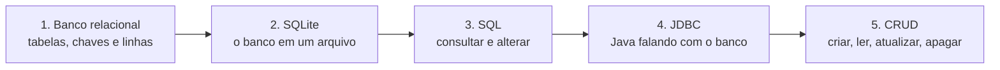
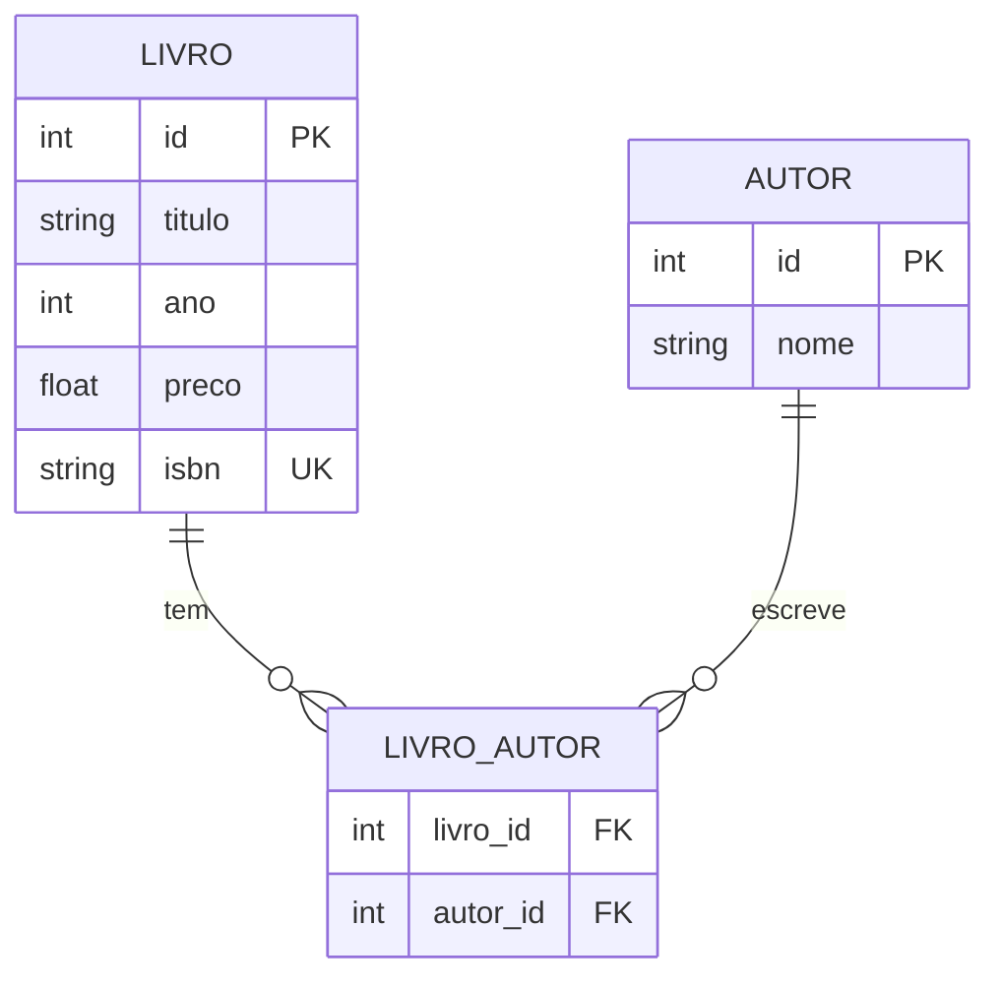
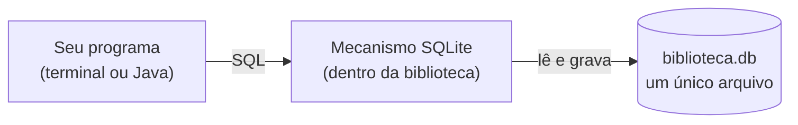
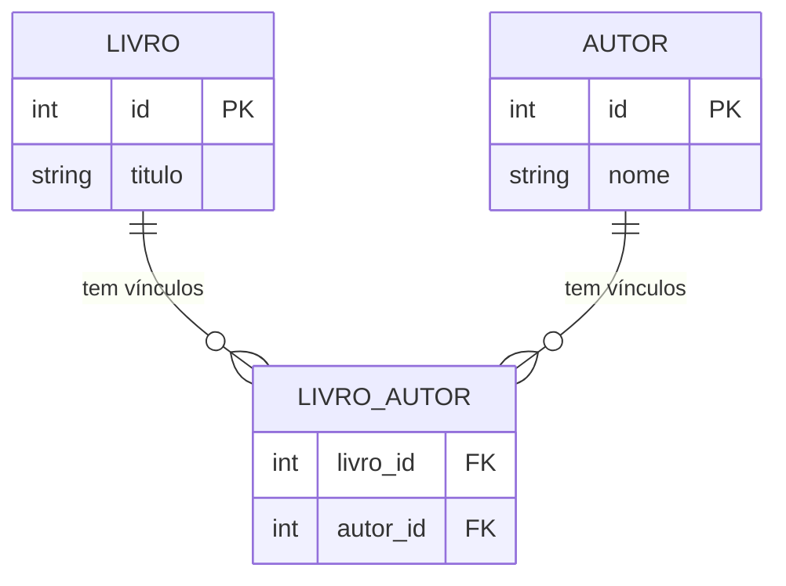
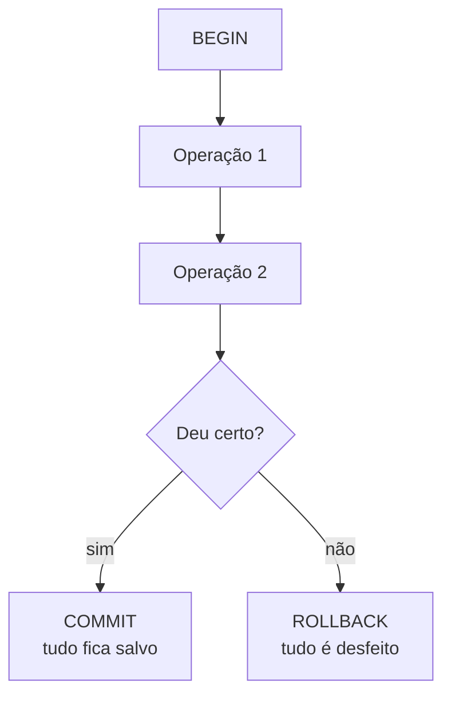
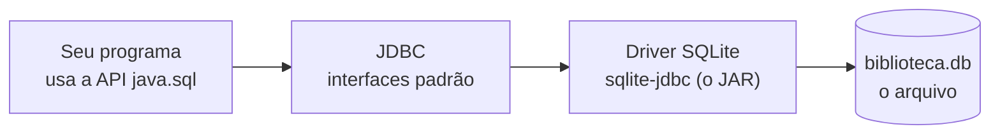
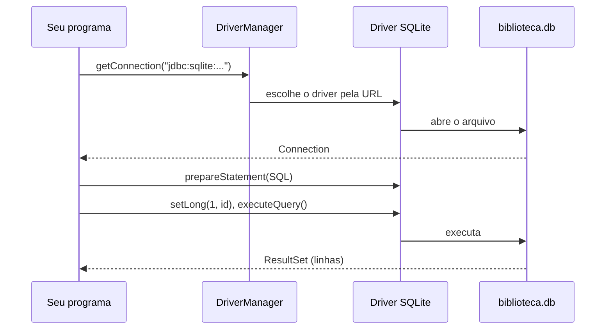
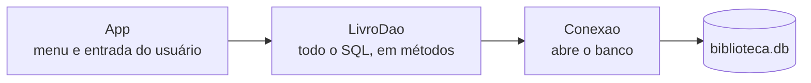

# SQL, SQLite e CRUD com Java: roteiro completo da aula

Este arquivo é o texto da aula, para você seguir slide por slide. Ele não substitui a apresentação: os slides continuam sendo o que a turma vê. Aqui está o que você deve **falar**, em profundidade, para cada slide.

Cada seção de slide traz:

- **Na tela:** o que está projetado.
- **O que falar:** a explicação completa, no nível de uma aula avançada, com o raciocínio por trás de cada conceito.
- **Por baixo dos panos:** o que o banco ou a JVM faz de fato.
- **Exemplo testado:** comandos que foram rodados no `sqlite3` e no projeto. As saídas são reais.
- **Perguntas e respostas:** perguntas para a turma, com a resposta esperada.
- **Erros comuns:** o que os alunos costumam errar neste ponto.

Os diagramas estão em Mermaid. Para ver o desenho, abra este arquivo no GitHub, ou cole o bloco no [mermaid.live](https://mermaid.live).

## Cronograma

**Tempo total: 4 horas**, em dois dias de 2 horas. Cada dia tem 1 hora de explicação e 1 hora de exercícios.

| Dia | Tempo | Atividade | Slides |
|---|---|---|---|
| 1 | 0:00 – 0:15 | Abertura e objetivos | 1 a 4 |
| 1 | 0:15 – 1:00 | Banco relacional, SQLite e SQL | 5 a 15 |
| 1 | 1:00 – 2:00 | Exercícios de SQL | 16 |
| 2 | 0:00 – 0:15 | Eclipse (configuração) | 17 a 19 |
| 2 | 0:15 – 1:00 | JDBC, CRUD com DAO e transações | 20 a 30 |
| 2 | 1:00 – 2:00 | Exercícios de Java | 31 |
| Fim | | Resumo e referências | 32 e 33 |

> **Correções em relação às versões anteriores deste roteiro:**
> - **Slide 9:** ordenando por título, o resultado do filtro `ano < 1900` é Dom Casmurro, Iracema e Memórias Póstumas. Capitães da Areia (1937) não entra no filtro. Uma versão antiga deste roteiro dizia o contrário.
> - **Slide 10:** no SQLite, uma coluna comum junto de `COUNT` sem GROUP BY **não dá erro**: o banco devolve uma linha qualquer. Outros bancos (PostgreSQL, por exemplo) recusam a consulta.
> - **Slide 21:** o trecho de `Conexao.java` foi corrigido para o código real.
> - **Slide 15:** o exemplo de chave estrangeira foi refeito com valores que não batem na chave UNIQUE, e o resultado foi conferido.

---

## Conceitos de fundo (leia antes da aula)

Estas são as ideias que sustentam a aula inteira. Você não precisa projetá-las. Elas servem para responder às perguntas mais difíceis da turma.

### O modelo relacional

Um banco relacional guarda dados em **relações**, que na prática são tabelas. Cada tabela tem colunas com tipos e linhas com valores. A ideia de Edgar Codd, de 1970, é que os dados sejam tratados como conjuntos, e que as consultas sejam expressas em termos desses conjuntos. O SQL é a linguagem que implementa essa ideia.

Por isso, uma tabela não tem ordem garantida. A linha que aparece primeiro num `SELECT` não é "a primeira que foi inserida": a ordem só existe se você pedir com `ORDER BY`. Essa é a primeira surpresa de quem vem de planilhas, e vale dizer logo.

### Chaves

- **Superchave:** qualquer conjunto de colunas que identifica uma linha de forma única. Em `livro`, `(id, titulo)` é uma superchave, mas não é a melhor escolha.
- **Chave candidata:** uma superchave mínima. Em `livro`, `id` e `isbn` são candidatas.
- **Chave primária:** a chave candidata escolhida para identificar as linhas. Aqui, `id`.
- **Chave natural:** uma chave que já existe no mundo real, como o ISBN.
- **Chave substituta (surrogate):** uma chave criada só para identificar, como `id` autoincremental.

A tabela `livro` usa chave substituta (`id`) e tem o ISBN como chave candidata com `UNIQUE`. O motivo é prático: o ISBN pode mudar ou faltar (um livro antigo pode não ter), e uma chave que muda obriga a atualizar todas as tabelas que apontam para ela. O `id` nunca muda.

### Integridade

O banco tem três tipos de integridade, e a aula usa os três:

- **Integridade de domínio:** o valor é do tipo certo e respeita a regra da coluna. Exemplo: `CHECK (ano > 0)`.
- **Integridade de entidade:** cada linha é identificável. Exemplo: a chave primária não pode ser nula nem repetida.
- **Integridade referencial:** uma chave estrangeira aponta para uma linha que existe. Exemplo: um vínculo em `livro_autor` aponta para um autor real.

### Normalização, de forma prática

A pergunta por trás de `livro_autor` é: por que não guardar o autor dentro de `livro`? Porque isso cria **redundância** e **anomalias**. Se o nome de um autor for escrito errado em três livros, é preciso corrigir três lugares, e pode-se esquecer um. Se um livro tem dois autores, a coluna precisa existir duas vezes, e o problema volta com três autores. A forma normal que resolve isso é separar as entidades em tabelas e ligá-las por chaves. Não é preciso decorar as formas normais nesta aula, só entender o motivo.

### Como uma consulta é avaliada

Esta é a ordem **lógica** de avaliação de um `SELECT`. Ela não é a ordem em que você escreve, e explica muitos erros:

1. `FROM` e `JOIN`: monta a combinação de tabelas.
2. `WHERE`: filtra as linhas.
3. `GROUP BY`: agrupa.
4. `HAVING`: filtra os grupos.
5. `SELECT`: escolhe as colunas e calcula as expressões.
6. `ORDER BY`: ordena.
7. `LIMIT`: corta.

Consequência prática: o `WHERE` não enxerga a coluna `COUNT(*)`, porque ela só existe depois do `GROUP BY`. Por isso o filtro sobre grupos vai no `HAVING`.

Observação sobre o SQLite: ele aceita aliases de colunas no `WHERE` (por exemplo, `SELECT preco*2 AS dobro FROM livro WHERE dobro > 50` funciona no SQLite e devolve `79.8`, `70.0` e `96.0`). Outros bancos, como PostgreSQL, não aceitam. Ensine a regra geral, e diga que a flexibilidade do SQLite não é padrão.

### NULL

`NULL` significa "valor desconhecido ou ausente". Não é zero, não é texto vazio. Três regras explicam quase todos os erros com NULL:

- Comparações com NULL dão NULL, não verdadeiro nem falso: `NULL = NULL` devolve NULL, não 1.
- Para testar, use `IS NULL` e `IS NOT NULL`.
- Funções de agregação ignoram NULL, com exceção de `COUNT(*)`, que conta linhas.

Teste feito na tabela `matricula` com uma linha de nota nula:

```sql
SELECT NULL = NULL, NULL IS NULL, COUNT(*), COUNT(nota), AVG(nota), SUM(nota)
FROM matricula;
-- |1|4|3|8.33333333333333|25.0
```

Leia assim: `NULL = NULL` é NULL (aparece vazio); `NULL IS NULL` é 1; há 4 linhas, mas só 3 notas, então `COUNT(nota)` é 3; a média é 25 dividido por 3, sem contar a linha nula.

### Tipos no SQLite

O SQLite usa **afinidade de tipo**. A coluna declarada como `INTEGER` aceita um texto qualquer, e o banco não recusa. Teste:

```sql
CREATE TABLE af(x INTEGER);
INSERT INTO af VALUES('abc');
INSERT INTO af VALUES('42');
SELECT x, typeof(x) FROM af;
-- abc|text
-- 42|integer
```

O `'42'` foi convertido para inteiro, mas `'abc'` ficou como texto. Isso surpreende quem vem de PostgreSQL ou MySQL, que recusariam o `'abc'`. Por isso a documentação de tipos do SQLite está na lista de referências.

Outras duas armadilhas de tipo:

- **Divisão de inteiros:** `7/2` dá `3`, porque os dois lados são inteiros. `7/2.0` dá `3.5`. Para calcular percentuais, use um lado decimal.
- **Comparação de texto:** `LIKE` ignora maiúsculas e minúsculas para letras ASCII. Teste: `'Ana' LIKE 'ana'` devolve 1, mas `'Ana' = 'ana'` devolve 0.

### Transações e ACID

Uma **transação** é uma sequência de operações que o banco trata como uma unidade. As quatro propriedades ACID são:

- **Atomicidade:** ou tudo acontece, ou nada acontece.
- **Consistência:** a transação leva o banco de um estado válido para outro estado válido, respeitando as restrições.
- **Isolamento:** transações simultâneas não enxergam os estados intermediários umas das outras (o grau exato depende do banco e do nível de isolamento).
- **Durabilidade:** depois do COMMIT, o dado sobrevive a uma queda de energia.

Na aula, a ênfase é a atomicidade, porque é a mais fácil de demonstrar.

### Como o SQLite trava o arquivo

Esta é a parte que explica o `database is locked`. No SQLite, em modo padrão (journal em modo `delete`, que é o que aparece no teste), um arquivo tem:

- **muitos leitores ao mesmo tempo**, desde que ninguém esteja escrevendo;
- **um único escritor por vez**. Enquanto um programa escreve, os outros que tentam escrever esperam, e, se a espera passar do limite, recebem o erro `database is locked`.

Por isso o SQLite é excelente para um programa de desktop, para testes e para dados locais, e não é a escolha para milhares de usuários escrevendo ao mesmo tempo. O modo WAL (`PRAGMA journal_mode = WAL`) permite que leitores continuem enquanto um escritor trabalha, mas ele não elimina a regra de um escritor por vez. Não é necessário ensinar WAL nesta aula; só saiba a regra.

### JDBC por dentro

JDBC é uma **especificação**: um conjunto de interfaces no pacote `java.sql`. O seu programa conhece só as interfaces (`Connection`, `PreparedStatement`, `ResultSet`). Quem implementa as interfaces para o SQLite é o **driver**, que é o JAR `sqlite-jdbc`. A `DriverManager` escolhe o driver certo pela URL: `jdbc:sqlite:` aponta para o driver do SQLite, e `jdbc:postgresql:` apontaria para outro.

Desde o JDBC 4.0, a `DriverManager` encontra os drivers sozinha, pelo `ServiceLoader`, se o JAR estiver no classpath. Por isso o `Class.forName` que aparece no projeto é um resquício, mantido para deixar claro qual driver está sendo usado, e para dar uma mensagem de erro útil quando o JAR falta.

---

## Introdução

### Slide 1: Capa

**Na tela:** "SQL, SQLite e CRUD com Java". Subtítulo: "Do SELECT ao DAO: um banco em arquivo, lido e alterado por um programa Java no Eclipse."

**O que falar:**
Comece com uma pergunta, não com uma definição: onde ficam guardados os contatos do seu celular, ou o histórico de um aplicativo que você usa offline? Em muitos casos, a resposta é um arquivo de banco de dados, parecido com o que vamos usar hoje.

Explique a estrutura: são duas horas por dia, e em cada dia, uma hora de explicação seguida de uma hora de exercícios. Diga que a segunda hora de cada dia não é descanso: é onde a aula se fixa. Quem só assiste esquece a sintaxe em uma semana.

**Perguntar à turma:**
- Vocês já usaram algum aplicativo que guarda dados offline? Qual?
- Quem já escreveu alguma consulta, mesmo sem saber que era SQL, por exemplo ao filtrar uma planilha?

---

### Slide 2: Objetivos

**Na tela:** os cinco objetivos.

1. Consultar e alterar dados com SQL: SELECT, INSERT, UPDATE e DELETE.
2. Explicar o que é um banco SQLite e por que ele é um arquivo.
3. Conectar um programa Java ao banco com JDBC.
4. Implementar um CRUD completo com DAO, PreparedStatement e transação.
5. Configurar o Eclipse e rodar um projeto com banco de dados.

**O que falar:**
Os objetivos 1 e 2 são do dia 1, e os objetivos 3, 4 e 5 são do dia 2. Leia os objetivos em voz alta e diga, para cada um, qual será a evidência de que a turma conseguiu. Para o objetivo 1, a evidência é a consulta escrita sem olhar. Para o objetivo 4, é o teste automático passando.

No fim das duas aulas, a turma vai rodar um programa que grava e apaga livros em um banco real, e vai conferir o resultado com um teste automático. Esse é o padrão de avaliação da aula: não é a memória, é o resultado verificável.

**Perguntar à turma:**
- Quem já escreveu um SELECT? Quem já ouviu falar de JDBC?

---

### Slide 3: Roteiro das 4 horas

**Na tela:** a tabela de dias e tempos. Nota: os exercícios estão em `exercicios/EXERCICIOS.md`, e o gabarito fica no fim de cada parte.

**O que falar:**
Combine o horário do intervalo antes de começar, e diga quando será. Isso evita que a turma saia no meio de um comando.

Se a turma já conhece SQL, reduza a parte de SELECT e avance mais devagar no dia 2. Mas não corte os exercícios. Eles são o momento em que o conteúdo vira habilidade. O dia 2 depende de o dia 1 ter sido entendido: se a turma não sabe escrever um `WHERE` com `?`, o `PreparedStatement` vira mágica.

---

### Slide 4: Mapa da aula

**Na tela:** cinco passos em sequência.



**O que falar:**
Esta é a espinha da aula. Os passos 1 a 3 são do dia 1; os passos 4 e 5 são do dia 2, e usam tudo o que foi visto antes. Volte a este slide no início do dia 2. A turma deve perceber que o passo 4 só existe porque o passo 3 funciona.

Uma forma de dizer isso: o JDBC não ensina banco de dados, ele apenas transporta. Se o SQL estiver errado, o Java vai transportar o erro com perfeição.

**Perguntar à turma:**
- Se o SQL está certo no terminal, o que ainda pode dar errado quando ele roda dentro de um programa Java? (Resposta: a forma de enviar os valores, a conexão, a transação e o tratamento de exceção.)

---

## Dia 1: SQL e SQLite

### Slide 5: Divisor, Dia 1

**Na tela:** "SQL e SQLite. Dia 1 · 2 horas. Uma hora de explicação e demonstração, e uma hora de exercícios de SQL."

**O que falar:**
Antes da teoria, peça que cada um confira o `sqlite3` no terminal com o comando `sqlite3 --version`. Quem não tiver deve avisar agora, para que o problema seja resolvido no intervalo. No macOS, o `sqlite3` já vem instalado. No Windows, é preciso baixá-lo do site sqlite.org.

Se uma pessoa não consegue rodar o `sqlite3`, ela ainda pode fazer os exercícios pelo site sqliteonline.com, com a ressalva de que o PRAGMA de chave estrangeira precisa ser rodado no início.

---

### Slide 6: Tabelas, linhas, colunas e chaves

**Na tela:** cinco definições e uma tabela de livros.

| id | titulo | ano | preco |
|---|---|---|---|
| 1 | Dom Casmurro | 1899 | 39.90 |
| 2 | Memórias Póstumas | 1881 | 35.00 |
| 3 | Iracema | 1865 | 22.50 |
| 4 | Capitães da Areia | 1937 | 48.00 |

As definições são: tabela (um conjunto de dados do mesmo tipo), linha (um registro), coluna (um atributo com tipo), chave primária (identifica cada linha, sem repetir) e chave estrangeira (aponta para a chave de outra tabela).

**O que falar:**
Use a tabela `livro` como exemplo em todo o dia 1. Escreva as quatro palavras no quadro: tabela, linha, coluna e chave. A turma vai ouvi-las o dia inteiro, então é melhor que elas sejam familiares desde o começo.

Uma imagem útil: uma tabela é uma planilha com regras. Cada coluna tem um tipo, e a regra da coluna é verificada pelo banco a cada gravação. O ponto principal é este: **cada tabela é um arquivo de dados com regras, e o banco garante que as regras valem**. Não é só o programa que confere. Se o programa tiver um erro, o banco recusa o dado errado. Essa diferença aparece de novo no slide 15.

Conecte com o resto da aula: a chave primária `id` é o que o CRUD usa para achar, alterar e apagar uma linha específica. Sem uma chave confiável, não há como dizer "este livro" para o banco.

**Diagrama: as tabelas do banco da aula**

Este diagrama mostra as três tabelas dos exemplos: `livro`, `autor` e a tabela de ligação `livro_autor`. A ligação é explicada no slide 11.



**Perguntar à turma:**
- Qual é a chave primária da tabela `livro`? (`id`.)
- Qual coluna não pode repetir? (`isbn`, que aparece no slide 15 com UNIQUE.)
- Por que o `id` é melhor que o ISBN como chave primária? (O ISBN pode faltar em um livro antigo ou mudar; uma chave que muda obriga a atualizar as tabelas que apontam para ela. O `id` não muda.)

**Erros comuns:** achar que a ordem das linhas é garantida. Não é: sem `ORDER BY`, a ordem é indefinida.

---

### Slide 7: SQLite, um banco que é um arquivo

**Na tela:**
- O que é: um mecanismo de banco de dados que roda dentro de uma biblioteca. Não tem servidor: o banco é um arquivo, por exemplo `biblioteca.db`.
- Onde aparece: celulares, navegadores, aplicativos de desktop e sistemas embarcados.
- Exemplo no terminal: `sqlite3 dia1.db`, `.tables`, `SELECT titulo FROM livro;`.
- Nota: o arquivo é o banco inteiro. Copiar o arquivo é copiar os dados. Apagar o arquivo apaga tudo.

**O que falar:**
Diferencie dois modelos. Em PostgreSQL ou MySQL, o banco é um **serviço**: um processo separado, que roda num servidor, aceita conexões pela rede e gerencia usuários e permissões. No SQLite, o banco é uma **biblioteca**: o seu programa carrega o mecanismo e lê e escreve o arquivo diretamente, sem processo separado e sem usuário ou senha.

Isso tem consequências práticas. Copiar o arquivo copia o banco inteiro, o que é ótimo para backup e para entregar um banco pronto para a turma. Por outro lado, não há controle de acesso no banco: quem tem o arquivo tem os dados.

Demonstre no terminal: `sqlite3 dia1.db`, depois `.tables`, depois uma consulta. Mostre que `.tables` não é SQL. Os comandos que começam com ponto (`.tables`, `.mode`, `.headers`) são do próprio programa `sqlite3`, que os interpreta antes de enviar o SQL ao mecanismo.

**Diagrama: como o programa fala com o SQLite**



**Perguntar à turma:**
- Se o SQLite não tem servidor, como duas pessoas usariam o mesmo banco ao mesmo tempo?

**Resposta esperada:** em geral, elas não deveriam. O SQLite permite vários leitores, mas um único escritor por vez. Se uma escrita ocupa o arquivo, a outra espera e pode receber `database is locked`. Por isso o SQLite é ótimo para um programa por vez e não para milhares de usuários escrevendo juntos. Essa é a mesma mensagem que aparece no slide de problemas do Eclipse.

**Erros comuns:** confundir `.tables` com SQL e tentar rodá-lo dentro de uma string Java. O comando com ponto só existe no `sqlite3` interativo.

---

### Slide 8: SELECT, escolher colunas e linhas

**Na tela:**

```sql
SELECT titulo, ano FROM livro;
```

Saída real do script `sql/03-consultas.sql`:

| titulo | ano |
|---|---|
| Dom Casmurro | 1899 |
| Memórias Póstumas | 1881 |
| Iracema | 1865 |
| Capitães da Areia | 1937 |

SELECT diz quais colunas quero. FROM diz de qual tabela. O ponto e vírgula termina a instrução.

**O que falar:**
Um SELECT é uma pergunta sobre um conjunto. "Me dê o título e o ano de cada livro" é a pergunta. O banco responde com um novo conjunto de linhas, que é o resultado. O resultado é uma tabela também, e por isso você pode consultá-lo de novo.

Ensine a leitura pela cláusula: SELECT escolhe as colunas que saem; FROM escolhe de onde vêm. A ordem das palavras é fixa, e o banco não aceita `FROM livro SELECT titulo`.

Sobre `SELECT *`: ele mostra todas as colunas, e é útil no terminal para olhar a tabela. Em código, evite. Se alguém adicionar uma coluna à tabela, a consulta passa a devolver um formato diferente, e o programa que lê o resultado por posição pode quebrar ou, pior, ler a coluna errada sem aviso. Listar as colunas explicitamente torna a consulta um contrato.

**Exemplo testado:**

```sql
-- todas as colunas, só para olhar a tabela
SELECT * FROM livro;

-- só as colunas que eu preciso
SELECT titulo, ano FROM livro;
```

**Perguntar à turma:**
- Escreva a consulta no quadro e peça para a turma prever o resultado antes de rodar.
- O que acontece se alguém adicionar uma coluna à tabela `livro` e a consulta usar `SELECT *`? (A saída ganha uma coluna nova. Um código que lê por posição pode ler o valor errado.)

**Erros comuns:** esquecer o `;` quando o comando é rodado no terminal (o `sqlite3` espera mais texto e não executa). Palavras-chave como `select` podem ser escritas em minúsculas: o SQL não diferencia maiúsculas nelas, e a convenção da aula é escrevê-las em maiúsculas para facilitar a leitura. No SQLite, nomes de tabela e de coluna também não diferenciam maiúsculas de minúsculas, mas valores de texto diferenciam na comparação com `=`: `'Ana' = 'ana'` devolve 0.

---

### Slide 9: WHERE filtra, ORDER BY ordena, LIMIT corta

**Na tela:**

```sql
SELECT * FROM livro WHERE ano < 1900 ORDER BY ano;
```

Saída real:

| id | titulo | ano |
|---|---|---|
| 3 | Iracema | 1865 |
| 2 | Memórias Póstumas | 1881 |
| 1 | Dom Casmurro | 1899 |

WHERE: só as linhas que casam com a condição. ORDER BY: a ordem da saída; DESC inverte. LIMIT: no máximo N linhas (paginação). Texto vai entre aspas simples: `WHERE titulo LIKE '%ca%'` encontra títulos que contêm "ca".

**O que falar:**
As três cláusulas fazem coisas diferentes, e é importante separá-las na cabeça. **WHERE** decide quais linhas entram no resultado. **ORDER BY** não muda nenhuma linha, só a ordem da saída. **LIMIT** corta a saída em N linhas. Na prática, uma paginação de 10 em 10 resultados é `ORDER BY ... LIMIT 10 OFFSET 20` para a terceira página.

Explique aspas: texto vai entre aspas simples, e número não. Se você escrever `WHERE titulo = Dom Casmurro`, o SQL entende `Dom` e `Casmurro` como nomes de colunas, e dá erro. Aspas duplas, no SQLite, também podem aparecer como identificadores, mas no padrão usamos aspas simples para texto.

Sobre `LIKE`: o `%` é curinga para qualquer sequência de caracteres, e o `_` é curinga para um caractere. No SQLite, `LIKE` ignora maiúsculas e minúsculas para letras ASCII: `'Ana' LIKE 'ana'` devolve 1.

**Exemplo testado: a ordem muda o resultado**

```sql
SELECT titulo, ano FROM livro WHERE ano < 1900 ORDER BY titulo;
-- Dom Casmurro|1899
-- Iracema|1865
-- Memórias Póstumas|1881

SELECT titulo, ano FROM livro WHERE ano < 1900 ORDER BY ano DESC;
-- Dom Casmurro|1899
-- Memórias Póstumas|1881
-- Iracema|1865
```

**Perguntar à turma:**
- Se a ordenação fosse por `titulo`, qual linha viraria a primeira? (Dom Casmurro, porque Capitães da Areia, de 1937, nem entra no filtro `ano < 1900`.)
- O que muda se trocarmos `ano < 1900` por `ano <= 1900`? (Nada neste conjunto, porque não há livro com ano 1900.)

**Erros comuns:** usar `=` em vez de `LIKE` quando quer procurar parte do texto; e colocar `LIMIT` sem `ORDER BY`, o que devolve linhas arbitrárias. Sem ORDER BY, o LIMIT corta um resultado que não tem ordem definida.

---

### Slide 10: COUNT, AVG e GROUP BY

**Na tela:**

```sql
SELECT COUNT(*) AS total, ROUND(AVG(preco), 2) AS preco_medio FROM livro;
```

| total | preco_medio |
|---|---|
| 4 | 36.35 |

COUNT conta linhas. AVG calcula a média. GROUP BY faz uma conta por grupo. Colunas comuns (titulo) não podem aparecer sem estar no GROUP BY, nem ser misturadas com COUNT sem agrupar.

**O que falar:**
Funções de agregação transformam muitas linhas em uma só. Sem GROUP BY, a consulta inteira vira um grupo só, e o resultado tem uma linha. A média de 36,35 é a soma dos quatro preços (145,40) dividida por quatro.

Com GROUP BY, o banco divide as linhas em grupos, calcula a agregação em cada grupo e devolve uma linha por grupo. A regra que a slide enuncia é que toda coluna no SELECT precisa estar no GROUP BY, ou ser uma função de agregação. O motivo é lógico: se um grupo tem vários títulos, o banco não sabe qual título mostrar para o grupo.

Relembre a lógica de avaliação do slide de conceitos: GROUP BY acontece antes do SELECT. Quando o SELECT roda, cada grupo já existe.

**Exemplo testado: contando por grupo**

```sql
SELECT ano, COUNT(*) AS quantidade
FROM livro
GROUP BY ano
ORDER BY ano;
-- 1865|1
-- 1881|1
-- 1899|1
-- 1937|1
```

Nota: aqui cada ano tem um livro, então cada grupo tem uma linha. Um exemplo mais interessante seria agrupar por autor, mas isso exige o JOIN do slide 11.

**Atenção: o SQLite é mais permissivo.** Se você escrever `SELECT titulo, COUNT(*) FROM livro;`, sem GROUP BY, o SQLite não dá erro. Ele devolve uma linha só, com um título qualquer escolhido pelo banco: `Dom Casmurro|4`. Esse resultado não tem sentido. PostgreSQL recusa a consulta. Não ensine esse padrão.

**Perguntar à turma:**
- Qual é a diferença entre `COUNT(*)` e `COUNT(isbn)`? (`COUNT(*)` conta linhas; `COUNT(isbn)` conta só as linhas em que o ISBN não é NULL.)
- Por que `AVG` não conta NULL? (Porque NULL é ausência de valor. Uma média de notas sem a nota de quem não fez a prova é diferente de uma média que trata a ausência como zero.)

**Erros comuns:** misturar uma coluna comum com `COUNT` sem GROUP BY (o SQLite engana, outros bancos não); e esquecer que a divisão de inteiros trunca o resultado.

---

### Slide 11: Relacionamento N:N usa uma tabela de ligação

**Na tela:** três caixas, `livro` → `livro_autor` → `autor`, com "1 livro → N vínculos" e "N vínculos → 1 autor". Consulta:

```sql
SELECT l.titulo, a.nome FROM livro l
  JOIN livro_autor la ON la.livro_id = l.id
  JOIN autor a ON a.id = la.autor_id ORDER BY l.titulo;
```

Saída real:
- Capitães da Areia – Jorge Amado
- Dom Casmurro – Machado de Assis
- Iracema – José de Alencar
- Memórias Póstumas – Machado de Assis

**O que falar:**
Desenhe as três caixas no quadro. A pergunta-chave é: por que um livro pode ter dois autores, e não um campo `autor` dentro da tabela `livro`?

Porque um campo guarda um valor só. Se o livro tiver dois autores, você criaria `autor1` e `autor2`. Quando aparecer um livro com três autores, a tabela precisa de outra coluna, e o problema volta. E as consultas ficam horríveis: para saber "todos os livros de Machado de Assis", seria preciso procurar em cada coluna de autor.

A solução é a **tabela de ligação**: `livro_autor` guarda um par por linha. Um livro com dois autores tem duas linhas nessa tabela. Um autor com dez livros tem dez linhas. Isso é o relacionamento N:N, e ele aparece no CRUD de verdade o tempo todo.

Explique o `JOIN` passo a passo, usando a ordem lógica do slide de conceitos. O banco parte da combinação de `livro` com `livro_autor`, mantendo só os pares em que `la.livro_id = l.id`. Depois junta com `autor`, mantendo os pares em que `a.id = la.autor_id`. As cláusulas `ON` dizem como as tabelas se ligam; sem elas, o banco faria o produto cartesiano, combinando cada livro com cada autor.

**Diagrama: o relacionamento N:N**



Leia assim: um livro tem zero ou mais vínculos, e cada vínculo pertence a exatamente um livro. O mesmo vale para o autor. Juntos, eles formam o N:N.

**Perguntar à turma:**
- Se um livro tivesse dois autores, quantas linhas ele teria em `livro_autor`? (Duas.)
- Por que `livro_autor` não tem `id` próprio? (Ela pode ter, mas não é necessário: a chave natural é o par `(livro_id, autor_id)`, que a restrição `PRIMARY KEY` do esquema já garante ser único.)
- O que aconteceria se esquecêssemos a cláusula `ON`? (Produto cartesiano: cada livro combinado com cada autor, o que devolve linhas que não existem no mundo real.)

**Erros comuns:** esquecer o `ON` e receber muito mais linhas que o esperado; trocar a ordem das colunas no `ON` sem perceber que o resultado muda quando a junção é externa.

---

### Slide 12: INSERT, criar uma linha

**Na tela:**

```sql
INSERT INTO livro (titulo, ano, preco, isbn)
  VALUES ('Macunaíma', 1928, 29.90, '978-0005');
```

- Quem gera o id? Como `id` é `INTEGER PRIMARY KEY`, o SQLite numera sozinho.
- Valores com aspas: texto entre aspas simples; número sem aspas; se o texto tiver aspas, dobre-as: `''`.

**O que falar:**
INSERT cria uma linha. Você lista as colunas e depois os valores, na mesma ordem. Se uma coluna não for listada, ela recebe o valor padrão, ou NULL se não tiver padrão.

No SQLite, uma coluna declarada como `INTEGER PRIMARY KEY` é um alias do `rowid`, que é o identificador interno de cada linha. Quando você não informa valor, o banco escolhe o próximo número disponível. Por isso ninguém precisa controlar esse número na mão. Dá para ver o id gerado com `last_insert_rowid()`, uma função que o programa Java também usa, de outra forma, no `getGeneratedKeys()`.

Para o texto com aspa simples, o SQL usa duas aspas seguidas. O título `O'Hara` vira `'O''Hara'`. Esse detalhe é um dos motivos para usar parâmetros (`PreparedStatement`) no dia 2: eles tratam isso sozinhos, e a concatenação manual é uma das portas da injeção de SQL.

**Exemplo testado:**

```sql
INSERT INTO livro (titulo, ano, preco, isbn)
  VALUES ('Macunaíma', 1928, 29.90, '978-0005');

SELECT id, titulo FROM livro WHERE isbn = '978-0005';
-- 5|Macunaíma
```

**Perguntar à turma:**
- O que aconteceria se dois livros tivessem o mesmo ISBN? (O banco recusaria o segundo, por causa do UNIQUE. A mensagem aparece no slide 15.)
- Por que a turma não deve informar o `id` no INSERT? (Para não haver conflito com o número gerado. Se informar um valor que já existe, o banco recusa.)

**Erros comuns:** usar aspas duplas para texto (no SQLite, elas podem ser lidas como nome de coluna, o que dá erro ou comportamento inesperado); esquecer a ordem entre colunas e valores; e inserir um número como texto entre aspas (o SQLite converte pela afinidade, mas é má prática).

---

### Slide 13: UPDATE e DELETE, WHERE decide quais linhas mudam

**Na tela:**

```sql
UPDATE livro SET preco = ROUND(preco * 1.10, 2) WHERE ano < 1900;
DELETE FROM livro WHERE isbn = '978-0005';
```

- Sem WHERE, tudo muda. `DELETE FROM livro;` apaga a tabela inteira, sem pedir confirmação.
- Teste antes. Troque o DELETE por SELECT com o mesmo WHERE. Se a lista estiver certa, aí sim apague.
- Ambos devolvem quantas linhas foram afetadas. Em Java, esse número vem de `executeUpdate()`.

**O que falar:**
UPDATE altera linhas existentes, e DELETE remove linhas. As duas seguem a mesma regra: **o WHERE decide quais linhas são afetadas**. Sem WHERE, a operação vale para a tabela inteira. Não há desfazer depois do COMMIT: a única proteção real é uma transação aberta, ou um backup.

O UPDATE avalia a expressão da direita com os valores **antigos** da linha. Por isso, `SET preco = preco * 1.10` soma 10% sobre o preço atual, e não sobre um valor intermediário. Isso vale para todas as colunas do mesmo SET: elas são calculadas antes de gravar.

A regra da aula é: **escreva o SELECT primeiro, depois transforme em DELETE**. Assim você vê exatamente quais linhas vão sair. Esse hábito evita muitos desastres, e vale para qualquer banco.

**Exemplo testado: quantas linhas foram afetadas**

```sql
UPDATE livro SET preco = preco WHERE ano < 1900;
SELECT changes();
-- 3
```

A função `changes()` devolve o número de linhas afetadas pelo último comando. É o equivalente, no terminal, do valor que `executeUpdate()` devolve em Java.

**Exemplo: o SELECT antes do DELETE**

```sql
-- 1. confira quais linhas vão ser afetadas
SELECT * FROM livro WHERE isbn = '978-0005';

-- 2. só depois, apague
DELETE FROM livro WHERE isbn = '978-0005';
```

**Perguntar à turma:**
- Quem já apagou dados sem querer? Conte o caso, é comum.
- Se o UPDATE afetar zero linhas, ele é um erro? (Não é erro para o banco; é uma informação. O programa decide o que fazer com ela. Veremos isso no slide 25, com o controle otimista.)

**Erros comuns:** esquecer o WHERE; usar `=` em um WHERE com texto sem aspas; e pensar que um UPDATE com WHERE que não casa com nada dá erro. Não dá: devolve zero.

---

### Slide 14: Transações, ou tudo vale, ou nada vale

**Na tela:**

```sql
BEGIN;
  DELETE FROM livro WHERE isbn = '978-0005';
ROLLBACK;  -- desfaz: a linha volta
```

- COMMIT: confirma tudo desde o BEGIN. Saída real: após o COMMIT, a contagem caiu de 5 para 4.
- ROLLBACK: desfaz tudo desde o BEGIN. Saída real: após o ROLLBACK, a contagem continuou 5.
- A transação garante a atomicidade: uma operação composta por várias partes não fica pela metade.

**O que falar:**
Uma transação agrupa comandos e os trata como um só: ou todos são confirmados com COMMIT, ou nenhum é, com ROLLBACK. Enquanto a transação está aberta, o banco mantém as alterações de forma que só a própria transação as enxerga como definitivas. Depois do COMMIT, elas valem para todos. Esse é o isolamento na prática.

Use a analogia da transferência bancária: tirar dinheiro de uma conta e pôr em outra. São dois UPDATEs. Se a energia cair entre eles, sem transação, o dinheiro some. Com transação, o banco desfaz o primeiro UPDATE quando a transação não termina, e nada muda.

Esta propriedade se chama atomicidade, e faz parte do ACID: atomicidade, consistência, isolamento e durabilidade. Na aula focamos na atomicidade, que é a mais fácil de demonstrar.

**Diagrama: o fluxo da transação**



**Perguntar à turma:**
- Se a energia cair entre a operação 1 e a operação 2, sem transação, qual é o estado do banco? (Parte da mudança ficou salva e parte não: dado inconsistente.)
- O que acontece se a conexão fechar sem COMMIT? (A transação não confirmada é desfeita. Esse é o comportamento padrão, e é o que se espera.)

**Erros comuns:** esquecer o COMMIT e achar que a alteração não foi salva por um erro do banco; e esquecer que, no terminal, cada comando sem BEGIN é uma transação própria, confirmada na hora.

---

### Slide 15: Restrições de integridade, o banco recusa o que está errado

**Na tela:** quatro restrições: CHECK (ano > 0), UNIQUE (isbn não repete), NOT NULL (titulo é obrigatório), FOREIGN KEY (o autor precisa existir). Mensagens reais:

```
Runtime error: CHECK constraint failed: ano > 0
Runtime error: UNIQUE constraint failed: livro.isbn
```

**O que falar:**
Restrições são regras guardadas no banco. Elas valem para qualquer programa que acesse o banco, incluindo um script que alguém roda amanhã sem ler o código. Essa é a grande vantagem: a regra não depende de alguém lembrar de conferir.

- **CHECK** confere uma condição sobre a linha. Exemplo: o ano precisa ser maior que zero. Ela também pode ser entre colunas, como `CHECK (inicio < fim)`.
- **UNIQUE** impede valores repetidos na coluna. Exemplo: dois livros com o mesmo ISBN. Aceita NULL repetido no SQLite, porque NULL não é igual a nada.
- **NOT NULL** impede o campo vazio. Exemplo: todo livro precisa de título.
- **FOREIGN KEY** exige que o valor exista na outra tabela. Exemplo: um vínculo em `livro_autor` precisa apontar para um autor existente.

As mensagens mostradas são as do `sqlite3`. O programa Java recebe a mesma falha como uma `SQLException`, e deve tratá-la, porque é ela que informa o usuário. Esconder a exceção, ou mostrar a pilha de erro para o usuário final, são dois erros comuns.

**Atenção: chave estrangeira no SQLite.** No SQLite, a verificação de chave estrangeira vem **desligada por padrão**, e vale por conexão. Para ligá-la:

```sql
PRAGMA foreign_keys = ON;
```

Sem ela, duas coisas acontecem: a chave estrangeira inválida passa sem erro, e o `ON DELETE CASCADE` não é executado.

**Exemplo testado: a chave estrangeira com e sem PRAGMA**

Use valores diferentes nos dois casos, para não bater na chave UNIQUE de `livro_autor`:

```sql
-- sem o PRAGMA: aceita um autor que não existe (autor 999)
INSERT INTO livro_autor (livro_id, autor_id) VALUES (1, 999);
-- sem erro

-- com o PRAGMA: recusa, porque o autor 998 não existe
PRAGMA foreign_keys = ON;
INSERT INTO livro_autor (livro_id, autor_id) VALUES (1, 998);
-- Erro: FOREIGN KEY constraint failed
```

Se você repetir o par (1, 999) com o PRAGMA ligado, o erro é `UNIQUE constraint failed`, porque o vínculo já existe. A mensagem depende de qual regra o banco avalia primeiro.

**Perguntar à turma:**
- Por que a regra "ano maior que zero" fica no banco, e não só no Java? (Porque o banco protege os dados contra qualquer programa, inclusive os que ainda não foram escritos. A regra no Java pode ser contornada por outro programa, ou esquecida numa nova tela.)
- Quando a verificação do Java e a do banco se repetem, qual é a fonte da verdade? (O banco. A validação no Java melhora a mensagem para o usuário, mas a garantia final é a do banco.)

**Erros comuns:** esquecer o PRAGMA e concluir que a chave estrangeira "não funciona"; e tratar a mensagem de erro do banco como texto para o usuário final, sem traduzir.

---

### Demonstração ao vivo: script para digitar com a turma (slides 6 a 15)

Esta é a parte prática da explicação. Você digita o script no terminal, bloco por bloco, enquanto a turma acompanha no próprio computador. Cada bloco corresponde a um ou mais slides, e está marcado no comentário.

O script está em `codigo-fonte/sql/04-demo-ao-vivo.sql`, e é o mesmo texto abaixo.

**Como rodar:**

```bash
rm -f ao-vivo.db
sqlite3 ao-vivo.db < sql/04-demo-ao-vivo.sql
```

Ou, para digitar junto, abra o banco e cole cada bloco:

```bash
sqlite3 ao-vivo.db
```

**Sobre a saída:** o script termina com código de saída 1, por causa dos quatro erros de restrição, que são esperados. Eles aparecem como `Runtime error near line ...`, e você deve mostrá-los à turma, não escondê-los.

**Pontos de checagem (confira se a turma está no mesmo lugar):**

| Depois do bloco | O que deve aparecer |
|---|---|
| 1 (criar) | `.tables` lista `autor`, `livro` e `livro_autor` |
| 2 (inserir) | `livros` = 4 |
| 4 (agregação) | `total` = 4 e `preco_medio` = 36.35 |
| 5 (JOIN) | 4 linhas, começando por Capitães da Areia – Jorge Amado |
| 6 (UPDATE e DELETE) | Dom Casmurro com preço 43.89 depois do reajuste de 10% |
| 7 (transação) | 3 dentro da transação; 4 depois do ROLLBACK; 3 depois do COMMIT |
| 8 (restrições) | 4 erros: CHECK, UNIQUE, NOT NULL e FOREIGN KEY |
| 9 (cascata) | vínculos caem de 4 para 3 ao apagar José de Alencar; os livros continuam |

**Dica de condução:** não rode tudo de uma vez. Pare em cada bloco, peça que a turma preveja o resultado, e só então execute. As perguntas da seção de cada slide servem para isso.

```sql
-- =====================================================================
-- Demonstração ao vivo (Dia 1): o professor digita e a turma acompanha.
-- Cada bloco corresponde a um slide. Rode bloco por bloco, ou tudo junto:
--   rm -f ao-vivo.db
--   sqlite3 ao-vivo.db < sql/04-demo-ao-vivo.sql
-- Os comentários "-- ERRO ESPERADO" são comandos que DEVEM falhar.
-- =====================================================================

.headers on
.mode column
PRAGMA foreign_keys = ON;

-- ---------- Bloco 1 (slide 6 e 11): criar o modelo ----------
CREATE TABLE livro (
    id     INTEGER PRIMARY KEY,
    titulo TEXT    NOT NULL,
    ano    INTEGER NOT NULL CHECK (ano > 0),
    preco  REAL    NOT NULL DEFAULT 0 CHECK (preco >= 0),
    isbn   TEXT    UNIQUE
);

CREATE TABLE autor (
    id   INTEGER PRIMARY KEY,
    nome TEXT    NOT NULL
);

CREATE TABLE livro_autor (
    livro_id INTEGER NOT NULL REFERENCES livro(id) ON DELETE CASCADE,
    autor_id INTEGER NOT NULL REFERENCES autor(id) ON DELETE CASCADE,
    PRIMARY KEY (livro_id, autor_id)
);

-- Confira o que foi criado
.tables

-- ---------- Bloco 2 (slide 12): inserir dados ----------
INSERT INTO livro (titulo, ano, preco, isbn) VALUES
    ('Dom Casmurro',      1899, 39.90, '978-0001'),
    ('Memórias Póstumas', 1881, 35.00, '978-0002'),
    ('Iracema',           1865, 22.50, '978-0003'),
    ('Capitães da Areia', 1937, 48.00, '978-0004');

INSERT INTO autor (nome) VALUES ('Machado de Assis'), ('José de Alencar'), ('Jorge Amado');

INSERT INTO livro_autor (livro_id, autor_id) VALUES (1, 1), (2, 1), (3, 2), (4, 3);

SELECT COUNT(*) AS livros FROM livro;

-- ---------- Bloco 3 (slides 8 e 9): SELECT, WHERE, ORDER BY, LIMIT ----------
SELECT titulo, ano FROM livro;

SELECT * FROM livro WHERE ano < 1900 ORDER BY ano;

SELECT titulo FROM livro ORDER BY ano DESC LIMIT 2;

SELECT titulo FROM livro WHERE titulo LIKE '%ca%';

-- ---------- Bloco 4 (slide 10): agregação ----------
SELECT COUNT(*) AS total, ROUND(AVG(preco), 2) AS preco_medio FROM livro;

-- Quantos livros por autor (um grupo por autor)
SELECT a.nome, COUNT(la.livro_id) AS livros
FROM autor a
LEFT JOIN livro_autor la ON la.autor_id = a.id
GROUP BY a.id
ORDER BY livros DESC, a.nome;

-- Só os autores com mais de um livro (HAVING filtra grupos)
SELECT a.nome, COUNT(*) AS livros
FROM autor a
JOIN livro_autor la ON la.autor_id = a.id
GROUP BY a.id
HAVING COUNT(*) > 1;

-- ---------- Bloco 5 (slide 11): JOIN no N:N ----------
SELECT l.titulo, a.nome
FROM livro l
JOIN livro_autor la ON la.livro_id = l.id
JOIN autor a        ON a.id = la.autor_id
ORDER BY l.titulo;

-- ---------- Bloco 6 (slide 13): UPDATE e DELETE, sempre com WHERE ----------
-- Passo 1: confira com SELECT quais linhas vão mudar
SELECT titulo, preco FROM livro WHERE ano < 1900;

-- Passo 2: só então altere
UPDATE livro SET preco = ROUND(preco * 1.10, 2) WHERE ano < 1900;
SELECT titulo, preco FROM livro WHERE ano < 1900 ORDER BY titulo;

-- UPDATE com subconsulta: sem digitar o id do autor
UPDATE livro SET preco = preco + 5
WHERE id IN (SELECT livro_id FROM livro_autor
             WHERE autor_id = (SELECT id FROM autor WHERE nome = 'Jorge Amado'));
SELECT titulo, preco FROM livro WHERE titulo = 'Capitães da Areia';

-- INSERT e DELETE de um livro novo
INSERT INTO livro (titulo, ano, preco, isbn) VALUES ('Macunaíma', 1928, 29.90, '978-0005');
SELECT id, titulo FROM livro WHERE isbn = '978-0005';
DELETE FROM livro WHERE isbn = '978-0005';
SELECT COUNT(*) AS livros_depois_do_delete FROM livro;

-- ---------- Bloco 7 (slide 14): transação ----------
BEGIN;
DELETE FROM livro WHERE isbn = '978-0004';
SELECT COUNT(*) AS dentro_da_transacao FROM livro;
ROLLBACK;
SELECT COUNT(*) AS depois_do_rollback FROM livro;

BEGIN;
DELETE FROM livro WHERE isbn = '978-0004';
COMMIT;
SELECT COUNT(*) AS depois_do_commit FROM livro;

-- Devolve o livro apagado para o resto da demonstração
INSERT INTO livro (titulo, ano, preco, isbn) VALUES ('Capitães da Areia', 1937, 48.00, '978-0004');
INSERT INTO livro_autor (livro_id, autor_id)
    SELECT id, (SELECT id FROM autor WHERE nome = 'Jorge Amado')
    FROM livro WHERE isbn = '978-0004';

-- ---------- Bloco 8 (slide 15): restrições ----------
-- ERRO ESPERADO: CHECK constraint failed
INSERT INTO livro (titulo, ano, preco, isbn) VALUES ('Livro sem ano', 0, 10, '978-9999');

-- ERRO ESPERADO: UNIQUE constraint failed: livro.isbn
INSERT INTO livro (titulo, ano, preco, isbn) VALUES ('Repetido', 2000, 10, '978-0001');

-- ERRO ESPERADO: NOT NULL constraint failed: livro.titulo
INSERT INTO livro (titulo, ano, preco, isbn) VALUES (NULL, 2000, 10, '978-9998');

-- ERRO ESPERADO: FOREIGN KEY constraint failed (autor 999 não existe)
INSERT INTO livro_autor (livro_id, autor_id) VALUES (1, 999);

-- ---------- Bloco 9 (slide 15): ON DELETE CASCADE ----------
-- Apagar o autor apaga só os vínculos. Os livros continuam.
SELECT COUNT(*) AS vinculos_antes FROM livro_autor;
DELETE FROM autor WHERE nome = 'José de Alencar';
SELECT COUNT(*) AS vinculos_depois FROM livro_autor;
SELECT COUNT(*) AS livros_depois FROM livro;

-- Apagar um livro também apaga os vínculos dele (ON DELETE CASCADE em livro_autor).
SELECT COUNT(*) AS vinculos_do_dom_casmurro FROM livro_autor WHERE livro_id = 1;
DELETE FROM livro WHERE id = 1;
SELECT COUNT(*) AS vinculos_do_dom_casmurro_depois FROM livro_autor WHERE livro_id = 1;
```

### Slide 16: Exercícios do dia 1, tente antes de olhar o gabarito

**Na tela:** os cinco exercícios de `exercicios/EXERCICIOS.md`, parte 1.

1. Títulos publicados depois de 1880, do mais novo para o mais antigo.
2. Quantos livros custam mais de R$ 30,00?
3. Autores com mais de um livro (JOIN e GROUP BY).
4. Aumentar 5% nos livros de Jorge Amado, sem digitar id.
5. Apagar o autor José de Alencar: o que acontece com os vínculos e com o livro?

**O que falar:**
Use o banco criado pelos scripts da pasta `sql/`. Esta é a hora em que a turma pratica. Circule pela sala, e não dê a resposta logo. Peça que cada um tente antes de perguntar, e pergunte qual parte travou: a consulta, o JOIN ou o resultado.

Os exercícios seguem a progressão da aula. O 1 e o 2 são só WHERE e ORDER BY. O 3 exige JOIN e GROUP BY, e é o primeiro que usa a tabela de ligação. O 4 pode ser resolvido com um UPDATE cujo `WHERE` usa uma subconsulta sobre o autor, para não precisar digitar o `id`. Confira o gabarito em `exercicios/EXERCICIOS.md` para a forma esperada. O 5 é o teste de integridade, e só dá o resultado certo se o PRAGMA estiver ligado.

**Erros comuns:**
- esquecer o `PRAGMA foreign_keys = ON` antes do DELETE (exercício 5), e concluir que o `ON DELETE CASCADE` não existe;
- usar `=` em vez de `LIKE` quando quer procurar parte de um texto;
- esquecer o GROUP BY ao misturar uma coluna com `COUNT`.

Ao final da hora, mostre o gabarito e peça que cada um compare com a sua resposta. Pergunte: qual resposta foi diferente? A diferença quase sempre ensina mais do que a resposta certa.

**Perguntar à turma:**
- No exercício 5, por que apagar o autor não apaga o livro, mas apaga os vínculos? (Porque o vínculo depende do autor (`ON DELETE CASCADE` na chave estrangeira de `livro_autor`), mas o livro não depende do autor para existir.)

---

## Dia 2: Java com SQLite

### Slide 17: Divisor, Dia 2

**Na tela:** "Java com SQLite. Dia 2 · 2 horas. Configurar o Eclipse, conectar com JDBC, montar o CRUD. Uma hora de explicação e uma de exercícios."

**O que falar:**
Antes de qualquer teoria, peça que cada um abra o Eclipse e confirme que o projeto `biblioteca-sqlite` aparece no Package Explorer. Quem não conseguir deve levantar a mão agora. Os problemas de configuração consomem a aula inteira se forem resolvidos depois da teoria.

Diga o que muda no dia 2: a mesma ideia de consulta, agora dentro de um programa. Tudo o que foi feito no terminal vai aparecer no Java, com uma diferença: os valores deixam de ser digitados e passam a vir de variáveis.

---

### Slide 18: Cinco passos para rodar o projeto

**Na tela:**
1. Conferir o JDK 17: Window › Preferences › Java › Installed JREs.
2. Importar: File › Import › Existing Projects into Workspace, pasta `codigo-fonte`.
3. Bibliotecas: Referenced Libraries com os dois JARs da pasta `lib`.
4. Encoding UTF-8: Properties › Resource, para os acentos aparecerem.
5. Rodar: Run As › Java Application em `aula/Dia2Demo.java`.

**O que falar:**
Faça os cinco passos ao vivo, em uma máquina de demonstração, com a turma acompanhando. Depois peça que cada um faça no próprio computador. Reserve 15 minutos.

Explique o motivo de cada passo, para que a turma não decore só o menu:

- **JDK 17:** o projeto usa recursos do Java 17, como `record` e text blocks. Com um JDK anterior, o código nem compila, ou o Eclipse usa outro compilador e dá erros estranhos.
- **Importar:** o Eclipse precisa do arquivo `.project` para reconhecer a pasta como projeto. O `.classpath` diz onde ficam os fontes e as bibliotecas.
- **JARs:** o Java não sabe falar com o SQLite sem o driver. O driver é o `sqlite-jdbc`, e a biblioteca `slf4j-api` é a API de log que ele usa.
- **UTF-8:** o arquivo `.java` é lido como texto. Se o Eclipse ler com outra codificação, "Memórias" e "Capitães" aparecem quebrados. O problema é de leitura, não do banco.
- **Rodar:** o `Dia2Demo` é o programa que mostra o CRUD inteiro, passo a passo.

**Notas do professor:** o passo 3 é o que mais dá problema. Se os JARs não aparecerem, refaça Build Path › Add External JARs. O guia completo, com caminhos de menu e problemas comuns, está em `01-configuracao-eclipse.md`.

---

### Slide 19: Quando a mensagem aparece, a causa é esta

**Na tela:**

| Mensagem | Causa | Solução |
|---|---|---|
| No suitable driver found | JAR fora do Build Path | Add External JARs |
| UnsupportedClassVersionError | JDK anterior ao 17 | Installed JREs |
| acentos viram ? ou à | codificação do arquivo | Encoding UTF-8 |
| database is locked | outro programa com o arquivo | fechar o outro programa |
| SLF4J(W): No SLF4J providers | aviso normal do driver | pode ignorar |

**O que falar:**
Leia sempre a primeira linha da mensagem de erro. O resto costuma ser a pilha de chamadas, que mostra onde o problema começou, de dentro para fora. Quem olha a última linha da pilha, em vez da primeira, perde tempo.

Cada linha da tabela corresponde a uma camada. "No suitable driver found" é a `DriverManager` dizendo que nenhum driver aceitou a URL, geralmente porque o JAR não está no classpath. `UnsupportedClassVersionError` é a JVM recusando um arquivo compilado para uma versão mais nova que a que está rodando. "database is locked" é o SQLite avisando que outro processo está escrevendo no arquivo.

Sobre o aviso `SLF4J(W)`: ele aparece em quase toda execução. O driver usa uma API de log, e nenhuma implementação de log foi incluída no projeto. Não é erro, e não afeta o banco. Pode ignorar, e você pode dizer isso para a turma de propósito, para que ela não entre em pânico.

**Perguntar à turma:**
- Peça que cada um copie a mensagem exata que aparece e procure na tabela. Quem não encontra, deve mostrar a primeira linha do erro, não a tela inteira.

---

### Slide 20: JDBC, a ponte entre Java e o banco

**Na tela:** a cadeia "Seu programa → JDBC → Driver SQLite → biblioteca.db", com três conceitos: `Connection`, `PreparedStatement` e `ResultSet`.



- Connection: a conexão aberta com o banco.
- PreparedStatement: um SQL com `?` para valores.
- ResultSet: as linhas devolvidas por SELECT.

**O que falar:**
O programa nunca fala com o arquivo diretamente. Ele fala com a API `java.sql`, que é a mesma para MySQL, PostgreSQL ou Oracle. Trocar de banco é trocar o driver e a URL. Isso é o que torna o JDBC útil: o código que faz as operações pode continuar o mesmo.

Separe os dois lados: **interfaces** e **implementações**. A `Connection` é uma interface. O driver do SQLite fornece a implementação dela. O seu código usa só a interface, então não sabe, nem precisa saber, que o banco é um arquivo.

Sequência de uma consulta, para desenhar no quadro:



**Perguntar à turma:**
- Por que o programa usa `java.sql` em vez de chamar o driver do SQLite diretamente? (Para trocar de banco sem reescrever o código das operações.)
- Quem cria o `ResultSet`: o programa ou o driver? (O driver. O programa só o lê.)

**Erros comuns:** tratar o JAR como se ele fosse o banco. O JAR é só o tradutor; o arquivo `biblioteca.db` é o banco.

---

### Slide 21: Abrir a conexão e ligar a chave estrangeira

**Na tela:**

```java
Connection con = DriverManager.getConnection("jdbc:sqlite:" + arquivo);
try (Statement st = con.createStatement()) {
    st.execute("PRAGMA foreign_keys = ON");
}
```

- A URL: `jdbc:sqlite:` seguido do caminho do arquivo. Se não existir, o arquivo é criado.
- O PRAGMA: vale só para esta conexão. Sem ele, a chave estrangeira não é verificada.

**O que falar:**
A URL `jdbc:sqlite:biblioteca.db` diz à `DriverManager` qual driver usar (o prefixo `jdbc:sqlite:`) e qual arquivo abrir (o resto). Se o arquivo não existir, o SQLite cria um novo. Por isso o programa pode começar do zero, sem configuração.

O `try` com recurso fecha o `Statement` no fim do bloco, mesmo que ocorra uma exceção. Isso é o `try-with-resources`, e funciona assim: qualquer objeto declarado no `try (...)` que implemente `AutoCloseable` é fechado automaticamente, na ordem inversa da declaração. Sem isso, recursos abertos seguram o arquivo e podem travar o banco para outros processos.

Note a intenção do PRAGMA. Ele é executado logo depois de abrir a conexão, porque o SQLite começa cada conexão com a verificação de chave estrangeira desligada. Se o programa abrir outra conexão, precisa executar o PRAGMA de novo. Isso é um ponto que a turma costuma esquecer, e vale repetir.

**Trecho real do projeto:** o método `abrir(arquivo)` de `codigo-fonte/src/biblioteca/Conexao.java`:

```java
public static Connection abrir(String arquivo) throws SQLException {
    Connection con = DriverManager.getConnection("jdbc:sqlite:" + arquivo);
    try (Statement st = con.createStatement()) {
        st.execute("PRAGMA foreign_keys = ON");   // por conexão: o SQLite começa com ela desligada
    }
    return con;
}
```

Esta é a única classe que conhece a URL. O resto do programa recebe a conexão pronta. Por isso o banco pode mudar sem mexer no resto.

**Carga do driver:** o bloco `static` de `Conexao` chama `Class.forName("org.sqlite.JDBC")`, e, se o JAR não estiver no classpath, lança uma mensagem clara: "Driver sqlite-jdbc não encontrado. Adicione o JAR da pasta lib/ ao projeto." Como visto no slide 15, desde o JDBC 4 o `Class.forName` é desnecessário, mas a mensagem é útil para o aluno.

**Perguntar à turma:**
- O que acontece se a pasta do caminho não existir? (O SQLite não cria pastas; dá erro de abertura do arquivo.)
- Se o programa abrir duas conexões, qual delas tem a chave estrangeira ligada? (Só a que executou o PRAGMA.)

**Erros comuns:** esquecer o PRAGMA na segunda conexão; e fechar a conexão antes de terminar de usar um `ResultSet` que veio dela.

---

### Slide 22: CREATE TABLE IF NOT EXISTS

**Na tela:**

```sql
CREATE TABLE IF NOT EXISTS livro (
    id     INTEGER PRIMARY KEY,
    titulo TEXT NOT NULL,
    ano    INTEGER NOT NULL CHECK (ano > 0),
    preco  REAL NOT NULL DEFAULT 0 CHECK (preco >= 0),
    isbn   TEXT UNIQUE)
```

IF NOT EXISTS permite rodar o programa várias vezes sem erro. O esquema é o mesmo do dia 1: a aplicação e o banco concordam sobre a forma dos dados.

**O que falar:**
Este é o mesmo `CREATE TABLE` do dia 1, agora dentro do Java. O programa cria a tabela na primeira execução. Nas seguintes, `IF NOT EXISTS` faz o comando não fazer nada, sem erro.

Pergunte à turma o que acontece sem o `IF NOT EXISTS`: na segunda execução, o banco recusa, porque a tabela já existe. Isso não é um bug do programa; é uma garantia do banco, e a forma de torná-lo idempotente é esse `IF NOT EXISTS`.

No código, o SQL é um *text block* do Java, delimitado por três aspas. Ele permite escrever o SQL em várias linhas, sem concatenação e sem `\n`. Isso deixa o SQL legível dentro do programa.

**Trecho real:** o método `criarTabelas(con)` de `Conexao.java`:

```java
public static void criarTabelas(Connection con) throws SQLException {
    try (Statement st = con.createStatement()) {
        st.execute("""
            CREATE TABLE IF NOT EXISTS livro (
                id     INTEGER PRIMARY KEY,
                titulo TEXT    NOT NULL,
                ano    INTEGER NOT NULL CHECK (ano > 0),
                preco  REAL    NOT NULL DEFAULT 0 CHECK (preco >= 0),
                isbn   TEXT    UNIQUE)""");
    }
}
```

**Perguntar à turma:**
- O que aconteceria se a tabela já existisse e o comando não tivesse `IF NOT EXISTS`? (Erro na segunda execução.)
- O esquema está em dois lugares: no código Java e na pasta `sql/`. O que acontece se os dois forem diferentes? (O programa e o banco passam a discordar sobre a forma dos dados. Por isso o esquema deve ser único, ou ao menos revisado nos dois lugares.)

**Erros comuns:** achar que `IF NOT EXISTS` atualiza uma tabela existente. Não atualiza: se a tabela já existir com outra estrutura, o comando não faz nada, e a diferença continua lá.

---

### Slide 23: INSERT em Java, inserir devolve o id que o banco gerou

**Na tela:**

```java
try (PreparedStatement ps = con.prepareStatement(sql, RETURN_GENERATED_KEYS)) {
    ps.setString(1, livro.titulo().strip());
    ps.executeUpdate();
    try (ResultSet chaves = ps.getGeneratedKeys()) { chaves.next(); return chaves.getLong(1); }
}
```

Saída real:
- id gerado: 1
- livros inseridos no lote: 3

Para várias linhas de uma vez: `addBatch()` e `executeBatch()`, dentro de uma transação.

**O que falar:**
Este é o C do CRUD, o **Create**. O método recebe um objeto `Livro` e devolve o `id` gerado. Passo a passo:

1. `prepareStatement(sql, RETURN_GENERATED_KEYS)` prepara o SQL e pede ao driver que guarde a chave gerada, para poder devolvê-la depois.
2. `setString(1, ...)` coloca o valor no primeiro `?`. Os valores vão por `setString`, `setInt`, `setLong` e `setDouble`, **nunca concatenados** no texto do SQL. A posição começa em 1, não em 0. Esse detalhe causa erros no começo.
3. `executeUpdate()` executa o INSERT, e devolve quantas linhas foram afetadas. No caso de um INSERT, é 1.
4. `getGeneratedKeys()` devolve um `ResultSet` com a chave gerada. O `chaves.next()` avança para a primeira (e única) linha, e `getLong(1)` lê a primeira coluna.

O `strip()` tira espaços do começo e do fim do título, para que `"  Dom Casmurro "` seja salvo como `"Dom Casmurro"`. É uma regra de negócio simples, aplicada antes de gravar.

**Por baixo dos panos:** o `PreparedStatement` separa o SQL dos valores. O SQL vai para o banco com os lugares marcados, e os valores vão separados, já tipados. O banco nunca interpreta o valor como comando, e é isso que torna a injeção impossível neste ponto. Veja o slide 27.

**Saída do Dia2Demo, passos 1 e 2:** `id gerado: 1` e `livros inseridos no lote: 3`.

**Inserção em lote:** para inserir muitas linhas, use `addBatch()` para acumular os comandos e `executeBatch()` para enviá-los de uma vez. Faça isso dentro de uma transação: se uma linha falhar, o lote inteiro é desfeito, e o banco não fica com metade dos dados.

**Perguntar à turma:**
- Por que não montar o SQL assim: `"INSERT ... VALUES ('" + titulo + "')"`? (Porque um título com aspas quebra o SQL, e um título malicioso pode executar comandos. Veja o slide 27.)
- O que acontece com `getGeneratedKeys()` se o INSERT falhar? (A exceção é lançada antes, e o método não devolve nada.)

**Erros comuns:** começar o índice dos `?` em zero; esquecer o `RETURN_GENERATED_KEYS` e depois tentar ler a chave; e não fechar o `ResultSet` das chaves.

---

### Slide 24: READ em Java, executeQuery e o ResultSet

**Na tela:**

```java
try (PreparedStatement ps = con.prepareStatement("SELECT ... FROM livro WHERE id = ?")) {
    ps.setLong(1, id);
    try (ResultSet rs = ps.executeQuery()) {
        return rs.next() ? Optional.of(mapear(rs)) : Optional.empty();
    }
}
```

Saída real:
- buscarPorId(1): #1 Dom Casmurro (1899) R$ 39.90 ISBN 978-0001
- buscarPorId(99): não existe

**O que falar:**
Este é o R do CRUD, o **Read**. Diferente do INSERT, aqui usamos `executeQuery()`, que devolve um `ResultSet`. Pense no `ResultSet` como um cursor: ele aponta para uma linha de cada vez, e você anda por ele com `next()`.

- **`rs.next()`** avança para a próxima linha, e devolve `false` quando não há mais linhas. Ele precisa ser chamado antes de ler a primeira linha: o cursor começa antes da primeira.
- **`mapear(rs)`** copia as colunas da linha atual para um objeto `Livro`. Ele lê por nome ou por posição, e a forma mais segura é por nome, porque sobrevive a uma mudança na ordem das colunas.
- **`Optional`** expressa o caso de não existir, sem devolver `null`. Quem chama o método é obrigado a tratar o caso vazio, e o compilador ajuda nisso. Retornar `null` é a forma antiga, e é a origem de muitos `NullPointerException`.

O `ResultSet` também vai dentro de um `try` com recurso, porque segura recursos do banco. Ele é fechado junto com o `PreparedStatement`, mas declará-lo explicitamente deixa claro o ciclo de vida.

**Por que o `rs.next()` aparece dentro de uma expressão condicional:** o método devolve um de dois valores. Se houver linha, mapeia. Se não houver, devolve `Optional.empty()`. O `rs.next()` é o teste, e é ele que consome a primeira linha.

**Perguntar à turma:**
- Por que o método devolve `Optional<Livro>` e não `Livro`? (Para deixar explícito que o livro pode não existir, e obrigar quem chama a tratar o caso.)
- Por que o `ResultSet` precisa ser fechado? (Ele segura recursos do banco, e fechar libera esses recursos.)
- Se o `rs.next()` não for chamado, o que `getLong(1)` devolve? (Erro: o cursor ainda não está em uma linha válida.)

**Erros comuns:** ler colunas antes de chamar `next()`; devolver `null` no lugar de `Optional.empty()`; e deixar o `ResultSet` aberto depois de ler o resultado.

---

### Slide 25: UPDATE em Java, o retorno diz se a linha existia

**Na tela:**

```java
String sql = "UPDATE livro SET preco = ? WHERE id = ? AND preco = ?";
ps.setDouble(1, novoPreco); ps.setLong(2, id); ps.setDouble(3, precoEsperado);
return ps.executeUpdate() == 1;
```

Saída real:
- preço era 25.90? true
- preço era 25.90 de novo? false

Controle otimista: a atualização só acontece se o preço ainda for o que a pessoa viu. Se outra pessoa mudou antes, o resultado é 0 linhas, e o programa avisa o conflito.

**O que falar:**
Este é o U do CRUD, o **Update**. O ponto central é o `AND preco = ?` no WHERE.

Imagine duas pessoas, Ana e Bruno, que abrem o mesmo livro ao mesmo tempo. Ana vê o preço como 25,90 e troca para 24,00. Depois, Bruno, que também viu 25,90, tenta trocar para 23,00. Sem o `AND preco = ?`, o segundo UPDATE sobrescreve a mudança da Ana, sem aviso: o último a gravar vence. Com o `AND preco = ?`, o segundo UPDATE não encontra a linha, porque o preço já é 24,00. O `executeUpdate()` devolve `0`, e o método devolve `false`.

Esse é o **controle otimista**. Ele não bloqueia ninguém enquanto a pessoa lê, nem trava a linha: só confere, na hora de gravar, se o dado ainda é o mesmo. A alternativa é o controle pessimista, que trava a linha com `SELECT ... FOR UPDATE` em outros bancos. O SQLite não tem essa instrução, e a regra de um escritor por vez já resolve o problema de forma mais grosseira.

Por que o método devolve `executeUpdate() == 1`? Porque o retorno diz se a linha existia **e** foi alterada. Um `false` significa que o programa precisa avisar a pessoa.

**Por baixo dos panos:** a comparação `preco = ?` usa o valor do `setDouble`. Números decimais em ponto flutuante podem ter pequenas diferenças de representação. Para preços, o ideal é guardar em centavos inteiros, mas isso é tema para outra aula. Aqui, o valor vem do mesmo `REAL`, e a comparação funciona.

**Notas do professor:** a saída mostra que a segunda chamada devolve `false`, porque o preço já mudou para 24,00. Pergunte: e se não houvesse o `AND preco = ?`? A última atualização venceria, sem aviso. Esse é o problema que o controle otimista evita.

**Perguntar à turma:**
- Se o método devolve `false`, o que a tela deveria mostrar? (Uma mensagem como "o livro foi alterado por outra pessoa; recarregue e tente de novo".)
- O UPDATE sem WHERE, em Java, afeta quantas linhas? (Todas. Por isso a regra do WHERE é a mesma do terminal.)

**Erros comuns:** esquecer o `AND preco = ?` e perder o controle; comparar `executeUpdate()` com `true` em vez de `== 1`, o que não compila em Java; e tratar `0` como erro de banco, quando é uma informação de negócio.

---

### Slide 26: DELETE em Java, remover com id e com retorno

**Na tela:**

```java
try (PreparedStatement ps = con.prepareStatement("DELETE FROM livro WHERE id = ?")) {
    ps.setLong(1, id);
    return ps.executeUpdate() == 1;
}
```

Saída real:
- remover(4): true
- remover(4) de novo: false

**O que falar:**
Este é o D do CRUD, o **Delete**. Assim como no UPDATE, o método devolve `true` se a linha foi removida, e `false` se não havia nada para remover.

Apagar o que não existe **não é erro**: devolve `false`. Isso se chama idempotência no resultado: repetir a operação não muda o estado do banco, que já está como deveria. O programa decide se isso é um problema para o usuário. Em uma tela de sistema, pode ser "item já removido" e seguir em frente. Em outro caso, pode ser um alerta.

O DELETE sempre usa a chave primária no WHERE. Nunca apague por título, por exemplo, porque dois livros podem ter o mesmo título. A chave é a única identidade que garante que a linha certa saiu.

**Perguntar à turma:**
- Em uma tela de sistema, o que você mostra quando o usuário clica em apagar um item que já foi apagado por outra pessoa? (Uma resposta razoável é "item removido"; a pior é uma tela de erro técnico.)
- Por que o DELETE usa `id` e não `titulo`? (Porque o `id` identifica uma linha; o título não.)

**Erros comuns:** tratar `false` como exceção; e apagar sem WHERE, ou com um WHERE que pode casar com várias linhas sem perceber.

---

### Slide 27: Segurança: concatenar texto abre a porta para a injeção

**Na tela:**

```java
// ERRADO: o que o usuário digita vira parte do SQL
String sql = "SELECT * FROM livro WHERE titulo = '" + entrada + "'";

// CERTO: o valor entra como dado, nunca como SQL
ps = con.prepareStatement("SELECT * FROM livro WHERE titulo = ?"); ps.setString(1, entrada);
```

- Entrada: `x' OR '1'='1`
  - Com concatenação: os 4 livros são devolvidos.
  - Com `?`: nenhum livro, porque o texto é procurado literalmente.

**O que falar:**
Este slide mostra o ataque de **injeção de SQL**, e o mecanismo é simples. Com a concatenação, o texto digitado vira parte do comando. A entrada `x' OR '1'='1` fecha a aspa do título e acrescenta uma condição sempre verdadeira, `'1'='1'`. O SQL vira:

```sql
SELECT * FROM livro WHERE titulo = 'x' OR '1'='1'
```

Como o `OR` basta que uma condição seja verdadeira, e `'1'='1'` é verdadeira para todas as linhas, o SELECT devolve a tabela inteira. Num formulário de login, o mesmo truque deixa entrar sem senha.

Com `?`, o banco recebe o SQL com um lugar marcado, e o valor chega separado, como dado puro. O texto `x' OR '1'='1` é procurado literalmente como título, e nenhum livro tem esse nome. O banco nunca vê o valor como SQL, porque a estrutura do comando já foi fixada antes de o valor chegar.

**Regra da aula:** valor do usuário sempre por `?`. Nunca concatenar. Não é recomendação de estilo: é segurança.

**Demonstração antes da aula:** rode no `sqlite3` o comando `SELECT * FROM livro WHERE titulo = 'x' OR '1'='1';`. Ele devolve a tabela inteira, e a turma entende o problema na prática. Em seguida, rode a versão com parâmetro no Java, e mostre que o resultado é vazio.

**Perguntas à turma:**
- Se o site de uma loja monta o SQL com concatenação, o que um atacante pode fazer além de ver os livros? (Dependendo das permissões do banco, apagar ou alterar dados. Por isso a regra vale sempre.)
- O `PreparedStatement` protege contra injeção em nomes de tabela ou de coluna? (Não. O `?` só funciona para valores. Nomes de tabela não podem ser parametrizados, e precisam vir de uma lista fixa escrita no código.)

**Erros comuns:** achar que escapar aspas manualmente resolve. Não é confiável: há outras formas de montar um ataque. Use sempre o `?`.

---

### Slide 28: Transações em Java, setAutoCommit(false), commit e rollback

**Na tela:**

```java
con.setAutoCommit(false);
try {
    // duas operações: trocar o preço de dois livros
    con.commit();
} catch (SQLException e) { con.rollback(); throw e; }
```

- Por padrão, cada comando é um commit. Para agrupar, desligue o autocommit.
- Sempre devolva o autocommit. O finally restaura o valor anterior, para não afetar o próximo uso da conexão.

Saída real do passo 7: Dom Casmurro 35.0, Memórias 39.9. Os preços foram trocados de forma atômica.

**O que falar:**
No JDBC, por padrão, cada comando é confirmado sozinho. Esse é o **autocommit**, e ele vem ligado. Para agrupar comandos numa transação, desligue o autocommit com `setAutoCommit(false)`. A partir daí, nada é gravado de forma definitiva até o `commit()`.

O fluxo tem três caminhos:

- **Dentro do `try`:** as operações acontecem. Se todas derem certo, `commit()` confirma tudo.
- **No `catch`:** se alguma operação lançar `SQLException`, `rollback()` desfaz tudo, e a exceção é relançada para quem chamou. Relançar é importante: quem chamou precisa saber que a operação falhou.
- **Ao final:** o autocommit precisa voltar ao valor anterior. A conexão pode ser reutilizada depois. Se ela ficar com o autocommit desligado, o próximo uso pode deixar comandos pendentes sem confirmar nada. Por isso o código restaura o valor no `finally`.

**Trecho real de `LivroDao.trocarPrecos()`:** duas atualizações de preço, dentro de uma transação. Se uma das duas falhar, nenhuma das duas fica salva.

**Por baixo dos panos:** o `rollback()` não "desfaz" em memória do programa. Ele pede ao banco que descarte as alterações pendentes daquela transação. Por isso ele precisa ser chamado na mesma conexão, e não em outra.

**Perguntar à turma:**
- O que aconteceria se a aplicação travasse entre as duas atualizações, sem transação? (Um livro ficaria com o preço novo e o outro com o antigo: dado inconsistente.)
- Por que o `catch` relança a exceção em vez de só chamar `rollback()`? (Para que quem chamou saiba que falhou e possa mostrar uma mensagem.)

**Notas do professor:** a saída do passo 7 mostra que os dois preços foram trocados juntos. A parte de rollback é mais difícil de mostrar: se der tempo, force um erro no meio do método (por exemplo, um preço negativo, que o `CHECK` recusa) e mostre que os preços não mudam.

**Erros comuns:** esquecer o `commit()`, e depois não entender por que a alteração "sumiu" quando a conexão fecha; e deixar o autocommit desligado em uma conexão reutilizada.

---

### Slide 29: Organizar, o padrão DAO

**Na tela:** a cadeia `App` → `LivroDao` → `Conexao`.



- Por que separar: se o SQL mudar, só o DAO muda. A tela e as regras de negócio não tocam em SQL.
- Como testar: o teste abre um banco em memória (`:memory:`) e chama o DAO direto, sem interface.

**O que falar:**
DAO significa *Data Access Object*. A ideia é reunir todo o SQL de uma tabela em uma classe só. Assim, o restante do programa não precisa saber que existe SQL: ele chama métodos como `inserir`, `buscarPorId` ou `remover`.

Mostre a estrutura de pastas do `codigo-fonte`:

- `biblioteca/Livro`: os dados, como um `record` com os campos do livro. Um `record` é uma classe imutável com construtor, getters e `equals` gerados pelo compilador.
- `biblioteca/Conexao`: abre o banco e cria a tabela.
- `biblioteca/LivroDao`: todo o SQL, em métodos.
- `biblioteca/App`: o menu que o usuário vê.

A vantagem aparece no teste. Como o DAO não depende da interface, o teste pode abrir um banco em memória (`:memory:`), que existe só durante a execução, e chamar os métodos direto. Isso é rápido e não deixa arquivo no disco. Cada teste pode começar com um banco limpo.

Esta é a diferença entre DAO e outras formas de acesso a dados. Num framework de ORM, o SQL é gerado pela biblioteca. Aqui, o SQL está escrito e visível, o que é uma vantagem didática: a turma vê exatamente o que é enviado ao banco.

**Perguntar à turma:**
- Em qual classe ficaria uma regra como "não permitir livro com preço negativo"? (O `CHECK` no banco é a garantia; a validação no `Livro` dá uma mensagem melhor. O DAO só executa.)
- Por que a regra de "não repetir ISBN" não deve ficar só no `App`? (Porque outro programa, ou um teste, poderia gravar direto no DAO e contornar a regra.)

**Erros comuns:** colocar SQL dentro da tela ou do `App`, o que espalha as consultas pelo projeto; e colocar regras de negócio dentro do DAO, o que mistura responsabilidades.

---

### Slide 30: Demonstração completa, rode aula/Dia2Demo e confira a saída

**Na tela:** trecho da saída real:

```
== 3. READ: listar em páginas de 2
  #4 Capitães da Areia (1937) R$ 48.00 ISBN 978-0004
  #1 Dom Casmurro (1899) R$ 39.90 ISBN 978-0001
  --- página 2
== 8. DELETE: remover um livro
remover(4): true
remover(4) de novo: false
total final: 3
```

**O que falar:**
Rode no Eclipse com Run As › Java Application. A demonstração faz o CRUD inteiro, em nove passos, e imprime o resultado de cada um. Ela é a versão executável de tudo o que foi visto: cada passo mostra uma operação e o retorno que o banco devolveu.

O programa recria o banco a cada execução: ele apaga o `biblioteca_aula.db` no início. Por isso a saída é sempre a mesma, e isso facilita comparar o resultado entre os computadores da turma. A saída completa está em `codigo-fonte/saidas/dia2-saida.txt`.

Observe a paginação do passo 3: a listagem traz duas linhas por página, e o programa usa `LIMIT` e `OFFSET` para pedir cada página. A ordem `#4` antes de `#1` tem uma explicação: a listagem é ordenada pelo título (Capitães vem antes de Dom), e não pelo id.

O teste automático é o próximo passo: `exercicio/ExercicioTeste`, no projeto de exercícios.

**Perguntar à turma:**
- Peça para a turma comparar a saída com o arquivo `saidas/dia2-saida.txt`. Se alguém tiver uma linha diferente, a causa quase sempre é o fuso, a formatação do preço ou a codificação (acentos).
- Por que a saída é igual em todas as execuções? (Porque o programa começa sempre do zero. Se ele não apagasse o arquivo, a segunda execução falharia no INSERT por causa do ISBN repetido.)

**Erros comuns:** rodar a demonstração duas vezes sem apagar o banco e achar que o programa está errado. Ele apaga, então esse erro não deveria acontecer; se acontecer, verifique se o arquivo não está aberto em outro programa.

---

### Slide 31: Exercícios do dia 2, implemente quatro métodos do DAO

**Na tela:** quatro métodos a implementar, no projeto `exercicios/dia2-java-aluno`:

1. buscarPorAno(int ano): livros de um ano, em ordem de título.
2. precoMedio(): média dos preços; 0 se a tabela estiver vazia.
3. existeIsbn(String isbn): verdadeiro se o ISBN já existe.
4. aplicarDescontoAntesDe(int ano, double percentual): quantos livros mudaram.

Meta: 8 de 8 testes passaram, rodando `exercicio/ExercicioTeste`.

**O que falar:**
Antes de começar, mostre a saída do teste sem implementar nada: 1 de 8 passa, e a mensagem `TODO` aparece. Isso mostra à turma o que falta, e deixa claro que o teste é o critério de pronto.

Os quatro métodos cobrem os três tipos de operação do JDBC: leitura com vários resultados (`buscarPorAno`), leitura de um único valor agregado (`precoMedio`), leitura de existência (`existeIsbn`) e alteração com retorno (`aplicarDescontoAntesDe`). Cada um reforça um ponto da teoria.

Dicas para quem travar, sem dar a solução:

- Para `precoMedio`, use uma função de agregação, e lembre que `AVG` devolve NULL quando a tabela está vazia. Use `COALESCE` para transformar NULL em 0.
- Para `existeIsbn`, `SELECT 1 ... LIMIT 1` é suficiente: a linha não precisa ser lida inteira.
- Para `aplicarDescontoAntesDe`, use `executeUpdate()` e devolva o número de linhas afetadas.

Use o exemplo do DAO já visto (`buscarPorId`) como modelo de `PreparedStatement` e `ResultSet`. As diferenças principais são o WHERE e o tipo de retorno.

Se alguém terminar cedo, peça que compare o resultado com a versão completa em `codigo-fonte/src/biblioteca/LivroDao.java`, mas só depois de tentar sozinho. Peça também que explique por que o `aplicarDescontoAntesDe` deve usar `?` para o ano e o percentual, em vez de concatenar.

**Perguntas à turma:**
- Qual método precisa de `executeQuery()` e qual precisa de `executeUpdate()`? (`buscarPorAno`, `precoMedio` e `existeIsbn` leem; `aplicarDescontoAntesDe` altera.)
- Por que `existeIsbn` não deveria buscar a linha inteira? (Porque só precisa saber se existe. Um `LIMIT 1` economiza leitura e deixa a intenção clara.)

**Erros comuns:** esquecer o `ORDER BY` em `buscarPorAno`, o que faz o teste falhar por ordem, e não por conteúdo; e fazer `precoMedio` devolver NULL no lugar de 0 quando a tabela está vazia.

---

## Fechamento

### Slide 32: Resumo, cada comando SQL tem o seu método Java

**Na tela:**

| Operação | SQL | Java (JDBC) |
|---|---|---|
| Create | `INSERT INTO ... VALUES (?, ?)` | `executeUpdate()` + `getGeneratedKeys()` |
| Read | `SELECT ... WHERE id = ?` | `executeQuery()` e `rs.next()` |
| Update | `UPDATE ... SET ... WHERE id = ?` | `executeUpdate() == 1` |
| Delete | `DELETE FROM ... WHERE id = ?` | `executeUpdate() == 1` |
| Transação | `BEGIN; ... COMMIT;` ou `ROLLBACK;` | `setAutoCommit(false); commit(); rollback()` |

Regra que vale nos dois dias: o valor de fora vai por `?`, e toda alteração com WHERE começa como um SELECT.

**O que falar:**
Este é o resumo da aula. Se a turma sair sabendo só uma coisa, que seja a regra do rodapé: o valor de fora vai por `?`, e toda alteração começa como um SELECT.

Repare que cada linha da tabela é a mesma ideia em duas linguagens. O SQL é o que o banco entende. O JDBC é a forma de pedir isso pelo Java: o `executeUpdate()` corresponde ao comando que não devolve linhas, e o `executeQuery()` ao comando que devolve linhas, com o `ResultSet` para percorrê-las.

Note o que não está na tabela: o banco garante as regras (slide 15), a transação garante o conjunto (slide 14), e o DAO organiza o código (slide 29). O CRUD é só a parte visível.

**Notas do professor:** deixe a tabela projetada durante o encerramento e peça para cada aluno dizer em voz alta uma linha. É a forma mais rápida de verificar se a turma saiu com o conteúdo.

**Perguntar à turma:**
- Qual das cinco linhas foi a mais difícil? Por quê? (A resposta costuma revelar o ponto que precisa de revisão.)

---

### Slide 33: Referências, para aprofundar

**Na tela:**
- SQLite. Documentação oficial: sqlite.org/docs.html
- Oracle. The JDBC API Tutorial (java.sql): docs.oracle.com/javase/tutorial/jdbc
- xerial. sqlite-jdbc, driver JDBC para SQLite: github.com/xerial/sqlite-jdbc
- Eclipse Foundation. Documentação do Eclipse IDE: eclipse.org/documentation
- Material do curso: LEIA-ME.md, EXERCICIOS.md e o projeto codigo-fonte, nesta pasta

**O que falar:**
Oriente a turma a ler a documentação do SQLite sobre tipos de dados. O SQLite é flexível com tipos, e isso surpreende quem vem de outros bancos: uma coluna `INTEGER` aceita um texto, como você viu no conceito de afinidade. Essa é uma diferença real, e a documentação é a fonte para entendê-la.

Para quem quer continuar, a sequência natural é: ler a documentação do `java.sql`, estudar transações com níveis de isolamento, e depois um framework de persistência como JPA. Entender o JDBC primeiro faz com que o framework deixe de ser mágica.

Os exemplos desta aula funcionam sem mudanças em qualquer versão recente do sqlite-jdbc.

---

## Apêndice: notas gerais para o professor

**Antes da aula:**
- Rode `codigo-fonte` no Eclipse e confirme que `aula.Dia2Demo` e `exercicio.ExercicioTeste` funcionam.
- Confirme que o `sqlite3` responde no terminal de todos os computadores.
- Tenha o arquivo `saidas/dia2-saida.txt` aberto para comparação.

**Se faltar tempo:**
- Não corte os exercícios. Eles são onde o conteúdo vira habilidade.
- Se precisar reduzir, encurte a demonstração do slide 28 (transações em Java), que pode ser mostrada só pela saída.

**Dúvidas frequentes e respostas:**

- *"Por que o `database is locked`?"* Outro processo está escrevendo no arquivo. Feche o outro programa, inclusive um `sqlite3` aberto, e rode de novo.
- *"Por que a chave estrangeira não funciona?"* Falta o `PRAGMA foreign_keys = ON` na conexão. Ele vale só para a conexão atual.
- *"Por que a ordem das linhas mudou?"* Não há ordem garantida sem `ORDER BY`. Não é um erro do banco.
- *"Por que o `COUNT` deu um número diferente?"* Verifique se a consulta usou `COUNT(*)` ou `COUNT(coluna)`. Colunas com NULL não entram no segundo.
- *"O programa diz `No suitable driver found`."* O JAR `sqlite-jdbc` não está no Build Path. Veja o slide 19.

**Bloco extra de modelagem:** há um exercício em `exercicios/modelagem-escola/`, com diagrama Mermaid e CRUD completo, que pode ser feito antes do dia 2. Ele tem 40 minutos de duração e estende o cronograma para 4 horas e 40 minutos.
