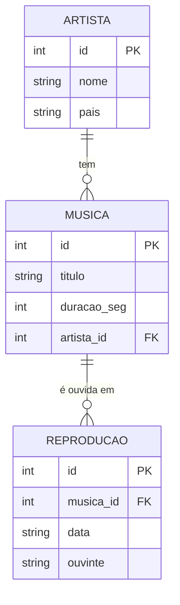

# Exemplo completo: CRUD de um streaming de música (Java + SQLite)

Este é um projeto Eclipse completo. Ele tem três tabelas, e mostra as quatro operações do CRUD (criar, ler, atualizar e apagar), com um INNER JOIN em cada tipo de leitura.

## 1. O modelo (MER)



Leitura do diagrama:

- Um artista tem zero ou mais músicas. Cada música pertence a exatamente um artista.
- Uma música pode ter zero ou mais reproduções. Cada reprodução pertence a exatamente uma música.
- `artista_id` e `musica_id` são chaves estrangeiras: elas apontam para a chave primária da outra tabela.

## 2. O esquema

O esquema está em `src/streaming/Conexao.java`, no método `criarTabelas`:

```sql
CREATE TABLE IF NOT EXISTS artista (
    id   INTEGER PRIMARY KEY,
    nome TEXT    NOT NULL,
    pais TEXT);

CREATE TABLE IF NOT EXISTS musica (
    id          INTEGER PRIMARY KEY,
    titulo      TEXT    NOT NULL,
    duracao_seg INTEGER NOT NULL CHECK (duracao_seg > 0),
    artista_id  INTEGER NOT NULL REFERENCES artista(id));

CREATE TABLE IF NOT EXISTS reproducao (
    id        INTEGER PRIMARY KEY,
    musica_id INTEGER NOT NULL REFERENCES musica(id) ON DELETE CASCADE,
    data      TEXT    NOT NULL,
    ouvinte   TEXT);
```

Dois pontos para destacar com a turma:

- `CHECK (duracao_seg > 0)` impede uma música de duração zero ou negativa. A regra fica no banco, então vale para qualquer programa.
- `ON DELETE CASCADE` em `reproducao` faz com que, ao apagar uma música, as reproduções dela sejam apagadas junto. Sem essa cláusula, o banco recusaria a exclusão.

## 3. Os arquivos

| Arquivo | O que faz |
|---|---|
| `src/streaming/Conexao.java` | Abre a conexão, liga a chave estrangeira e cria as tabelas |
| `src/streaming/StreamingDao.java` | Todo o SQL: inserir, consultar, atualizar e apagar |
| `src/streaming/Main.java` | Demonstração passo a passo, com a saída de cada operação |
| `saida-esperada.txt` | A saída real do `Main`, para comparar |

## 4. As operações, uma por uma

### CREATE: INSERT com id gerado

```java
public long inserirArtista(String nome, String pais) throws SQLException {
    String sql = "INSERT INTO artista (nome, pais) VALUES (?, ?)";
    try (PreparedStatement ps = con.prepareStatement(sql, Statement.RETURN_GENERATED_KEYS)) {
        ps.setString(1, nome);
        ps.setString(2, pais);
        ps.executeUpdate();
        return idGerado(ps);
    }
}
```

Os valores entram pelos `?`, nunca concatenados. O `RETURN_GENERATED_KEYS` pede ao banco o `id` da linha nova, que o método devolve.

### READ: INNER JOIN de duas tabelas

```java
String sql = """
    SELECT m.titulo, a.nome, m.duracao_seg
    FROM musica m
    INNER JOIN artista a ON a.id = m.artista_id
    ORDER BY m.titulo""";
```

Equivale a: "para cada música, encontre o artista cujo `id` é igual ao `artista_id` dela". O INNER JOIN só devolve as combinações que existem nas duas tabelas.

### READ: INNER JOIN de três tabelas, com GROUP BY

```java
String sql = """
    SELECT a.nome, COUNT(r.id) AS reproducoes
    FROM artista a
    INNER JOIN musica m     ON m.artista_id = a.id
    INNER JOIN reproducao r ON r.musica_id = m.id
    GROUP BY a.id
    ORDER BY reproducoes DESC, a.nome""";
```

Leia assim: junte artista com música, depois junte o resultado com reprodução. Depois conte as reproduções por artista.

Uma consequência importante: artistas sem nenhuma reprodução não aparecem. O INNER JOIN exige correspondência nas três tabelas. Se você quiser todos os artistas, mesmo sem reprodução, use `LEFT JOIN`, que é o assunto do exercício de SQL do dia 1.

### UPDATE: corrigir um valor

```java
String sql = "UPDATE musica SET duracao_seg = ? WHERE id = ?";
// ...
return ps.executeUpdate() == 1;
```

O `WHERE id = ?` escolhe a linha. O retorno `== 1` diz se a linha existia e foi alterada.

### DELETE: remover uma linha, ou uma música com as reproduções dela

```java
String sql = "DELETE FROM musica WHERE id = ?";
```

Ao apagar uma música, as reproduções dela saem junto, por causa do `ON DELETE CASCADE`. Esse é o efeito que o passo 6 da demonstração mostra.

## 5. Como rodar no Eclipse

1. Importe a pasta `exemplo-streaming` com **File › Import › Existing Projects into Workspace**. Se o Eclipse reclamar do JRE, confira o JDK 17 (veja `01-configuracao-eclipse.md`).
2. Confira que os dois JARs da pasta `lib/` estão no **Referenced Libraries**. Se não estiverem, use **Build Path › Add External JARs**.
3. Clique com o botão direito em `src/streaming/Main.java` e escolha **Run As › Java Application**.
4. O arquivo `streaming.db` é criado na pasta do projeto, e é recriado a cada execução.

O aviso `SLF4J(W): No SLF4J providers were found` pode aparecer no console. Ele é esperado, e pode ser ignorado.

## 6. Saída esperada

A saída completa está em `saida-esperada.txt`. Resumo:

```
== 1. CREATE: cadastrar artistas, músicas e reproduções
  artistas: 3, músicas: 4, reproduções: 6

== 2. READ: INNER JOIN de duas tabelas (música + artista)
  Cidade Lenta - Banda Horizonte (190 s)
  Mar de Vidro - The Lowlands (180 s)
  Noite Azul - Banda Horizonte (215 s)
  Vento Leste - Luana Pires (240 s)

== 3. READ: INNER JOIN de três tabelas com GROUP BY
  Banda Horizonte: 3 reproduções
  Luana Pires: 3 reproduções
  (The Lowlands não aparece: nenhuma reprodução para as músicas dele)

== 4. UPDATE: corrigir a duração de uma música
  duração antes: 215 s
  atualizou: true
  duração depois: 230 s

== 5. DELETE: remover uma reprodução
  reproduções antes: 6
  removeu: true
  removeu de novo: false
  reproduções depois: 5

== 6. DELETE com ON DELETE CASCADE: remover uma música apaga as reproduções dela
  reproduções antes: 5
  removeu a música Vento Leste: true
  reproduções depois: 2
  músicas depois: 3

== 7. Resultado final: reproduções por artista
  Banda Horizonte: 2 reproduções
```

## 7. Perguntas para a turma

- Por que o `INSERT` não recebe o `id`? (Porque ele é `INTEGER PRIMARY KEY`, e o banco gera o número.)
- Se o `UPDATE` do passo 4 usasse `WHERE duracao_seg = 215` em vez de `WHERE id = ?`, o que mudaria? (Poderia alterar outras músicas com a mesma duração.)
- No passo 3, por que The Lowlands não aparece? (A segunda junção, com `reproducao`, é INNER JOIN e exige pelo menos uma reprodução. Se ela fosse LEFT JOIN, The Lowlands apareceria com 0.)
- O que aconteceria no passo 6 sem o `ON DELETE CASCADE`? (O banco recusaria a exclusão, com `FOREIGN KEY constraint failed`.)
