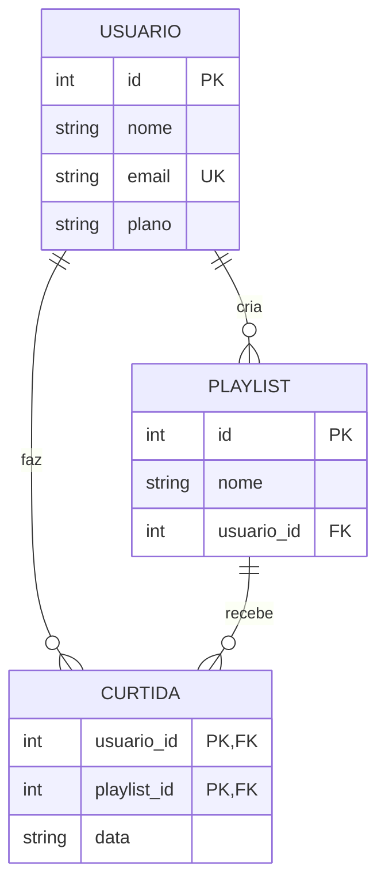

# Exercício: playlists e curtidas em um streaming (Java + SQLite)

Este projeto Eclipse tem três tabelas novas e um DAO com oito métodos para você implementar. O critério de pronto é o teste automático: **8 de 8 testes passando**.

## 1. O modelo (MER)



Leitura do diagrama:

- Um usuário cria zero ou mais playlists. Cada playlist tem exatamente um dono.
- Um usuário pode curtir zero ou mais playlists, e uma playlist pode ser curtida por vários usuários. Isso é um N:N, e a tabela `curtida` é a ligação entre as duas.
- A chave primária de `curtida` é composta: o par `(usuario_id, playlist_id)`. Assim, o mesmo usuário não consegue curtir a mesma playlist duas vezes.
- `email` é único, e `plano` só aceita `gratuito` ou `premium`.

## 2. O esquema

Está pronto em `src/streaming/Conexao.java`. Não precisa alterá-lo. As regras que ele impõe:

- `usuario.email` é UNIQUE;
- `usuario.plano` só aceita `'gratuito'` e `'premium'`;
- apagar um usuário apaga as playlists dele e as curtidas dele (`ON DELETE CASCADE`);
- apagar uma playlist apaga as curtidas dela.

## 3. O que você deve implementar

Abra `src/streaming/StreamingExercicioDao.java`. Cada método começa com `throw new UnsupportedOperationException(...)`. Apague essa linha e escreva o código.

| Método | Operação | O que faz |
|---|---|---|
| `inserirUsuario(nome, email, plano)` | INSERT | cadastra um usuário e devolve o id gerado |
| `criarPlaylist(nome, usuarioId)` | INSERT | cria uma playlist para um usuário e devolve o id gerado |
| `curtir(usuarioId, playlistId, data)` | INSERT | grava a curtida; devolve `true` se gravou |
| `contarCurtidas(playlistId)` | SELECT COUNT | quantas curtidas a playlist tem |
| `playlistsCurtidas(usuarioId)` | SELECT com INNER JOIN de três tabelas | texto `NOME (dono: NOME_DO_DONO)` para cada playlist curtida, em ordem de nome |
| `renomearPlaylist(playlistId, novoNome)` | UPDATE | muda o nome; devolve `true` se a playlist existia |
| `descurtir(usuarioId, playlistId)` | DELETE | remove a curtida; devolve `true` se ela existia |
| `removerUsuario(usuarioId)` | DELETE | remove o usuário; devolve `true` se existia |

### 3.1 Os SQL prontos para colar no Java

Os comandos abaixo são os que o gabarito usa. Cole cada um na `String sql` do método correspondente. Sua tarefa é o código Java em volta: abrir o `PreparedStatement`, preencher os `?` com `setString` ou `setLong` na ordem indicada, executar e ler o resultado.

**`inserirUsuario`** (INSERT, com id gerado). Parâmetros: `nome`, `email`, `plano`.

```java
String sql = "INSERT INTO usuario (nome, email, plano) VALUES (?, ?, ?)";
```

**`criarPlaylist`** (INSERT, com id gerado). Parâmetros: `nome`, `usuarioId`.

```java
String sql = "INSERT INTO playlist (nome, usuario_id) VALUES (?, ?)";
```

**`curtir`** (INSERT). Parâmetros: `usuarioId`, `playlistId`, `data`.

```java
String sql = "INSERT INTO curtida (usuario_id, playlist_id, data) VALUES (?, ?, ?)";
```

**`contarCurtidas`** (SELECT COUNT). Parâmetro: `playlistId`.

```java
String sql = "SELECT COUNT(*) FROM curtida WHERE playlist_id = ?";
```

**`playlistsCurtidas`** (INNER JOIN de três tabelas). Parâmetro: `usuarioId`. Com `executeQuery()`, leia `nome` e `dono` do `ResultSet`.

```java
String sql = """
    SELECT p.nome, u.nome AS dono
    FROM curtida c
    INNER JOIN playlist p ON p.id = c.playlist_id
    INNER JOIN usuario u  ON u.id = p.usuario_id
    WHERE c.usuario_id = ?
    ORDER BY p.nome""";
```

**`renomearPlaylist`** (UPDATE). Parâmetros: `novoNome`, `playlistId`. Repare que a ordem é diferente da assinatura do método: o `?` do `SET` vem antes do `?` do `WHERE`.

```java
String sql = "UPDATE playlist SET nome = ? WHERE id = ?";
```

**`descurtir`** (DELETE com chave composta). Parâmetros: `usuarioId`, `playlistId`.

```java
String sql = "DELETE FROM curtida WHERE usuario_id = ? AND playlist_id = ?";
```

**`removerUsuario`** (DELETE). Parâmetro: `usuarioId`.

```java
String sql = "DELETE FROM usuario WHERE id = ?";
```

Dica: antes de colar no Java, teste o SQL no terminal. O teste usa banco em memória, então não existe um arquivo para abrir. Crie um banco de teste com o esquema do `Conexao.java` (copie os três `CREATE TABLE` para um arquivo `esquema.sql`, rode `sqlite3 teste.db < esquema.sql` e depois substitua os `?` por valores reais). Assim você separa erro de SQL de erro de Java.

## 4. Regras que valem para todos os métodos

- **Valores de fora entram por `?`.** Nunca concatene texto no SQL. O teste não cobre isso, mas a regra é da aula.
- **Use `executeUpdate() == 1`** para saber se uma alteração afetou uma linha.
- **Use `try` com recurso** para o `PreparedStatement` e o `ResultSet`.
- **Use `Statement.RETURN_GENERATED_KEYS`** nos INSERTs que devolvem id.

## 5. A consulta que mais importa: INNER JOIN de três tabelas

O método `playlistsCurtidas` precisa juntar três tabelas. Escreva primeiro a consulta no `sqlite3`, para ver o resultado, e só depois traduza para o Java:

```sql
SELECT p.nome, u.nome AS dono
FROM curtida c
INNER JOIN playlist p ON p.id = c.playlist_id
INNER JOIN usuario u  ON u.id = p.usuario_id
WHERE c.usuario_id = 2
ORDER BY p.nome;
```

Pense assim: começo com as curtidas do usuário, passo para a playlist curtida, e dela para o dono.

## 6. Como rodar no Eclipse

1. Importe a pasta `exercicio-streaming` com **File › Import › Existing Projects into Workspace**.
2. Confira os dois JARs da pasta `lib/` em **Referenced Libraries**.
3. Rode `src/exercicio/ExercicioTeste.java` com **Run As › Java Application**.
4. Antes de implementar, a saída mostra `0 de 8`, e cada teste falha com `UnsupportedOperationException: TODO: nome-do-método`. Isso é o esperado.
5. Implemente um método de cada vez e rode o teste de novo.

O teste usa um banco em memória. Ele não grava arquivo nenhum no projeto.

## 7. Dicas para quem travar

- Em `contarCurtidas`, use `SELECT COUNT(*)` com um `WHERE`. Lembre que `rs.next()` precisa ser chamado antes de ler a primeira linha.
- Em `renomearPlaylist`, o `WHERE id = ?` escolhe a linha. Um id que não existe não afeta nada, e o retorno é `false`.
- Em `descurtir`, a chave é composta. O `WHERE` precisa das duas colunas: `usuario_id = ? AND playlist_id = ?`.
- Em `removerUsuario`, não é preciso apagar as playlists nem as curtidas à mão. O `ON DELETE CASCADE` faz isso. Se o teste reclamar de contagem, confira se a conexão tem `PRAGMA foreign_keys = ON` (ela já tem, em `Conexao.abrir`).
- Se um método lança `SQLException`, leia a mensagem: ela diz qual restrição falhou.

## 8. Perguntas para discutir

1. Por que `curtida` não tem um `id` próprio, como as outras tabelas?
2. Se você removesse a palavra `ON DELETE CASCADE` de `curtida`, o que aconteceria ao apagar uma playlist que tem curtidas?
3. Na consulta de `playlistsCurtidas`, trocar o `INNER JOIN` entre `playlist` e `usuario` por `LEFT JOIN` mudaria o resultado? Por quê? (Não mudaria: `playlist.usuario_id` é obrigatório e sempre aponta para um usuário existente.)
