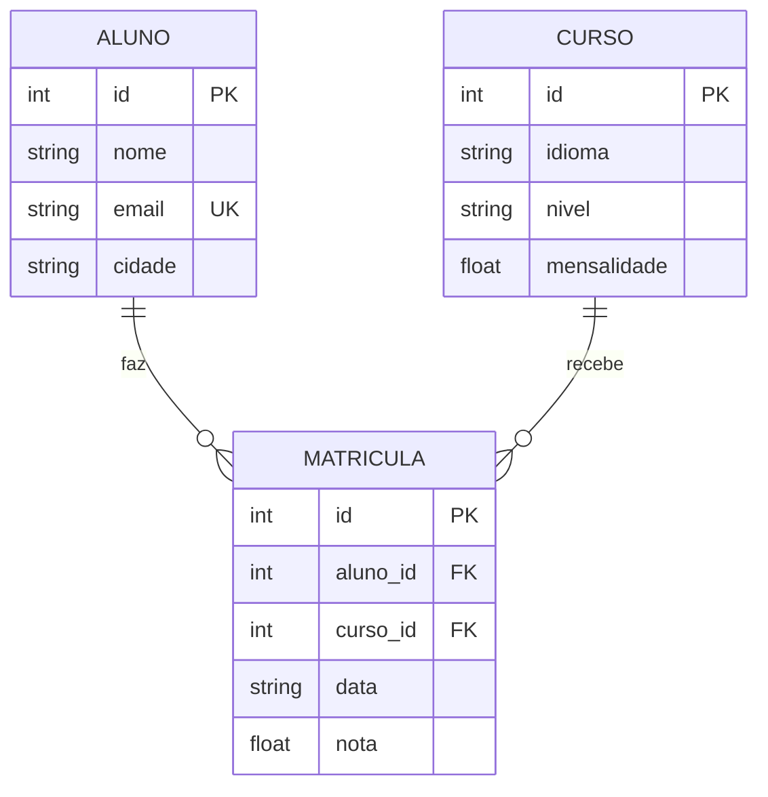

# Exercício de modelagem: escola de idiomas

**Tempo sugerido:** 40 minutos. Faça antes do Dia 2.

Você recebe o modelo de um banco de dados de uma escola de idiomas. Sua tarefa é transformar o diagrama em um script SQL, inserir os dados, fazer as operações de CRUD e, no fim, evoluir o modelo.

**Entrega:** um arquivo `meu-script.sql` que roda do início ao fim sem erro (os erros da parte C7 e C10 são esperados e devem ser só observados).

---

## Como visualizar o diagrama e rodar o SQL

Você não precisa instalar nada além do que já foi pedido para o Dia 1. Escolha uma das opções.

### Opção 1: navegador, sem instalar nada (recomendada para a sala)

**Diagrama:** abra [mermaid.live](https://mermaid.live), apague o exemplo que aparece no campo da esquerda, cole o conteúdo de `escola.mmd` e o diagrama aparece na hora. Você também pode exportar como imagem pelo próprio site.

**SQL:** abra [sqliteonline.com](https://sqliteonline.com), cole o conteúdo do seu `meu-script.sql` e execute. Antes de tudo, rode esta linha, porque o site pode vir com as chaves estrangeiras desligadas:

```sql
PRAGMA foreign_keys = ON;
```

> Esses sites são de terceiros e podem sair do ar ou mudar. Se algum não abrir, use a Opção 2 ou 3.

### Opção 2: VS Code

1. Abra a pasta `exercicios/modelagem-escola` no VS Code (File › Open Folder).
2. **Diagrama:** instale a extensão **Markdown Preview Mermaid Support** (ícone de extensões, procure pelo nome). Abra este `ENUNCIADO.md` e pressione `Ctrl+Shift+V` (no Mac, `Cmd+Shift+V`). O diagrama aparece na pré-visualização. Para o arquivo `escola.mmd` puro, use o site da Opção 1.
3. **SQL:** abra o terminal integrado (`` Ctrl+` ``) na pasta e rode:

```bash
sqlite3 escola.db < meu-script.sql
```

Para consultar depois, entre no banco com `sqlite3 escola.db` e digite `.tables` ou uma consulta `SELECT`.

### Opção 3: GitHub, sem instalar nada

Se a turma já usa o repositório, o GitHub mostra o diagrama em qualquer arquivo `.md` que tenha um bloco `mermaid`, como o abaixo. Você só precisa abrir o arquivo no navegador.

---

## Diagrama da escola (parte A)



Leitura do diagrama:

- **PK** é a chave primária, **FK** é a chave estrangeira e **UK** é um valor único (UNIQUE).
- `ALUNO ||--o{ MATRICULA` quer dizer: um aluno tem **zero ou mais** matrículas, e cada matrícula pertence a **exatamente um** aluno.
- Um aluno não aparece diretamente ligado a um curso. A ligação é feita pela tabela `MATRICULA`, que é o que se chama de relação N:N resolvida com uma tabela intermediária.

---

## Parte A: criar as tabelas (10 min)

Escreva no início do `meu-script.sql` o `CREATE TABLE` de cada entidade. Siga estas regras, que estão no diagrama e nas regras de negócio:

| Tabela | Regras |
|---|---|
| `aluno` | `id` é chave primária. `nome` é obrigatório. `email` é obrigatório e não pode se repetir. `cidade` é opcional. |
| `curso` | `id` é chave primária. `idioma` é obrigatório. `nivel` só aceita `'basico'`, `'intermediario'` ou `'avancado'`. `mensalidade` é obrigatória e maior que zero. |
| `matricula` | `id` é chave primária. `aluno_id` e `curso_id` são obrigatórios e são chaves estrangeiras. Ao apagar um aluno, apague junto as matrículas dele (`ON DELETE CASCADE`). Um aluno não pode ter duas matrículas no mesmo curso. `nota` é opcional e, quando existe, fica entre 0 e 10. |

Lembre a primeira linha do script:

```sql
PRAGMA foreign_keys = ON;
```

Sem ela, o SQLite ignora as chaves estrangeiras e o `ON DELETE CASCADE` não funciona.

---

## Parte B: inserir os dados (5 min)

Insira estes dados. Use um `INSERT` com várias linhas para cada tabela.

**aluno**

| nome | email | cidade |
|---|---|---|
| Ana Souza | ana@exemplo.com | Recife |
| Bruno Lima | bruno@exemplo.com | Olinda |
| Carla Dias | carla@exemplo.com | Recife |
| Diego Melo | diego@exemplo.com | Paulista |

**curso**

| idioma | nivel | mensalidade |
|---|---|---|
| Inglês | basico | 250.00 |
| Inglês | avancado | 320.00 |
| Espanhol | basico | 230.00 |
| Francês | intermediario | 280.00 |

**matricula** (use o `id` do aluno e do curso na ordem em que foram inseridos: Ana é o aluno 1, Bruno é o 2 etc.)

| aluno_id | curso_id | data | nota |
|---|---|---|---|
| 1 | 1 | 2026-02-10 | 8.5 |
| 1 | 2 | 2026-03-01 | (vazio) |
| 2 | 1 | 2026-02-10 | 6.0 |
| 3 | 3 | 2026-02-15 | 9.0 |
| 3 | 4 | 2026-03-05 | 7.5 |

---

## Parte C: consultas e alterações (20 min)

Escreva o comando SQL para cada item. Depois de cada um, confira o resultado com o esperado. Os resultados estão em ordem; se o seu for diferente, releia o enunciado antes de perguntar.

**C1. Consulta simples.** Nomes dos alunos de Recife, em ordem alfabética.
*Esperado:* `Ana Souza` e `Carla Dias`.

**C2. Consulta com JOIN.** Nome do aluno, idioma e nível de cada matrícula, ordenado por nome do aluno e depois pelo `id` do curso.
*Esperado:* 5 linhas, começando por `Ana Souza | Inglês | basico`.

**C3. Alunos sem matrícula.** Use `LEFT JOIN` e `IS NULL`.
*Esperado:* `Diego Melo`.

**C4. INSERT.** Adicione a aluna `Elisa Rocha`, e-mail `elisa@exemplo.com`, cidade `Jaboatão`. Depois conte os alunos.
*Esperado:* `5`.

**C5. UPDATE com WHERE.** Reajuste em 10% a mensalidade do Inglês básico, arredondando para 2 casas. Depois consulte os cursos de Inglês.
*Esperado:* o Inglês básico passa a ter mensalidade `275.0`.

**C6. UPDATE com subconsulta.** Mude para `7.0` a nota do Bruno no Inglês básico. Use `SELECT` dentro do `WHERE` para achar o `id` dele pelo nome.
*Esperado:* a consulta de notas do aluno 2 mostra `7.0`.

**C7. Erros que você deve observar (não é para corrigir).** Rode cada linha separadamente, em um teste à parte, e anote a mensagem:

```sql
INSERT INTO matricula (aluno_id, curso_id, data) VALUES (1, 1, '2026-04-01');
```
*Erro esperado:* `UNIQUE constraint failed`. A Ana já está no Inglês básico.

```sql
INSERT INTO curso (idioma, nivel, mensalidade) VALUES ('Italiano', 'expert', 200);
```
*Erro esperado:* `CHECK constraint failed`. O nível `expert` não é permitido.

```sql
INSERT INTO matricula (aluno_id, curso_id, data) VALUES (99, 1, '2026-04-01');
```
*Erro esperado:* `FOREIGN KEY constraint failed`. Não existe aluno 99.

**C8. DELETE de uma matrícula.** Apague a matrícula da Ana no Inglês avançado. Depois conte as matrículas.
*Esperado:* `4`.

**C9. DELETE em cascata.** Apague o Bruno. A matrícula dele também deve sair. Depois conte as matrículas.
*Esperado:* `3`.

**C10. Erro que você deve observar.** Tente apagar o Inglês básico.

```sql
DELETE FROM curso WHERE id = 1;
```
*Erro esperado:* `FOREIGN KEY constraint failed`. Ainda existe matrícula nesse curso.

**C11. GROUP BY e HAVING.** Para cada curso com pelo menos uma matrícula, mostre o idioma, o nível e o número de matrículas. Ordene pelo `id` do curso.
*Esperado:* 3 linhas, uma para cada curso que ainda tem matrícula.

---

## Parte D: evoluir o modelo (10 min)

A escola decidiu registrar **o professor de cada curso**. Um professor pode dar vários cursos, e cada curso tem um professor.

**D1. Modelagem.** Copie o diagrama da parte A para um novo arquivo, `escola-com-professor.mmd`, e acrescente:

- a entidade `PROFESSOR`, com `id` (PK), `nome` e `especialidade`;
- a relação `PROFESSOR ||--o{ CURSO : "leciona"`;
- o campo `professor_id` (FK) dentro de `CURSO`.

Compare com o arquivo de gabarito `escola-com-professor.mmd` só depois de tentar sozinho.

**D2. SQL.** Escreva o script que:

1. cria a tabela `professor`;
2. adiciona a coluna `professor_id` na tabela `curso` com `ALTER TABLE`, como chave estrangeira que aponta para `professor(id)`;
3. insere duas professoras: `Marta Viana` (Inglês) e `Pedro Alves` (Espanhol e Francês);
4. liga cada curso à professora certa com `UPDATE`;
5. consulta o idioma, o nível e o nome da professora de cada curso, com `LEFT JOIN`.

*Esperado no passo 5:* 4 linhas, começando por `Inglês | basico | Marta Viana`.

---

## Perguntas para discutir em dupla

1. Por que `matricula` é uma tabela separada, e não uma coluna `curso_id` dentro de `aluno`? O que se perderia?
2. Se o professor tivesse que ser único por curso, mas um professor pudesse ter vários cursos, a relação mudaria no diagrama? Como?

---

## Conferindo o resultado

Rode o seu script inteiro na pasta do exercício:

```bash
sqlite3 escola.db < meu-script.sql
```

Compare a saída com `gabarito/saida-esperada.txt`. As linhas são as mesmas, na mesma ordem, quando você rodar as consultas da parte C na sequência, sem apagar o banco no meio.

O gabarito completo, com o script que já passa sem erro, está em `gabarito/gabarito.sql`. Use-o só depois de tentar sozinho.
