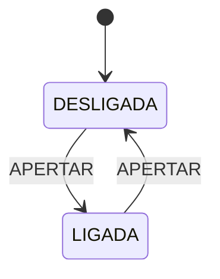
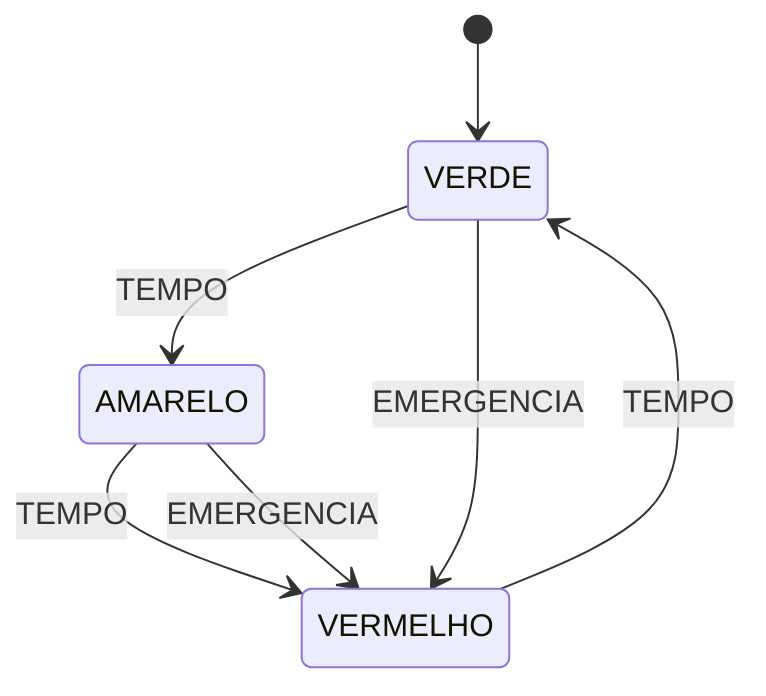
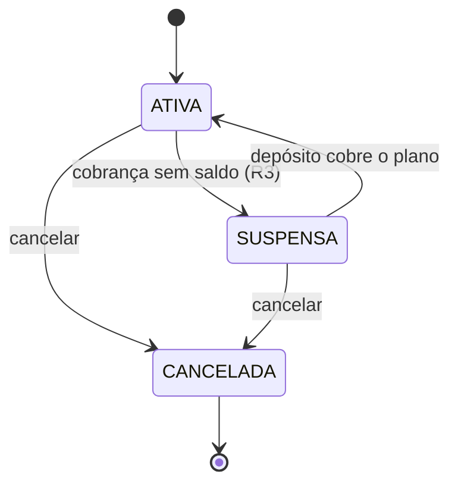
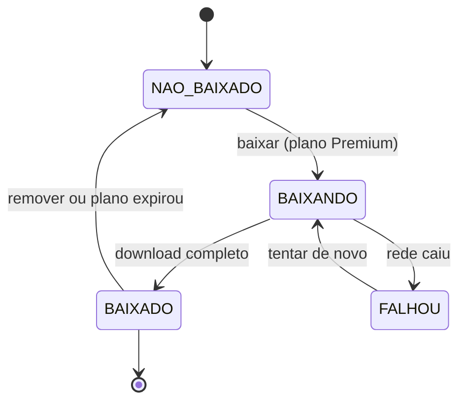
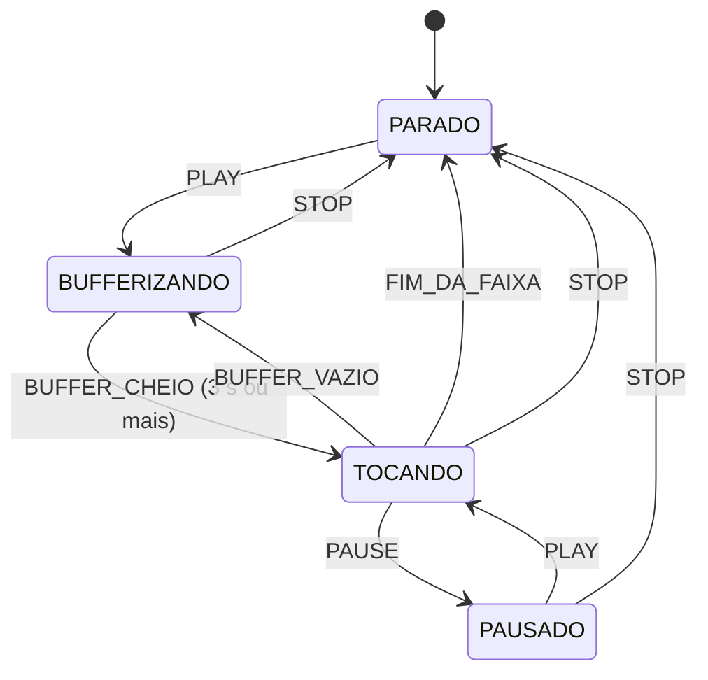

# Máquina de estados em Java: cinco exemplos, do simples ao avançado

Cola para a aula. Cada nível repete a mesma ideia com uma novidade. Mostre o diagrama, depois o código e por último a saída; é nessa ordem que a turma entende a evolução.

## Roteiro de demonstração

| Nível | Exemplo | O que é novo | Conceito |
|---|---|---|---|
| 1 | Lâmpada | Dois estados, um evento. Nada além da transição. | Estado e transição; `switch` expression cobre todos os casos. |
| 2 | Semáforo | Três estados em ciclo e um evento de emergência que vai de qualquer cor a vermelho. | Ciclo; transições que se repetem por estado; `switch` que o compilador verifica. |
| 3 | Assinatura | Guardas numéricas (saldo) e um estado final (CANCELADA). | Guarda; ação junto da transição; estado final sem saída. |
| 4 | Download offline | A regra vira dado: uma tabela de transições. Eventos sem linha são recusados. | Tabela de transições; guarda antes da tabela; falha e nova tentativa. |
| 5 | Player com padrão State | Cada estado decide o próprio comportamento. Ações de entrada e guardas em um só lugar. | Padrão State com enum; ação de entrada; evento recusado com `null`. |

Para rodar qualquer exemplo (a partir da pasta do repositório):

```bash
javac -Xlint:all -d out <arquivo>.java
java -cp out <Classe>
```

---

## Nível 1 · Lâmpada

**Ideia.** Uma lâmpada está ligada ou desligada. Cada aperto troca de situação. É o menor diagrama de estados possível.

**O que muda em relação ao anterior.** Ponto de partida: o estado é um `enum` e a transição é um `switch` de expressão.

**Conceito.** Estado e transição; `switch` expression cobre todos os casos.

### Diagrama



### Código Java

Arquivo: `evolucao/1-lampada/Lampada.java`

```java
/**
 * Nível 1: a lâmpada tem dois estados e um único evento.
 * Uma transição por estado, sem guardas e sem ações.
 */
public class Lampada {

    enum Estado { DESLIGADA, LIGADA }

    private Estado estado = Estado.DESLIGADA;

    void apertar() {
        estado = switch (estado) {
            case DESLIGADA -> Estado.LIGADA;
            case LIGADA -> Estado.DESLIGADA;
        };
        System.out.println("apertar -> " + estado);
    }

    public static void main(String[] args) {
        Lampada lampada = new Lampada();
        lampada.apertar();
        lampada.apertar();
        lampada.apertar();
    }
}
```

### Saída real

```text
apertar -> LIGADA
apertar -> DESLIGADA
apertar -> LIGADA
```

**Pergunta para a turma:** Se a lâmpada fosse fundida, qual seria o novo estado? Precisaríamos de uma transição nova?

---

## Nível 2 · Semáforo

**Ideia.** Um semáforo passa de verde para amarelo e de amarelo para vermelho, sempre no mesmo ciclo. Uma emergência manda para vermelho em qualquer cor.

**O que muda em relação ao anterior.** Agora há dois eventos. O `if` trata a emergência antes do `switch`, que cuida do ciclo normal.

**Conceito.** Ciclo; transições que se repetem por estado; `switch` que o compilador verifica.

### Diagrama



### Código Java

Arquivo: `evolucao/2-semaforo/Semaforo.java`

```java
/**
 * Nível 2: três estados em ciclo e um evento de emergência que vai a VERMELHO de qualquer cor.
 * O switch cobre todos os casos: o compilador avisa se faltar um estado.
 */
public class Semaforo {

    enum Cor { VERDE, AMARELO, VERMELHO }

    enum Evento { TEMPO, EMERGENCIA }

    private Cor cor = Cor.VERDE;

    void disparar(Evento evento) {
        Cor anterior = cor;
        if (evento == Evento.EMERGENCIA) {
            cor = Cor.VERMELHO;
        } else {
            cor = switch (cor) {
                case VERDE -> Cor.AMARELO;
                case AMARELO -> Cor.VERMELHO;
                case VERMELHO -> Cor.VERDE;
            };
        }
        System.out.println(anterior + " + " + evento + " -> " + cor);
    }

    public static void main(String[] args) {
        Semaforo semaforo = new Semaforo();
        for (int i = 0; i < 4; i++) {
            semaforo.disparar(Evento.TEMPO);
        }
        semaforo.disparar(Evento.EMERGENCIA);
        semaforo.disparar(Evento.TEMPO);
    }
}
```

### Saída real

```text
VERDE + TEMPO -> AMARELO
AMARELO + TEMPO -> VERMELHO
VERMELHO + TEMPO -> VERDE
VERDE + TEMPO -> AMARELO
AMARELO + EMERGENCIA -> VERMELHO
VERMELHO + TEMPO -> VERDE
```

**Pergunta para a turma:** No diagrama, VERMELHO + EMERGENCIA não tem seta. No código, o que acontece? (Resposta: fica em VERMELHO. A seta é omitida por convenção, e a nota deve dizer isso.)

---

## Nível 3 · Assinatura

**Ideia.** Uma assinatura de R$ 19,90 é cobrada todo mês. Sem saldo, fica suspensa (R3). Cancelada, nunca mais é cobrada (R4).

**O que muda em relação ao anterior.** A transição depende de um número: `saldo >= PLANO`. E `CANCELADA` recusa toda cobrança.

**Conceito.** Guarda; ação junto da transição; estado final sem saída.

### Diagrama



### Código Java

Arquivo: `evolucao/3-assinatura/Assinatura.java`

```java
import java.util.ArrayList;
import java.util.List;
import java.util.Locale;

/**
 * Nível 3: guardas numéricas e estado final.
 * A cobrança depende do saldo (guarda), e CANCELADA não tem transição de saída.
 */
public class Assinatura {

    enum Status { ATIVA, SUSPENSA, CANCELADA }

    private static final double PLANO = 19.90;

    private Status status = Status.ATIVA;
    private double saldo;
    private final List<String> log = new ArrayList<>();

    Assinatura(double saldoInicial) {
        this.saldo = saldoInicial;
    }

    /** Cobrança mensal. Guarda: saldo >= PLANO. Sem saldo, suspende (R3). */
    void cobrar() {
        if (status == Status.CANCELADA) {
            log.add("cobrança recusada: assinatura cancelada (R4)");
            return;
        }
        if (saldo >= PLANO) {
            saldo -= PLANO;
            status = Status.ATIVA;
            log.add(String.format("cobrança: debita %.2f, saldo %.2f -> ATIVA", PLANO, saldo));
        } else {
            status = Status.SUSPENSA;
            log.add(String.format("cobrança: saldo %.2f insuficiente -> SUSPENSA (R3)", saldo));
        }
    }

    void depositar(double valor) {
        saldo += valor;
        if (status == Status.SUSPENSA && saldo >= PLANO) {
            status = Status.ATIVA;
            log.add(String.format("depósito %.2f regulariza -> ATIVA", valor));
        } else {
            log.add(String.format("depósito %.2f, saldo %.2f", valor, saldo));
        }
    }

    void cancelar() {
        if (status == Status.CANCELADA) {
            log.add("cancelar: já estava cancelada");
            return;
        }
        status = Status.CANCELADA;
        log.add("cancelar -> CANCELADA (estado final)");
    }

    Status getStatus() { return status; }
    List<String> getLog() { return log; }

    public static void main(String[] args) {
        Locale.setDefault(Locale.ROOT);
        Assinatura assinatura = new Assinatura(30.10);
        assinatura.cobrar();      // sobra 10,20 -> ATIVA
        assinatura.cobrar();      // 10,20 < 19,90 -> SUSPENSA
        assinatura.depositar(15.00);
        assinatura.cancelar();
        assinatura.cobrar();      // recusada: R4
        assinatura.depositar(50.00);
        assinatura.getLog().forEach(System.out::println);
        System.out.println("status final: " + assinatura.getStatus());
    }
}
```

### Saída real

```text
cobrança: debita 19.90, saldo 10.20 -> ATIVA
cobrança: saldo 10.20 insuficiente -> SUSPENSA (R3)
depósito 15.00 regulariza -> ATIVA
cancelar -> CANCELADA (estado final)
cobrança recusada: assinatura cancelada (R4)
depósito 50.00, saldo 75.20
status final: CANCELADA
```

**Pergunta para a turma:** Um depósito de R$ 5,00 com saldo de R$ 10,20 regulariza uma conta SUSPENSA? (Não: 15,20 < 19,90.)

---

## Nível 4 · Download offline

**Ideia.** Um álbum é baixado para ouvir sem internet. A rede pode cair no meio, e a pessoa pode tentar de novo.

**O que muda em relação ao anterior.** Em vez de um `switch`, cada seta é uma linha da tabela `TABELA`. Quando a máquina cresce, a tabela continua legível.

**Conceito.** Tabela de transições; guarda antes da tabela; falha e nova tentativa.

### Diagrama



### Código Java

Arquivo: `download/Download.java`

```java
import java.util.ArrayList;
import java.util.EnumMap;
import java.util.List;
import java.util.Map;

/**
 * Download offline de álbum no Melodia, com a tabela de transições escrita em código.
 * Em vez de um switch gigante, a máquina é uma tabela: estado atual -> evento -> próximo estado.
 * Quem lê a tabela enxerga o diagrama inteiro, e cada célula vazia é uma transição recusada.
 */
public class Download {

    enum Estado { NAO_BAIXADO, BAIXANDO, BAIXADO, FALHOU }

    enum Evento { BAIXAR, RECEBER_TUDO, REDE_CAIU, TENTAR_NOVAMENTE, REMOVER, PLANO_EXPIROU }

    // A tabela de transições. Cada linha é uma seta do diagrama.
    private static final Map<Estado, Map<Evento, Estado>> TABELA = new EnumMap<>(Estado.class);

    static {
        adicionar(Estado.NAO_BAIXADO, Evento.BAIXAR, Estado.BAIXANDO);
        adicionar(Estado.BAIXANDO, Evento.RECEBER_TUDO, Estado.BAIXADO);
        adicionar(Estado.BAIXANDO, Evento.REDE_CAIU, Estado.FALHOU);
        adicionar(Estado.FALHOU, Evento.TENTAR_NOVAMENTE, Estado.BAIXANDO);
        adicionar(Estado.BAIXADO, Evento.REMOVER, Estado.NAO_BAIXADO);
        adicionar(Estado.BAIXADO, Evento.PLANO_EXPIROU, Estado.NAO_BAIXADO);
    }

    private static void adicionar(Estado de, Evento evento, Estado para) {
        TABELA.computeIfAbsent(de, k -> new EnumMap<>(Evento.class)).put(evento, para);
    }

    static final class Album {
        private final String nome;
        private final boolean premium;
        private Estado estado = Estado.NAO_BAIXADO;
        private final List<String> log = new ArrayList<>();

        Album(String nome, boolean premium) {
            this.nome = nome;
            this.premium = premium;
        }

        /** Dispara um evento. Devolve false quando a transição não existe ou a guarda falha. */
        boolean disparar(Evento evento) {
            // guarda: só assinante Premium pode baixar
            if (evento == Evento.BAIXAR && !premium) {
                log.add(String.format("  %-12s + %-16s -> recusado [guarda: plano Free]", estado, evento));
                return false;
            }
            Estado proximo = TABELA.getOrDefault(estado, Map.of()).get(evento);
            if (proximo == null) {
                log.add(String.format("  %-12s + %-16s -> recusado (sem transição na tabela)", estado, evento));
                return false;
            }
            log.add(String.format("  %-12s + %-16s -> %s", estado, evento, proximo));
            estado = proximo;
            return true;
        }

        Estado getEstado() { return estado; }
        List<String> getLog() { return log; }
        String getNome() { return nome; }
    }

    static void imprimirTabela() {
        System.out.println("Tabela de transições (estado -> evento -> próximo):");
        for (Estado de : Estado.values()) {
            Map<Evento, Estado> linha = TABELA.getOrDefault(de, Map.of());
            for (Map.Entry<Evento, Estado> t : linha.entrySet()) {
                System.out.printf("  %-12s --%s--> %s%n", de, t.getKey(), t.getValue());
            }
        }
    }

    static void cenario(String titulo, Album album, Evento... eventos) {
        System.out.println("\n== " + titulo + " (" + album.getNome() + ")");
        for (Evento e : eventos) album.disparar(e);
        album.getLog().forEach(System.out::println);
        System.out.println("estado final: " + album.getEstado());
    }

    public static void main(String[] args) {
        java.util.Locale.setDefault(java.util.Locale.ROOT);
        imprimirTabela();

        cenario("1. Download completo", new Album("Abbey Road", true),
                Evento.BAIXAR, Evento.RECEBER_TUDO);

        cenario("2. Rede cai no meio e a pessoa tenta de novo", new Album("Rumours", true),
                Evento.BAIXAR, Evento.REDE_CAIU, Evento.TENTAR_NOVAMENTE, Evento.RECEBER_TUDO);

        cenario("3. Plano Free tenta baixar", new Album("Thriller", false),
                Evento.BAIXAR);

        cenario("4. Plano expira depois do download", new Album("Random Access Memories", true),
                Evento.BAIXAR, Evento.RECEBER_TUDO, Evento.PLANO_EXPIROU);

        cenario("5. Evento que não existe no estado", new Album("Dark Side", true),
                Evento.RECEBER_TUDO);
    }
}
```

### Saída real

```text
Tabela de transições (estado -> evento -> próximo):
  NAO_BAIXADO  --BAIXAR--> BAIXANDO
  BAIXANDO     --RECEBER_TUDO--> BAIXADO
  BAIXANDO     --REDE_CAIU--> FALHOU
  BAIXADO      --REMOVER--> NAO_BAIXADO
  BAIXADO      --PLANO_EXPIROU--> NAO_BAIXADO
  FALHOU       --TENTAR_NOVAMENTE--> BAIXANDO

== 1. Download completo (Abbey Road)
  NAO_BAIXADO  + BAIXAR           -> BAIXANDO
  BAIXANDO     + RECEBER_TUDO     -> BAIXADO
estado final: BAIXADO

== 2. Rede cai no meio e a pessoa tenta de novo (Rumours)
  NAO_BAIXADO  + BAIXAR           -> BAIXANDO
  BAIXANDO     + REDE_CAIU        -> FALHOU
  FALHOU       + TENTAR_NOVAMENTE -> BAIXANDO
  BAIXANDO     + RECEBER_TUDO     -> BAIXADO
estado final: BAIXADO

== 3. Plano Free tenta baixar (Thriller)
  NAO_BAIXADO  + BAIXAR           -> recusado [guarda: plano Free]
estado final: NAO_BAIXADO

== 4. Plano expira depois do download (Random Access Memories)
  NAO_BAIXADO  + BAIXAR           -> BAIXANDO
  BAIXANDO     + RECEBER_TUDO     -> BAIXADO
  BAIXADO      + PLANO_EXPIROU    -> NAO_BAIXADO
estado final: NAO_BAIXADO

== 5. Evento que não existe no estado (Dark Side)
  NAO_BAIXADO  + RECEBER_TUDO     -> recusado (sem transição na tabela)
estado final: NAO_BAIXADO
```

**Pergunta para a turma:** Acrescente PAUSADO: BAIXANDO --PAUSAR--> PAUSADO e PAUSADO --RETOMAR--> BAIXANDO. Quais linhas da tabela mudam?

---

## Nível 5 · Player com padrão State

**Ideia.** O player precisa esperar o buffer encher antes de tocar. Se a rede cai, volta a esperar. Cada evento tem uma resposta diferente em cada estado.

**O que muda em relação ao anterior.** Cada constante do enum sobrescreve só os eventos que aceita. O evento que não tem resposta cai no padrão, que recusa. Quem quer saber o que `TOCANDO` faz com `PAUSE` lê uma linha.

**Conceito.** Padrão State com enum; ação de entrada; evento recusado com `null`.

### Diagrama



### Código Java

Arquivo: `evolucao/5-player-estado/PlayerEstado.java`

```java
import java.util.ArrayList;
import java.util.List;

/**
 * Nível 5: padrão State com enum. Cada estado é uma constante que decide,
 * sozinha, o próximo estado para cada evento. Null significa "evento recusado".
 * Ações de entrada e saída ficam junto da máquina, em um único lugar.
 */
public class PlayerEstado {

    enum Estado {
        PARADO {
            @Override Estado play() { return BUFFERIZANDO; }
        },
        BUFFERIZANDO {
            // guarda: só toca com pelo menos 3 segundos no buffer
            @Override Estado bufferCheio(int segundos) { return segundos >= 3 ? TOCANDO : null; }
            @Override Estado stop() { return PARADO; }
        },
        TOCANDO {
            @Override Estado pause() { return PAUSADO; }
            @Override Estado bufferVazio() { return BUFFERIZANDO; }
            @Override Estado fimDaFaixa() { return PARADO; }
            @Override Estado stop() { return PARADO; }
        },
        PAUSADO {
            @Override Estado play() { return TOCANDO; }
            @Override Estado stop() { return PARADO; }
        };

        // Comportamento padrão: o evento não tem transição neste estado.
        Estado play() { return null; }
        Estado pause() { return null; }
        Estado bufferCheio(int segundos) { return null; }
        Estado bufferVazio() { return null; }
        Estado fimDaFaixa() { return null; }
        Estado stop() { return null; }
    }

    private Estado estado = Estado.PARADO;
    private int segundosNoBuffer;
    private final List<String> log = new ArrayList<>();

    boolean play() { return aplicar(estado.play(), "PLAY"); }
    boolean pause() { return aplicar(estado.pause(), "PAUSE"); }
    boolean bufferCheio() { return aplicar(estado.bufferCheio(segundosNoBuffer), "BUFFER_CHEIO"); }
    boolean bufferVazio() { return aplicar(estado.bufferVazio(), "BUFFER_VAZIO"); }
    boolean fimDaFaixa() { return aplicar(estado.fimDaFaixa(), "FIM_DA_FAIXA"); }
    boolean stop() { return aplicar(estado.stop(), "STOP"); }

    void carregarSegundo() {
        if (estado == Estado.BUFFERIZANDO) {
            segundosNoBuffer++;
        }
    }

    private boolean aplicar(Estado destino, String evento) {
        if (destino == null) {
            log.add(String.format("  %-13s + %-14s -> recusado", estado, evento));
            return false;
        }
        Estado anterior = estado;
        estado = destino;
        if (destino == Estado.BUFFERIZANDO) {
            segundosNoBuffer = 0; // ação de entrada: começa a contar do zero
        }
        log.add(String.format("  %-13s + %-14s -> %s", anterior, evento, estado));
        return true;
    }

    Estado getEstado() { return estado; }
    List<String> getLog() { return log; }

    public static void main(String[] args) {
        java.util.Locale.setDefault(java.util.Locale.ROOT);

        System.out.println("== 1. Reprodução feliz");
        PlayerEstado feliz = new PlayerEstado();
        feliz.play();
        feliz.carregarSegundo(); feliz.carregarSegundo(); feliz.carregarSegundo();
        feliz.bufferCheio();
        feliz.pause();
        feliz.play();
        feliz.fimDaFaixa();
        feliz.getLog().forEach(System.out::println);
        System.out.println("estado final: " + feliz.getEstado());

        System.out.println("\n== 2. A rede cai e o buffer esvazia");
        PlayerEstado queda = new PlayerEstado();
        queda.play();
        queda.carregarSegundo(); queda.carregarSegundo(); queda.carregarSegundo();
        queda.bufferCheio();
        queda.bufferVazio();
        queda.pause();                       // recusado: nada está tocando
        queda.carregarSegundo(); queda.carregarSegundo(); queda.carregarSegundo();
        queda.bufferCheio();
        queda.getLog().forEach(System.out::println);
        System.out.println("estado final: " + queda.getEstado());

        System.out.println("\n== 3. Guarda do buffer mínimo");
        PlayerEstado curto = new PlayerEstado();
        curto.play();
        curto.carregarSegundo();
        curto.bufferCheio();                 // guarda falsa: 1 segundo
        curto.getLog().forEach(System.out::println);
        System.out.println("estado final: " + curto.getEstado());
    }
}
```

### Saída real

```text
== 1. Reprodução feliz
  PARADO        + PLAY           -> BUFFERIZANDO
  BUFFERIZANDO  + BUFFER_CHEIO   -> TOCANDO
  TOCANDO       + PAUSE          -> PAUSADO
  PAUSADO       + PLAY           -> TOCANDO
  TOCANDO       + FIM_DA_FAIXA   -> PARADO
estado final: PARADO

== 2. A rede cai e o buffer esvazia
  PARADO        + PLAY           -> BUFFERIZANDO
  BUFFERIZANDO  + BUFFER_CHEIO   -> TOCANDO
  TOCANDO       + BUFFER_VAZIO   -> BUFFERIZANDO
  BUFFERIZANDO  + PAUSE          -> recusado
  BUFFERIZANDO  + BUFFER_CHEIO   -> TOCANDO
estado final: TOCANDO

== 3. Guarda do buffer mínimo
  PARADO        + PLAY           -> BUFFERIZANDO
  BUFFERIZANDO  + BUFFER_CHEIO   -> recusado
estado final: BUFFERIZANDO
```

**Pergunta para a turma:** Por que `bufferCheio` retorna `null` quando faltam segundos, em vez de `this`? (Porque `null` sinaliza recusa; `this` pareceria um sucesso sem mudança.)

---
