# SOLID em sala: diagramas de classes e projetos ruim × bom

Cola para a aula. Para cada princípio: o conceito, por que ele existe, o diagrama de classes da versão ruim, o código e a saída real, depois o mesmo para a versão boa. Os diagramas são Mermaid (`classDiagram`) e renderizam no GitHub.

## Roteiro sugerido (50 minutos)

1. Motivação (5 min): pergunte quantos arquivos a turma abriu na última mudança.
2. Acoplamento (5 min): mostre um diagrama com `new` e outro com interface.
3. Os cinco, em ordem S, O, L, I, D (35 min): para cada um, diagrama ruim, rodar, diagrama bom, rodar.
4. Quando não aplicar (5 min): um programa de 50 linhas com um tipo de desconto não precisa de interface.

## Monólogo de abertura (fala do professor, cerca de 5 minutos)

> Vou começar com uma pergunta: quantos arquivos vocês abriram na última vez que alguém pediu uma mudança em um sistema? Guardem esse número. No fim da aula, a resposta de vocês deve ser menor.
>
> Esses cinco princípios não surgiram juntos. Em 1988, Bertrand Meyer escreveu no livro *Object-Oriented Software Construction* que um módulo deve estar aberto para extensão e fechado para modificação. Em 1987, Barbara Liskov apresentou a ideia de que um subtipo deve poder substituir o tipo base, e em 1994 ela e Jeannette Wing formalizaram isso. No começo dos anos 2000, Robert C. Martin reuniu princípios de design e de desenvolvimento ágil. E por volta de 2004, Michael Feathers juntou as iniciais na sigla SOLID. São cinco pessoas, duas décadas, e um problema só.
>
> Qual é o problema? Software muda. Quem não projeta para mudar paga juros: cada alteração custa um pouco mais que a anterior, até que ninguém mais ousa mexer no sistema.
>
> **S: uma classe, um motivo para mudar.** Imaginem um sistema de pedidos. Um dia o financeiro pede outro arredondamento no total. Vocês abrem a classe que também envia e-mail e grava em arquivo. Na mesma semana, o marketing pede um texto novo no e-mail, e outra pessoa mexe na mesma classe. Uma mudança quebra a outra. Martin, no livro *Clean Architecture* (2017), descreve exatamente esse problema com uma classe Employee que atende áreas diferentes: uma alteração pedida por uma área quebra o cálculo usado por outra.
>
> **O: aberto para extensão, fechado para modificação.** Uma loja começa aceitando só cartão. Depois entra boleto, depois Pix. Se cada forma de pagamento é um if dentro do método que finaliza a compra, toda nova forma reabre um fluxo que já funciona e já foi testado. Com uma interface de pagamento, o Pix vira uma classe nova, e o fluxo de finalizar compra não muda. Esse é o cenário típico da integração de meios de pagamento.
>
> **L: o subtipo precisa honrar o contrato.** Vocês já usaram a biblioteca padrão do Java. A classe Stack estende Vector, então uma pilha herda métodos de lista, como inserir no meio, e quem a usa como pilha pode quebrar a regra sem perceber. Outro caso: Arrays.asList e List.of são ambas List, mas o método add lança UnsupportedOperationException. O subtipo não aceita o que o contrato de List promete, e o erro só aparece em execução.
>
> **I: nenhum cliente depende do que não usa.** A interface Iterator tem o método remove. Desde o Java 8, ele tem uma implementação padrão que lança UnsupportedOperationException. Quem implementa um iterador só de leitura fica com um método que não faz sentido para ele. Uma interface grande demais força todo mundo a conviver com isso.
>
> **D: quem decide a tecnologia não é a regra de negócio.** Um serviço de pedidos cria diretamente a conexão com o banco. Os testes precisam do banco de verdade, e trocar de banco ou migrar para a nuvem significa editar cada serviço. Com inversão de dependência, o serviço recebe uma interface pelo construtor, e o teste recebe uma versão em memória. Frameworks como o Spring fazem exatamente essa montagem, e vocês vão encontrar isso em projetos reais.
>
> Para fechar: os cinco princípios são critérios, e não leis. Antes de aplicar, perguntem se a mudança já aconteceu ou é previsível. Três casos parecidos pedem abstração; um caso só, não. Agora vamos ver como fica cada um no código.

**Notas para o professor.** Os cenários de pagamento, de Employee e de e-mail são situações típicas descritas na literatura e na prática, e não casos de empresas específicas. Os fatos sobre o JDK (Stack, Vector, Arrays.asList, List.of, Iterator.remove) podem ser conferidos na documentação oficial da versão que a turma usa. O caso de Employee está em Martin (2017); o da Xerox citado no slide sobre I está em Martin (2003), e vale conferir o trecho antes de citá-lo em voz alta.

---

## Como rodar cada projeto

Entre na pasta da versão e rode:

```bash
javac -Xlint:all -d out Main.java
java -cp out Main
```

Todos os projetos usam Java 17 ou superior.

## Tabela de projetos

| Princípio | Versão ruim | Versão boa |
|---|---|---|
| S · Responsabilidade única | `S-responsabilidade/ruim` | `S-responsabilidade/bom` |
| O · Aberto–fechado | `O-aberto-fechado/ruim` | `O-aberto-fechado/bom` |
| L · Substituição de Liskov | `L-liskov/ruim` | `L-liskov/bom` |
| I · Segregação de interfaces | `I-segregacao/ruim` | `I-segregacao/bom` |
| D · Inversão de dependência | `D-inversao/ruim` | `D-inversao/bom` |

---

## Os cálculos da aula

**Princípio O: novos descontos.** Modelo: cada tipo custa 3 linhas. Na versão ruim, os tipos antigos são retestados.

| k novos tipos | Ruim: linhas editadas | Ruim: testes repetidos | Boa: linhas editadas | Boa: testes novos |
|---|---|---|---|---|
| 1 | 3 | 3 | 0 | 1 |
| 2 | 6 | 7 | 0 | 2 |
| 3 | 9 | 12 | 0 | 3 |
| 4 | 12 | 18 | 0 | 4 |
| 5 | 15 | 25 | 0 | 5 |

A conta: testes repetidos na versão ruim = soma de (2 + j) para j de 1 até k. Com k = 5: 3 + 4 + 5 + 6 + 7 = 25.

**Princípio D: trocar o banco.** Modelo: cada serviço que faz `new` no banco é uma edição. Na versão boa, é uma linha no ponto de montagem.

| Serviços (m) | Ruim: edições | Boa: edições | Ruim: testes sem banco |
|---|---|---|---|
| 2 | 2 | 1 | 0 |
| 5 | 5 | 1 | 0 |
| 10 | 10 | 1 | 0 |
| 20 | 20 | 1 | 0 |

Os números são de um modelo simples. Use para discutir a ordem de grandeza, e não como medida exata.

---

## Cola de consulta: uma letra por vez

Use esta seção durante a aula, quando precisar lembrar o princípio. Cada letra tem a definição, a pergunta para checar um código, o sinal de que o princípio foi violado, a correção e uma frase curta para a turma levar para casa.

| Letra | Definição em uma frase | Pergunta para checar | Sinal de violação | Correção típica | Frase para levar |
|---|---|---|---|---|---|
| **S** · Responsabilidade única | Uma classe tem um motivo para mudar, que é um grupo de interessados. | Quem pode pedir uma mudança nesta classe? | A mesma classe muda por pedidos de áreas diferentes. | Separar em classes com um motivo cada, e um orquestrador que só chama. | Um motivo de mudança, uma classe. |
| **O** · Aberto–fechado | Novo comportamento entra por extensão, sem editar código testado. | Para incluir um tipo novo, preciso editar um método antigo? | if/else ou switch que cresce a cada novo caso. | Interface com uma implementação por regra. | Estender, não editar. |
| **L** · Substituição de Liskov | Um subtipo deve poder ocupar o lugar do tipo base sem surpresa. | O cliente que conhece só o tipo base continua correto com o subtipo? | Subclasse que sobrescreve para quebrar a regra, ou lança exceção onde o pai não lança. | Trocar herança por interface comum e implementações independentes. | O contrato vem antes da herança. |
| **I** · Segregação de interfaces | Nenhum cliente depende de métodos que não usa. | Alguma implementação tem método vazio, que lança exceção ou retorna nada? | Interface com muitos métodos e classes que lançam UnsupportedOperationException. | Interfaces pequenas, uma por capacidade. | Interface pequena, cliente livre. |
| **D** · Inversão de dependência | Regra de negócio depende de abstrações; quem monta o objeto escolhe a tecnologia. | Esta classe usa new em banco, rede ou arquivo? | new de classes concretas dentro de serviços; teste impossível sem infraestrutura. | Receber as dependências pelo construtor e montar no ponto de entrada. | A regra não sabe qual é o banco. |

### Como usar na aula

- **Antes de cada princípio:** leia a definição em voz alta e faça a pergunta para a turma. Espere uma resposta antes de mostrar o código.
- **No código ruim:** procure o sinal de violação com a turma. Peça para apontar a linha.
- **No código bom:** mostre a correção e confirme que a saída é a mesma. Esse é o critério de uma refatoração.
- **Ao final:** repita as cinco frases. Elas são o que deve sobrar na cabeça dos alunos.

---

## S · Responsabilidade única

**Conceito.** Uma classe deve ter um, e apenas um, motivo para mudar.

**Por que existe.** Quando um método valida, calcula, grava e notifica, cada pedido de mudança mexe no mesmo lugar e pode quebrar as outras partes.

### Versão ruim (jeito errado)

**Diagrama de classes**

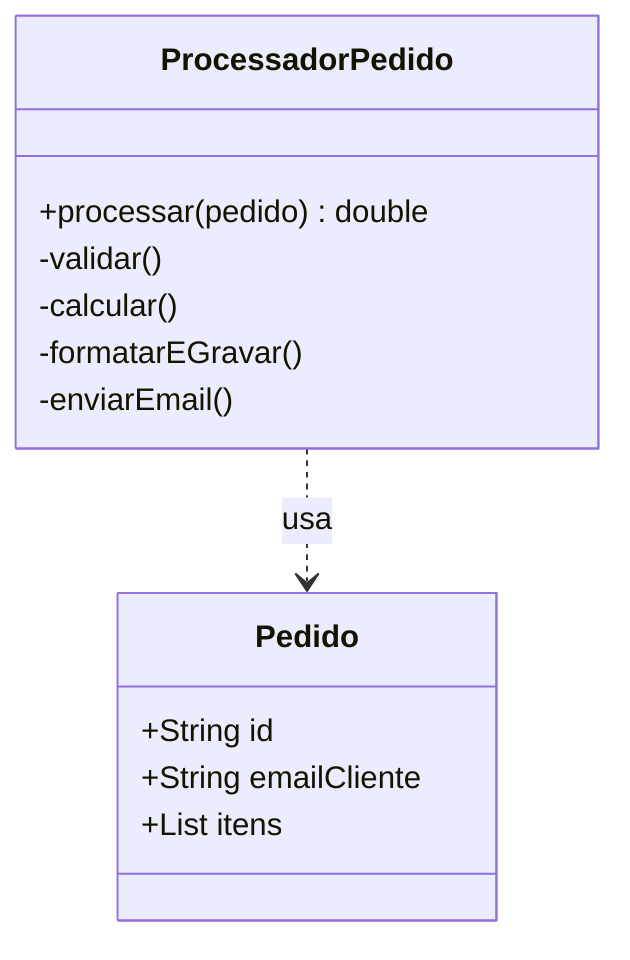

**O que mostrar na tela.** Uma classe com quatro responsabilidades: o diagrama já mostra o problema. Pergunte quantos motivos de mudança existem.

<details><summary>Código: <code>exemplos/solid/S-responsabilidade/ruim/Main.java</code></summary>

```java
import java.util.ArrayList;
import java.util.List;
import java.util.Locale;

/**
 * S ruim: ProcessadorPedido valida, calcula, grava em arquivo e envia e-mail.
 * Qualquer mudança em uma dessas regras obriga a abrir e testar a mesma classe.
 */
public class Main {

    record Item(String nome, double preco, int quantidade) {}

    static final class Pedido {
        final String id;
        final String emailCliente;
        final List<Item> itens = new ArrayList<>();

        Pedido(String id, String emailCliente) {
            this.id = id;
            this.emailCliente = emailCliente;
        }
    }

    static final class ProcessadorPedido {
        double processar(Pedido pedido) {
            // validação
            if (pedido.itens.isEmpty()) {
                throw new IllegalArgumentException("pedido vazio: " + pedido.id);
            }
            // cálculo do total e regra de desconto
            double total = 0;
            for (Item item : pedido.itens) {
                total += item.preco() * item.quantidade();
            }
            if (total > 500) {
                total *= 0.95;
            }
            // formatação e persistência (arquivo)
            String linha = pedido.id + ";" + String.format("%.2f", total);
            System.out.println("gravando em pedidos.csv: " + linha);
            // notificação por e-mail
            System.out.println("enviando e-mail para " + pedido.emailCliente
                    + ": pedido " + pedido.id + " confirmado, total R$ " + String.format("%.2f", total));
            return total;
        }
    }

    public static void main(String[] args) {
        Locale.setDefault(Locale.ROOT);
        Pedido pedido = new Pedido("P-1001", "ana@exemplo.com");
        pedido.itens.add(new Item("teclado", 150.00, 2));
        pedido.itens.add(new Item("mouse", 80.00, 3));
        new ProcessadorPedido().processar(pedido);
    }
}
```

</details>

Saída real:

```text
gravando em pedidos.csv: P-1001;513.00
enviando e-mail para ana@exemplo.com: pedido P-1001 confirmado, total R$ 513.00
```

### Versão boa (como deveria ser)

**Diagrama de classes**

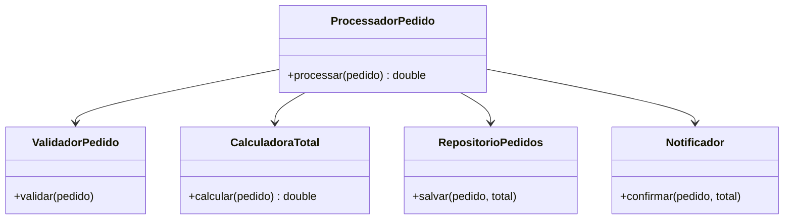

**O que mostrar na tela.** Quatro classes pequenas, com um motivo cada. O orquestrador só liga as peças. A saída é a mesma da versão ruim.

<details><summary>Código: <code>exemplos/solid/S-responsabilidade/bom/Main.java</code></summary>

```java
import java.util.ArrayList;
import java.util.List;
import java.util.Locale;

/**
 * S bom: cada classe tem um motivo para mudar.
 * Validação, cálculo, persistência e notificação ficam separados; o orquestrador só chama as partes.
 */
public class Main {

    record Item(String nome, double preco, int quantidade) {}

    static final class Pedido {
        final String id;
        final String emailCliente;
        final List<Item> itens = new ArrayList<>();

        Pedido(String id, String emailCliente) {
            this.id = id;
            this.emailCliente = emailCliente;
        }
    }

    // Motivo para mudar: regras de validação
    static final class ValidadorPedido {
        void validar(Pedido pedido) {
            if (pedido.itens.isEmpty()) {
                throw new IllegalArgumentException("pedido vazio: " + pedido.id);
            }
        }
    }

    // Motivo para mudar: regras de preço e desconto
    static final class CalculadoraTotal {
        double calcular(Pedido pedido) {
            double total = 0;
            for (Item item : pedido.itens) {
                total += item.preco() * item.quantidade();
            }
            return total > 500 ? total * 0.95 : total;
        }
    }

    // Motivo para mudar: formato ou local de gravação
    static final class RepositorioPedidos {
        void salvar(Pedido pedido, double total) {
            System.out.println("gravando em pedidos.csv: " + pedido.id + ";" + String.format("%.2f", total));
        }
    }

    // Motivo para mudar: canal de notificação
    static final class Notificador {
        void confirmar(Pedido pedido, double total) {
            System.out.println("enviando e-mail para " + pedido.emailCliente
                    + ": pedido " + pedido.id + " confirmado, total R$ " + String.format("%.2f", total));
        }
    }

    // Orquestrador: só coordena, não decide regra alguma
    static final class ProcessadorPedido {
        private final ValidadorPedido validador = new ValidadorPedido();
        private final CalculadoraTotal calculadora = new CalculadoraTotal();
        private final RepositorioPedidos repositorio = new RepositorioPedidos();
        private final Notificador notificador = new Notificador();

        double processar(Pedido pedido) {
            validador.validar(pedido);
            double total = calculadora.calcular(pedido);
            repositorio.salvar(pedido, total);
            notificador.confirmar(pedido, total);
            return total;
        }
    }

    public static void main(String[] args) {
        Locale.setDefault(Locale.ROOT);
        Pedido pedido = new Pedido("P-1001", "ana@exemplo.com");
        pedido.itens.add(new Item("teclado", 150.00, 2));
        pedido.itens.add(new Item("mouse", 80.00, 3));
        new ProcessadorPedido().processar(pedido);
    }
}
```

</details>

Saída real:

```text
gravando em pedidos.csv: P-1001;513.00
enviando e-mail para ana@exemplo.com: pedido P-1001 confirmado, total R$ 513.00
```

**Exercício para a turma.** Adicione o requisito “frete de R$ 15,00 abaixo de R$ 200,00”. Em qual classe entra? Quantas classes precisa abrir?

### Exercício rápido: S no streaming

**Contexto.** Um player de streaming toca a música, conta quantas vezes ela foi ouvida, avisa o usuário por e-mail e gera um relatório. No código ruim, tudo isso está na mesma classe.

**Diagrama de classes (ruim)**

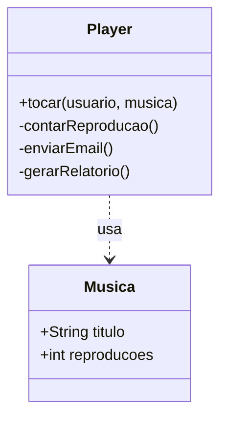

<details><summary>Código: versão ruim</summary>

```java
import java.util.Locale;

/**
 * S ruim: Player toca, conta reproduções, envia e-mail e gera relatório.
 * Qualquer mudança em contagem, aviso ou relatório mexe na mesma classe.
 */
public class Main {

    static final class Musica {
        final String titulo;
        int reproducoes;

        Musica(String titulo) { this.titulo = titulo; }
    }

    static final class Player {
        void tocar(String usuario, Musica musica) {
            System.out.println("tocando " + musica.titulo + " para " + usuario);
            // contagem de reproduções
            musica.reproducoes++;
            // aviso por e-mail
            System.out.println("enviando e-mail para " + usuario + ": você ouviu " + musica.titulo);
            // relatório
            System.out.println("relatório: " + musica.titulo + " tem " + musica.reproducoes + " reprodução(ões)");
        }
    }

    public static void main(String[] args) {
        Locale.setDefault(Locale.ROOT);
        Player player = new Player();
        Musica aquarela = new Musica("Aquarela");
        player.tocar("Ana", aquarela);
        player.tocar("Bruno", aquarela);
    }
}
```

</details>

Saída real:

```text
tocando Aquarela para Ana
enviando e-mail para Ana: você ouviu Aquarela
relatório: Aquarela tem 1 reprodução(ões)
tocando Aquarela para Bruno
enviando e-mail para Bruno: você ouviu Aquarela
relatório: Aquarela tem 2 reprodução(ões)
```

**Correção.** Separe cada motivo de mudança em uma classe. O Player só chama as outras.

**Diagrama de classes (correção)**

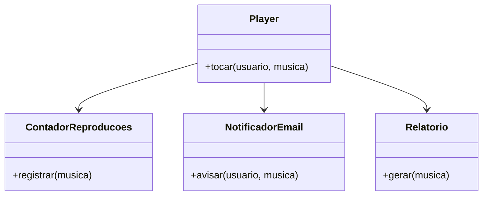

<details><summary>Código: versão corrigida</summary>

```java
import java.util.Locale;

/**
 * S bom: cada classe tem um motivo para mudar.
 * Player só toca e liga as peças; contagem, aviso e relatório ficam separados.
 */
public class Main {

    static final class Musica {
        final String titulo;
        int reproducoes;

        Musica(String titulo) { this.titulo = titulo; }
    }

    // Motivo para mudar: regra de contagem
    static final class ContadorReproducoes {
        void registrar(Musica musica) { musica.reproducoes++; }
    }

    // Motivo para mudar: canal de aviso ao usuário
    static final class NotificadorEmail {
        void avisar(String usuario, Musica musica) {
            System.out.println("enviando e-mail para " + usuario + ": você ouviu " + musica.titulo);
        }
    }

    // Motivo para mudar: formato do relatório
    static final class Relatorio {
        void gerar(Musica musica) {
            System.out.println("relatório: " + musica.titulo + " tem " + musica.reproducoes + " reprodução(ões)");
        }
    }

    // Orquestrador: só chama as partes
    static final class Player {
        private final ContadorReproducoes contador = new ContadorReproducoes();
        private final NotificadorEmail notificador = new NotificadorEmail();
        private final Relatorio relatorio = new Relatorio();

        void tocar(String usuario, Musica musica) {
            System.out.println("tocando " + musica.titulo + " para " + usuario);
            contador.registrar(musica);
            notificador.avisar(usuario, musica);
            relatorio.gerar(musica);
        }
    }

    public static void main(String[] args) {
        Locale.setDefault(Locale.ROOT);
        Player player = new Player();
        Musica aquarela = new Musica("Aquarela");
        player.tocar("Ana", aquarela);
        player.tocar("Bruno", aquarela);
    }
}
```

</details>

Saída real:

```text
tocando Aquarela para Ana
enviando e-mail para Ana: você ouviu Aquarela
relatório: Aquarela tem 1 reprodução(ões)
tocando Aquarela para Bruno
enviando e-mail para Bruno: você ouviu Aquarela
relatório: Aquarela tem 2 reprodução(ões)
```

**O que mudou.** Contagem, aviso e relatório estão em classes diferentes. Um pedido de relatório não encosta na contagem, e a saída continua igual.

---


## O · Aberto–fechado

**Conceito.** Um módulo deve permitir novo comportamento sem alterar o código que já funciona.

**Por que existe.** Código testado tem valor. Um if/else que cresce obriga a retestar tudo a cada novo tipo.

### Versão ruim (jeito errado)

**Diagrama de classes**

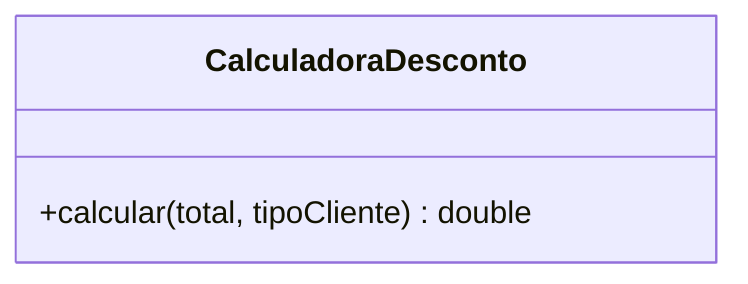

**O que mostrar na tela.** Uma classe com um método cheio de ramos. A nota no diagrama diz onde mexer para ESTUDANTE.

<details><summary>Código: <code>exemplos/solid/O-aberto-fechado/ruim/Main.java</code></summary>

```java
import java.util.Locale;

/**
 * O ruim: cada novo tipo de desconto obriga a editar o método existente.
 * O if/else cresce, e cada teste antigo precisa ser refeito.
 */
public class Main {

    static final class CalculadoraDesconto {
        double calcular(double total, String tipoCliente) {
            if (tipoCliente.equals("VIP")) {
                return total * 0.80;
            } else if (tipoCliente.equals("FUNCIONARIO")) {
                return total * 0.70;
            } else if (tipoCliente.equals("NORMAL")) {
                return total;
            }
            // para incluir ESTUDANTE, é preciso abrir esta classe e mudar a lógica
            throw new IllegalArgumentException("tipo desconhecido: " + tipoCliente);
        }
    }

    public static void main(String[] args) {
        Locale.setDefault(Locale.ROOT);
        CalculadoraDesconto calc = new CalculadoraDesconto();
        System.out.printf("VIP: %.2f%n", calc.calcular(200, "VIP"));
        System.out.printf("FUNCIONARIO: %.2f%n", calc.calcular(200, "FUNCIONARIO"));
        System.out.printf("NORMAL: %.2f%n", calc.calcular(200, "NORMAL"));
        try {
            calc.calcular(200, "ESTUDANTE");
        } catch (IllegalArgumentException e) {
            System.out.println("erro: " + e.getMessage());
        }
    }
}
```

</details>

Saída real:

```text
VIP: 160.00
FUNCIONARIO: 140.00
NORMAL: 200.00
erro: tipo desconhecido: ESTUDANTE
```

### Versão boa (como deveria ser)

**Diagrama de classes**

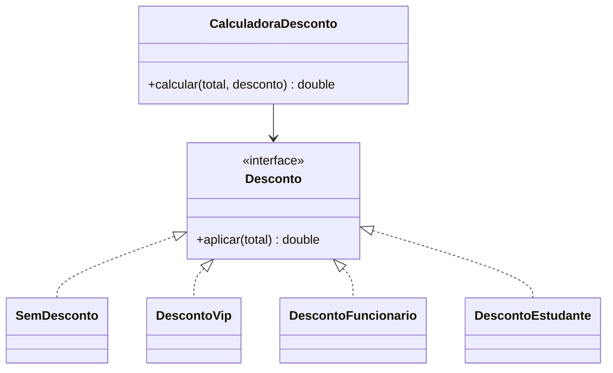

**O que mostrar na tela.** Uma interface Desconto e uma classe por regra. A calculadora depende só da interface. Novo desconto é nova classe.

<details><summary>Código: <code>exemplos/solid/O-aberto-fechado/bom/Main.java</code></summary>

```java
import java.util.Locale;

/**
 * O bom: a calculadora é fechada para mudança e aberta para extensão.
 * Um novo desconto é uma nova classe que implementa a interface; nenhuma linha antiga muda.
 */
public class Main {

    interface Desconto {
        double aplicar(double total);
    }

    static final class SemDesconto implements Desconto {
        public double aplicar(double total) { return total; }
    }

    static final class DescontoVip implements Desconto {
        public double aplicar(double total) { return total * 0.80; }
    }

    static final class DescontoFuncionario implements Desconto {
        public double aplicar(double total) { return total * 0.70; }
    }

    // Adicionado depois, sem tocar nas classes acima
    static final class DescontoEstudante implements Desconto {
        public double aplicar(double total) { return total * 0.85; }
    }

    static final class CalculadoraDesconto {
        double calcular(double total, Desconto desconto) {
            return desconto.aplicar(total);
        }
    }

    public static void main(String[] args) {
        Locale.setDefault(Locale.ROOT);
        CalculadoraDesconto calc = new CalculadoraDesconto();
        System.out.printf("VIP: %.2f%n", calc.calcular(200, new DescontoVip()));
        System.out.printf("FUNCIONARIO: %.2f%n", calc.calcular(200, new DescontoFuncionario()));
        System.out.printf("NORMAL: %.2f%n", calc.calcular(200, new SemDesconto()));
        System.out.printf("ESTUDANTE: %.2f%n", calc.calcular(200, new DescontoEstudante()));
    }
}
```

</details>

Saída real:

```text
VIP: 160.00
FUNCIONARIO: 140.00
NORMAL: 200.00
ESTUDANTE: 170.00
```

**Exercício para a turma.** Crie DescontoBlackFriday (30%) na versão boa. Liste as classes existentes que você precisou alterar: resposta esperada, nenhuma.

### Exercício rápido: O no streaming

**Contexto.** A assinatura tem preço por plano. O método de preço é um switch que cresce a cada plano novo, e o plano UNIVERSITARIO ainda não existe.

**Diagrama de classes (ruim)**

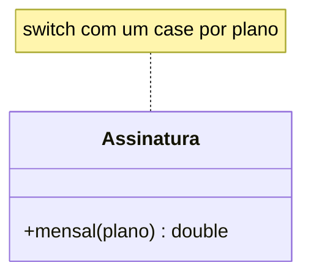

<details><summary>Código: versão ruim</summary>

```java
import java.util.List;
import java.util.Locale;

/**
 * O ruim: o preço da assinatura é um switch que cresce a cada plano novo.
 * Incluir um plano obriga a abrir e retestar o método existente.
 */
public class Main {

    static final class Assinatura {
        double mensal(String plano) {
            switch (plano) {
                case "BASICO": return 19.90;
                case "PADRAO": return 29.90;
                case "PREMIUM": return 39.90;
                // para incluir UNIVERSITARIO, é preciso editar este switch
                default: throw new IllegalArgumentException("plano desconhecido: " + plano);
            }
        }
    }

    public static void main(String[] args) {
        Locale.setDefault(Locale.ROOT);
        Assinatura assinatura = new Assinatura();
        for (String plano : List.of("BASICO", "PADRAO", "PREMIUM")) {
            System.out.printf("%s: R$ %.2f%n", plano, assinatura.mensal(plano));
        }
        try {
            assinatura.mensal("UNIVERSITARIO");
        } catch (IllegalArgumentException e) {
            System.out.println("erro: " + e.getMessage());
        }
    }
}
```

</details>

Saída real:

```text
BASICO: R$ 19.90
PADRAO: R$ 29.90
PREMIUM: R$ 39.90
erro: plano desconhecido: UNIVERSITARIO
```

**Correção.** Cada plano vira uma classe que implementa Plano. O preço é responsabilidade do próprio plano.

**Diagrama de classes (correção)**

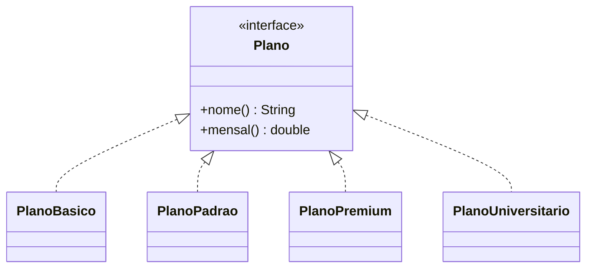

<details><summary>Código: versão corrigida</summary>

```java
import java.util.Locale;

/**
 * O bom: cada plano é uma classe que implementa Plano.
 * Um plano novo entra por extensão; nenhuma classe antiga é editada.
 */
public class Main {

    interface Plano {
        String nome();
        double mensal();
    }

    static final class PlanoBasico implements Plano {
        public String nome() { return "BASICO"; }
        public double mensal() { return 19.90; }
    }

    static final class PlanoPadrao implements Plano {
        public String nome() { return "PADRAO"; }
        public double mensal() { return 29.90; }
    }

    static final class PlanoPremium implements Plano {
        public String nome() { return "PREMIUM"; }
        public double mensal() { return 39.90; }
    }

    // Adicionado depois, sem tocar nas classes acima
    static final class PlanoUniversitario implements Plano {
        public String nome() { return "UNIVERSITARIO"; }
        public double mensal() { return 14.90; }
    }

    static void mostrar(Plano plano) {
        System.out.printf("%s: R$ %.2f%n", plano.nome(), plano.mensal());
    }

    public static void main(String[] args) {
        Locale.setDefault(Locale.ROOT);
        mostrar(new PlanoBasico());
        mostrar(new PlanoPadrao());
        mostrar(new PlanoPremium());
        mostrar(new PlanoUniversitario());
    }
}
```

</details>

Saída real:

```text
BASICO: R$ 19.90
PADRAO: R$ 29.90
PREMIUM: R$ 39.90
UNIVERSITARIO: R$ 14.90
```

**O que mudou.** Na versão ruim, o plano novo exigiu editar o switch. Na versão boa, UNIVERSITARIO entrou como classe nova, e nenhuma classe antiga foi editada.

---


## L · Substituição de Liskov

**Conceito.** Um subtipo deve poder ocupar o lugar do tipo base sem quebrar o programa.

**Por que existe.** Herança que sobrescreve setters viola o contrato do tipo base. Quem usa Retangulo espera lados independentes.

### Versão ruim (jeito errado)

**Diagrama de classes**

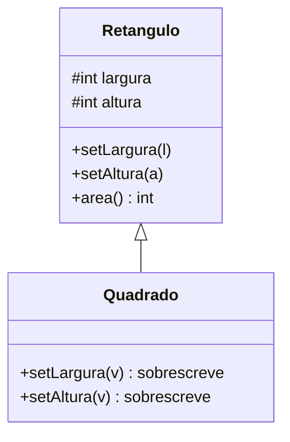

**O que mostrar na tela.** A seta de herança e o método sobrescrito. Rode o programa e mostre a linha FALHOU: o erro não lança exceção.

<details><summary>Código: <code>exemplos/solid/L-liskov/ruim/Main.java</code></summary>

```java
import java.util.Locale;

/**
 * L ruim: Quadrado herda de Retangulo e quebra o contrato de setLargura/setAltura.
 * Código que usa Retangulo espera que largura e altura mudem de forma independente.
 */
public class Main {

    static class Retangulo {
        protected int largura;
        protected int altura;

        void setLargura(int largura) { this.largura = largura; }
        void setAltura(int altura) { this.altura = altura; }
        int area() { return largura * altura; }
    }

    static final class Quadrado extends Retangulo {
        @Override void setLargura(int valor) { largura = valor; altura = valor; }
        @Override void setAltura(int valor) { largura = valor; altura = valor; }
    }

    static void testarArea(Retangulo r) {
        r.setLargura(5);
        r.setAltura(4);
        int esperado = 20;
        System.out.println("esperado " + esperado + ", obtido " + r.area()
                + (r.area() == esperado ? " (ok)" : " (FALHOU)"));
    }

    public static void main(String[] args) {
        Locale.setDefault(Locale.ROOT);
        testarArea(new Retangulo());
        testarArea(new Quadrado());
    }
}
```

</details>

Saída real:

```text
esperado 20, obtido 20 (ok)
esperado 20, obtido 16 (FALHOU)
```

### Versão boa (como deveria ser)

**Diagrama de classes**

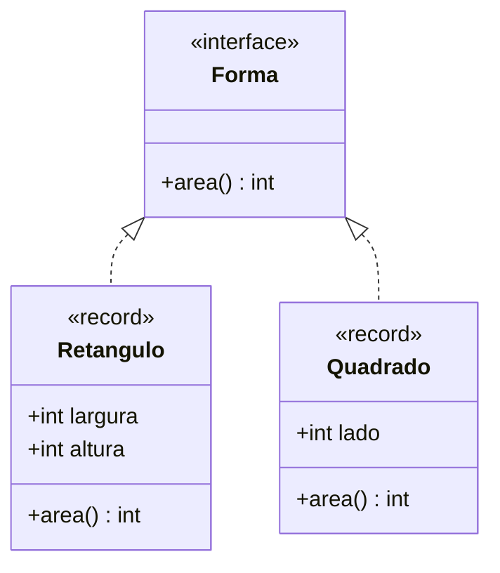

**O que mostrar na tela.** Forma é contrato, e os dois records são irmãos. Não há setter, então não há como quebrar a área.

<details><summary>Código: <code>exemplos/solid/L-liskov/bom/Main.java</code></summary>

```java
import java.util.Locale;

/**
 * L bom: a forma é um contrato comum (área), sem herança que quebre o comportamento.
 * Retangulo e Quadrado são implementações independentes, e o teste de área vale para os dois.
 */
public class Main {

    interface Forma {
        int area();
    }

    // imutável: não há setters, então nenhuma substituição pode quebrar o contrato
    record Retangulo(int largura, int altura) implements Forma {
        public int area() { return largura * altura; }
    }

    record Quadrado(int lado) implements Forma {
        public int area() { return lado * lado; }
    }

    static void testarArea(String nome, Forma forma, int esperado) {
        System.out.println(nome + ": esperado " + esperado + ", obtido " + forma.area()
                + (forma.area() == esperado ? " (ok)" : " (FALHOU)"));
    }

    public static void main(String[] args) {
        Locale.setDefault(Locale.ROOT);
        testarArea("retangulo 5x4", new Retangulo(5, 4), 20);
        testarArea("quadrado 4", new Quadrado(4), 16);
    }
}
```

</details>

Saída real:

```text
retangulo 5x4: esperado 20, obtido 20 (ok)
quadrado 4: esperado 16, obtido 16 (ok)
```

**Exercício para a turma.** Crie um Triangulo que implemente Forma. Escreva um teste de contrato que qualquer Forma deva passar.

### Exercício rápido: L no streaming

**Contexto.** A fila de reprodução pula cada item com pular(). Anúncio herda de Musica, mas não pode ser pulado, então quebra a promessa da classe base.

**Diagrama de classes (ruim)**

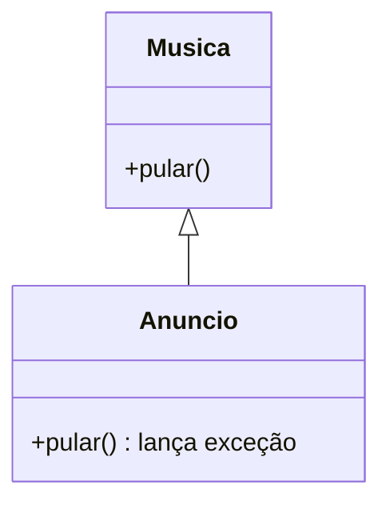

<details><summary>Código: versão ruim</summary>

```java
import java.util.List;
import java.util.Locale;

/**
 * L ruim: Anuncio herda de Musica e sobrescreve pular para lançar exceção.
 * Quem recebe uma Musica espera poder pulá-la; o erro só aparece em execução.
 */
public class Main {

    static class Musica {
        final String titulo;
        Musica(String titulo) { this.titulo = titulo; }
        void pular() { System.out.println("pulou " + titulo); }
    }

    static final class Anuncio extends Musica {
        Anuncio(String titulo) { super(titulo); }

        @Override
        void pular() { throw new UnsupportedOperationException("anúncio não pode ser pulado"); }
    }

    // cliente: pula cada item da fila
    static void pularFila(List<Musica> fila) {
        for (Musica m : fila) {
            m.pular();
        }
    }

    public static void main(String[] args) {
        Locale.setDefault(Locale.ROOT);
        pularFila(List.of(new Musica("Aquarela"), new Musica("Garota")));
        try {
            pularFila(List.of(new Musica("Samba"), new Anuncio("Promo X")));
        } catch (UnsupportedOperationException e) {
            System.out.println("erro: " + e.getMessage());
        }
    }
}
```

</details>

Saída real:

```text
pulou Aquarela
pulou Garota
pulou Samba
erro: anúncio não pode ser pulado
```

**Correção.** Anúncio deixa de herdar de Musica e implementa só o contrato comum Faixa. Só quem pode ser pulado implementa Pulavel, e a fila de pulo aceita apenas esse tipo.

**Diagrama de classes (correção)**

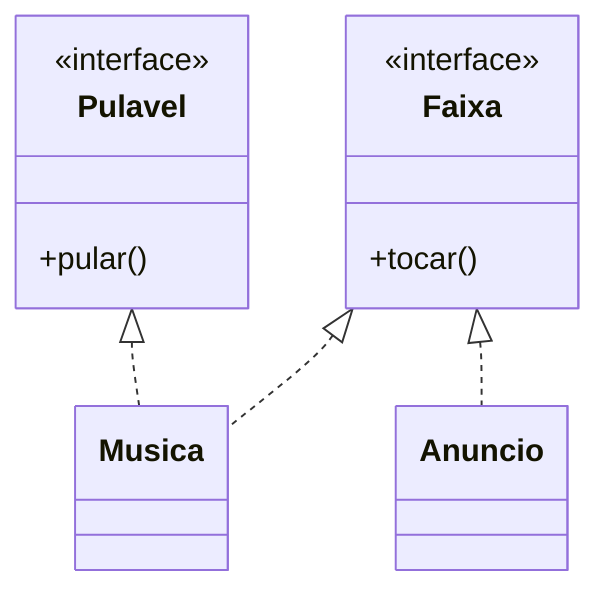

<details><summary>Código: versão corrigida</summary>

```java
import java.util.List;
import java.util.Locale;

/**
 * L bom: Musica e Anuncio são faixas independentes, ambas tocam.
 * Só Musica pode ser pulada, e a fila de pulo aceita só o que de fato pula.
 */
public class Main {

    // contrato comum: toda faixa toca
    interface Faixa {
        void tocar();
    }

    // capacidade extra: só música pode ser pulada
    interface Pulavel {
        void pular();
    }

    static final class Musica implements Faixa, Pulavel {
        private final String titulo;
        Musica(String titulo) { this.titulo = titulo; }
        public void tocar() { System.out.println("tocando " + titulo); }
        public void pular() { System.out.println("pulou " + titulo); }
    }

    static final class Anuncio implements Faixa {
        private final String titulo;
        Anuncio(String titulo) { this.titulo = titulo; }
        public void tocar() { System.out.println("tocando anúncio " + titulo); }
    }

    static void tocarFila(List<Faixa> fila) {
        for (Faixa f : fila) {
            f.tocar();
        }
    }

    static void pularFila(List<Pulavel> fila) {
        for (Pulavel p : fila) {
            p.pular();
        }
    }

    public static void main(String[] args) {
        Locale.setDefault(Locale.ROOT);
        tocarFila(List.of(new Musica("Aquarela"), new Anuncio("Promo X")));
        pularFila(List.of(new Musica("Samba"), new Musica("Garota")));
        // pularFila(List.of(new Anuncio("Promo X"))); // não compila: anúncio não é Pulavel
    }
}
```

</details>

Saída real:

```text
tocando Aquarela
tocando anúncio Promo X
pulou Samba
pulou Garota
```

**O que mudou.** Passar um anúncio para a fila de pulo virou erro de compilação, e não surpresa em execução. O anúncio continua tocando normalmente.

---


## I · Segregação de interfaces

**Conceito.** Nenhum cliente deve depender de métodos que não usa.

**Por que existe.** Uma interface gorda obriga implementações simples a lançar exceção, e o erro só aparece em execução.

### Versão ruim (jeito errado)

**Diagrama de classes**

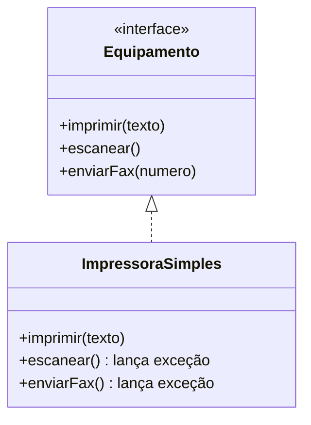

**O que mostrar na tela.** Uma interface com três métodos e uma classe que lança exceção em dois deles.

<details><summary>Código: <code>exemplos/solid/I-segregacao/ruim/Main.java</code></summary>

```java
import java.util.Locale;

/**
 * I ruim: uma interface gorda obriga a implementação a ter métodos que ela não usa.
 * ImpressoraSimples precisa "implementar" escanear e fax, e lança exceção.
 */
public class Main {

    interface Equipamento {
        void imprimir(String texto);
        void escanear();
        void enviarFax(String numero);
    }

    static final class ImpressoraSimples implements Equipamento {
        public void imprimir(String texto) { System.out.println("imprimindo: " + texto); }
        public void escanear() { throw new UnsupportedOperationException("não escaneia"); }
        public void enviarFax(String numero) { throw new UnsupportedOperationException("não envia fax"); }
    }

    public static void main(String[] args) {
        Locale.setDefault(Locale.ROOT);
        Equipamento eq = new ImpressoraSimples();
        eq.imprimir("relatório de vendas");
        try {
            eq.escanear();
        } catch (UnsupportedOperationException e) {
            System.out.println("erro em tempo de execução: " + e.getMessage());
        }
    }
}
```

</details>

Saída real:

```text
imprimindo: relatório de vendas
erro em tempo de execução: não escaneia
```

### Versão boa (como deveria ser)

**Diagrama de classes**

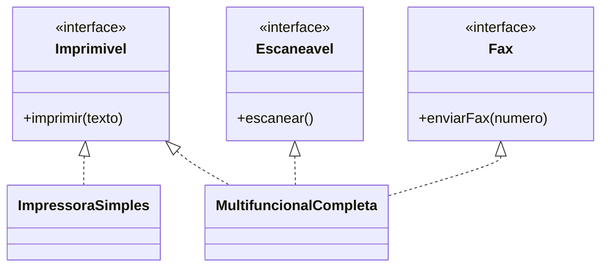

**O que mostrar na tela.** Três interfaces pequenas. ImpressoraSimples implementa uma, MultifuncionalCompleta implementa três.

<details><summary>Código: <code>exemplos/solid/I-segregacao/bom/Main.java</code></summary>

```java
import java.util.Locale;

/**
 * I bom: interfaces pequenas, uma por capacidade.
 * Cada classe implementa só o que de fato faz; quem precisa de escanear depende só de Escaneavel.
 */
public class Main {

    interface Imprimivel { void imprimir(String texto); }
    interface Escaneavel { void escanear(); }
    interface Fax { void enviarFax(String numero); }

    static final class ImpressoraSimples implements Imprimivel {
        public void imprimir(String texto) { System.out.println("imprimindo: " + texto); }
    }

    static final class MultifuncionalCompleta implements Imprimivel, Escaneavel, Fax {
        public void imprimir(String texto) { System.out.println("imprimindo: " + texto); }
        public void escanear() { System.out.println("escaneando documento"); }
        public void enviarFax(String numero) { System.out.println("enviando fax para " + numero); }
    }

    // depende só do que usa: não precisa saber que existe fax
    static void digitalizar(Escaneavel equipamento) {
        equipamento.escanear();
    }

    public static void main(String[] args) {
        Locale.setDefault(Locale.ROOT);
        new ImpressoraSimples().imprimir("relatório de vendas");
        MultifuncionalCompleta mf = new MultifuncionalCompleta();
        digitalizar(mf);
        mf.enviarFax("1199999-0000");
    }
}
```

</details>

Saída real:

```text
imprimindo: relatório de vendas
escaneando documento
enviando fax para 1199999-0000
```

**Exercício para a turma.** Crie uma impressora duplex (frente e verso). Ela precisa implementar Escaneavel? Justifique com o princípio.

### Exercício rápido: I no streaming

**Contexto.** A interface Reprodutor exige tocar, pausar e baixarOffline. Uma rádio online não baixa músicas, mas é obrigada a implementar o método.

**Diagrama de classes (ruim)**

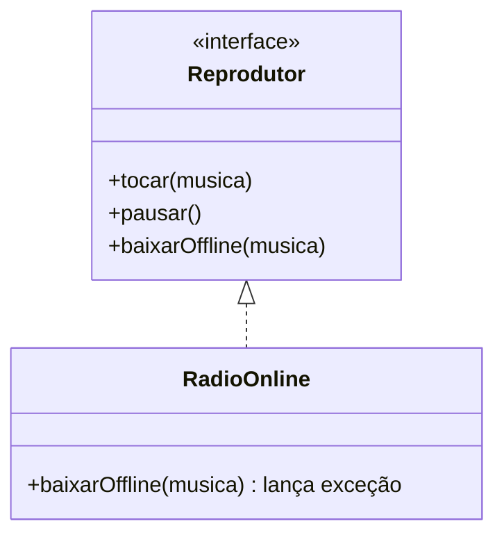

<details><summary>Código: versão ruim</summary>

```java
import java.util.Locale;

/**
 * I ruim: a interface Reprodutor obriga toda implementação a baixar músicas.
 * RadioOnline não baixa nada, e lança exceção no método que não faz sentido para ela.
 */
public class Main {

    interface Reprodutor {
        void tocar(String musica);
        void pausar();
        void baixarOffline(String musica);
    }

    static final class RadioOnline implements Reprodutor {
        public void tocar(String musica) { System.out.println("rádio tocando " + musica); }
        public void pausar() { System.out.println("rádio pausada"); }
        public void baixarOffline(String musica) { throw new UnsupportedOperationException("rádio não baixa músicas"); }
    }

    public static void main(String[] args) {
        Locale.setDefault(Locale.ROOT);
        Reprodutor radio = new RadioOnline();
        radio.tocar("Garota");
        try {
            radio.baixarOffline("Garota");
        } catch (UnsupportedOperationException e) {
            System.out.println("erro em tempo de execução: " + e.getMessage());
        }
    }
}
```

</details>

Saída real:

```text
rádio tocando Garota
erro em tempo de execução: rádio não baixa músicas
```

**Correção.** A interface grande é dividida em Tocavel e Baixavel. A rádio implementa só Tocavel; o player premium implementa as duas.

**Diagrama de classes (correção)**

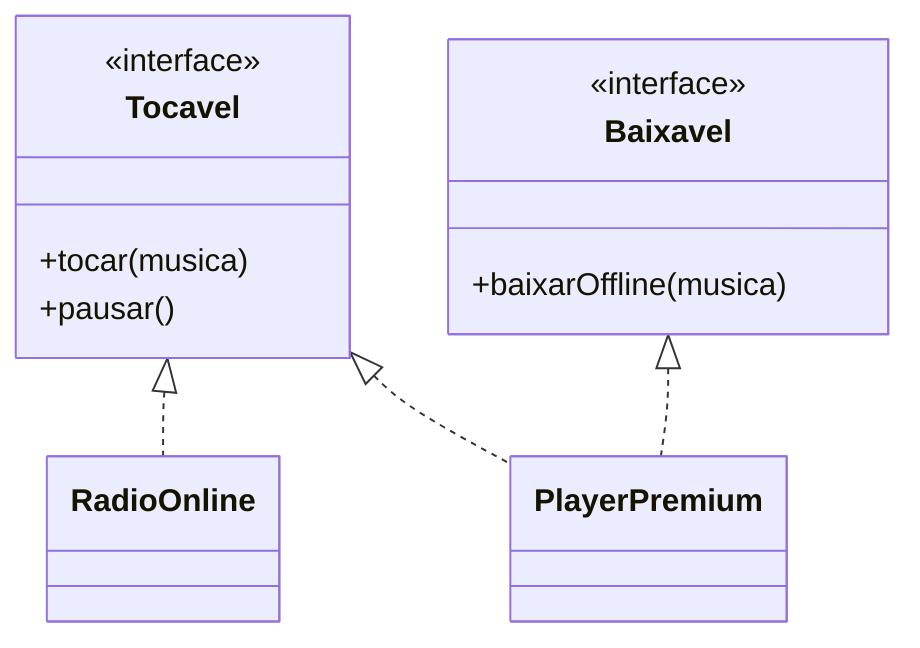

<details><summary>Código: versão corrigida</summary>

```java
import java.util.Locale;

/**
 * I bom: interfaces pequenas, uma por capacidade.
 * RadioOnline implementa só Tocavel; quem precisa baixar depende só de Baixavel.
 */
public class Main {

    interface Tocavel {
        void tocar(String musica);
        void pausar();
    }

    interface Baixavel {
        void baixarOffline(String musica);
    }

    static final class RadioOnline implements Tocavel {
        public void tocar(String musica) { System.out.println("rádio tocando " + musica); }
        public void pausar() { System.out.println("rádio pausada"); }
    }

    static final class PlayerPremium implements Tocavel, Baixavel {
        public void tocar(String musica) { System.out.println("tocando " + musica); }
        public void pausar() { System.out.println("pausado"); }
        public void baixarOffline(String musica) { System.out.println("baixado para ouvir offline: " + musica); }
    }

    // depende só do que usa: não precisa saber que existe tocar
    static void prepararViagem(Baixavel reprodutor, String musica) {
        reprodutor.baixarOffline(musica);
    }

    public static void main(String[] args) {
        Locale.setDefault(Locale.ROOT);
        new RadioOnline().tocar("Garota");
        PlayerPremium premium = new PlayerPremium();
        premium.tocar("Samba");
        prepararViagem(premium, "Samba");
    }
}
```

</details>

Saída real:

```text
rádio tocando Garota
tocando Samba
baixado para ouvir offline: Samba
```

**O que mudou.** A rádio não tem mais método que lança exceção. Quem precisa baixar depende só de Baixavel, e a saída do que toca não mudou.

---


## D · Inversão de dependência

**Conceito.** Módulos de alto nível não devem depender de baixo nível; ambos dependem de abstrações.

**Por que existe.** Sem isso, a regra de negócio fica presa ao banco e ao e-mail, e não dá para testar. Fowler (2004) chama de injeção de dependência.

### Versão ruim (jeito errado)

**Diagrama de classes**

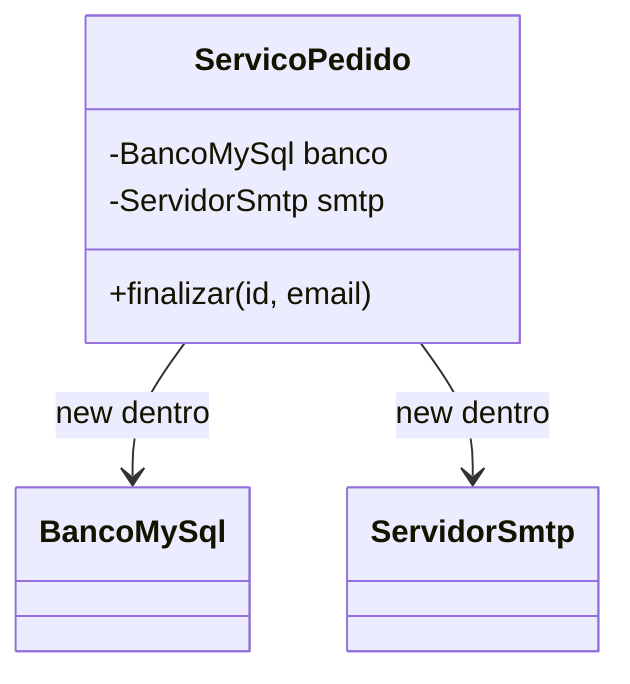

**O que mostrar na tela.** O serviço cria as próprias dependências com new. Não há como trocar nem testar sem servidor.

<details><summary>Código: <code>exemplos/solid/D-inversao/ruim/Main.java</code></summary>

```java
import java.util.ArrayList;
import java.util.List;
import java.util.Locale;

/**
 * D ruim: ServicoPedido cria o banco e o e-mail por conta própria (new).
 * Não dá para testar sem banco real e sem enviar e-mail de verdade.
 */
public class Main {

    static final class BancoMySql {
        private final List<String> tabela = new ArrayList<>();
        void inserir(String pedido) {
            tabela.add(pedido);
            System.out.println("INSERT INTO pedidos (dados) VALUES ('" + pedido + "') -- servidor MySQL");
        }
    }

    static final class ServidorSmtp {
        void enviar(String para, String texto) {
            System.out.println("SMTP -> " + para + ": " + texto);
        }
    }

    static final class ServicoPedido {
        // dependências concretas, criadas aqui dentro
        private final BancoMySql banco = new BancoMySql();
        private final ServidorSmtp smtp = new ServidorSmtp();

        void finalizar(String id, String email) {
            banco.inserir(id);
            smtp.enviar(email, "pedido " + id + " confirmado");
        }
    }

    public static void main(String[] args) {
        Locale.setDefault(Locale.ROOT);
        new ServicoPedido().finalizar("P-1001", "ana@exemplo.com");
    }
}
```

</details>

Saída real:

```text
INSERT INTO pedidos (dados) VALUES ('P-1001') -- servidor MySQL
SMTP -> ana@exemplo.com: pedido P-1001 confirmado
```

### Versão boa (como deveria ser)

**Diagrama de classes**

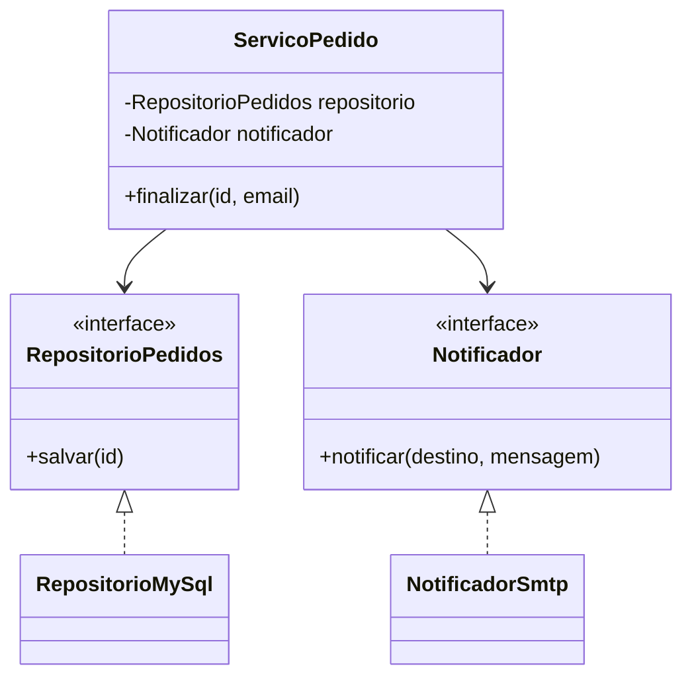

**O que mostrar na tela.** O serviço recebe as abstrações pelo construtor. O main escolhe a implementação. O teste usa versões em memória.

<details><summary>Código: <code>exemplos/solid/D-inversao/bom/Main.java</code></summary>

```java
import java.util.ArrayList;
import java.util.List;
import java.util.Locale;

/**
 * D bom: ServicoPedido depende de abstrações (RepositorioPedidos, Notificador).
 * Quem monta o objeto decide a implementação: produção usa MySQL e SMTP; o teste usa versões falsas.
 */
public class Main {

    // abstrações de alto nível
    interface RepositorioPedidos { void salvar(String id); }
    interface Notificador { void notificar(String destino, String mensagem); }

    // detalhes de baixo nível: produção
    static final class RepositorioMySql implements RepositorioPedidos {
        public void salvar(String id) { System.out.println("MySQL: pedido " + id + " gravado"); }
    }

    static final class NotificadorSmtp implements Notificador {
        public void notificar(String destino, String mensagem) {
            System.out.println("SMTP -> " + destino + ": " + mensagem);
        }
    }

    // detalhe para teste: não toca em rede nem em disco
    static final class RepositorioEmMemoria implements RepositorioPedidos {
        final List<String> gravados = new ArrayList<>();
        public void salvar(String id) { gravados.add(id); }
    }

    static final class NotificadorFalso implements Notificador {
        public void notificar(String destino, String mensagem) {
            System.out.println("(teste) notificação para " + destino + ": " + mensagem);
        }
    }

    static final class ServicoPedido {
        private final RepositorioPedidos repositorio;
        private final Notificador notificador;

        // dependências chegam pelo construtor (injeção de dependência)
        ServicoPedido(RepositorioPedidos repositorio, Notificador notificador) {
            this.repositorio = repositorio;
            this.notificador = notificador;
        }

        void finalizar(String id, String email) {
            repositorio.salvar(id);
            notificador.notificar(email, "pedido " + id + " confirmado");
        }
    }

    public static void main(String[] args) {
        Locale.setDefault(Locale.ROOT);
        System.out.println("== produção");
        new ServicoPedido(new RepositorioMySql(), new NotificadorSmtp()).finalizar("P-1001", "ana@exemplo.com");

        System.out.println("== teste");
        RepositorioEmMemoria memoria = new RepositorioEmMemoria();
        new ServicoPedido(memoria, new NotificadorFalso()).finalizar("P-T1", "teste@exemplo.com");
        System.out.println("gravados em memória: " + memoria.gravados);
    }
}
```

</details>

Saída real:

```text
== produção
MySQL: pedido P-1001 gravado
SMTP -> ana@exemplo.com: pedido P-1001 confirmado
== teste
(teste) notificação para teste@exemplo.com: pedido P-T1 confirmado
gravados em memória: [P-T1]
```

**Exercício para a turma.** Crie RepositorioArquivo (grava em texto) e rode o serviço com ele. Quantas linhas mudam em ServicoPedido?

### Exercício rápido: D no streaming

**Contexto.** ReprodutorMusica cria por conta própria o servidor S3 que entrega o áudio. Para testar sem rede, seria preciso editar a classe do reprodutor.

**Diagrama de classes (ruim)**

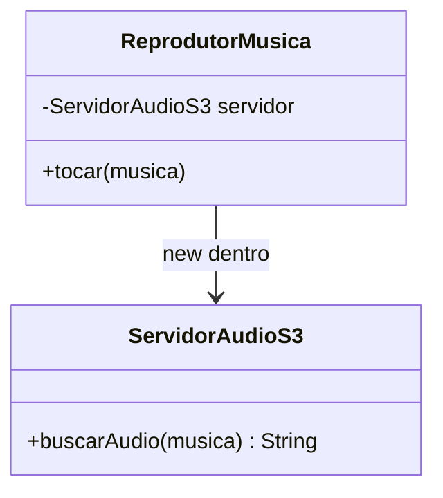

<details><summary>Código: versão ruim</summary>

```java
import java.util.Locale;

/**
 * D ruim: ReprodutorMusica cria o servidor de áudio por conta própria (new).
 * Para testar sem rede, seria preciso editar a classe do reprodutor.
 */
public class Main {

    static final class ServidorAudioS3 {
        String buscarAudio(String musica) {
            System.out.println("S3: buscando " + musica);
            return "audio-" + musica;
        }
    }

    static final class ReprodutorMusica {
        // dependência concreta, criada aqui dentro
        private final ServidorAudioS3 servidor = new ServidorAudioS3();

        void tocar(String musica) {
            String audio = servidor.buscarAudio(musica);
            System.out.println("tocando " + audio);
        }
    }

    public static void main(String[] args) {
        Locale.setDefault(Locale.ROOT);
        new ReprodutorMusica().tocar("Garota");
    }
}
```

</details>

Saída real:

```text
S3: buscando Garota
tocando audio-Garota
```

**Correção.** O reprodutor passa a depender de FonteAudio, e quem monta o objeto escolhe a fonte. Em produção entra o S3; no teste, a versão em memória.

**Diagrama de classes (correção)**

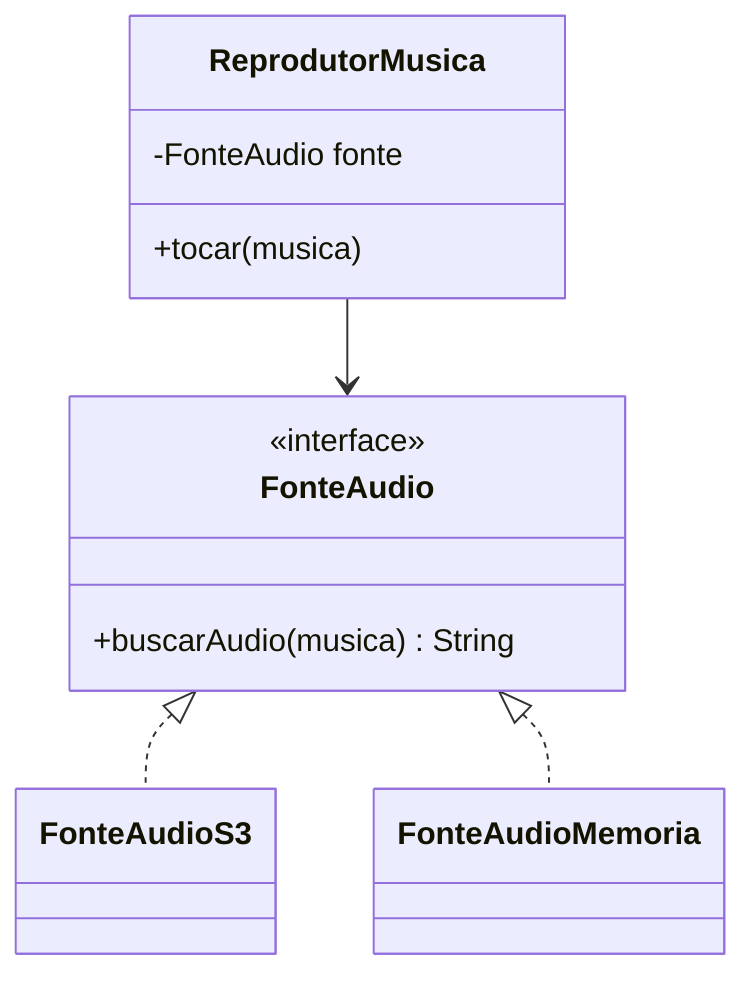

<details><summary>Código: versão corrigida</summary>

```java
import java.util.Locale;

/**
 * D bom: ReprodutorMusica depende da abstração FonteAudio.
 * Quem monta o objeto escolhe a fonte: produção usa S3; o teste usa uma versão em memória.
 */
public class Main {

    interface FonteAudio {
        String buscarAudio(String musica);
    }

    static final class FonteAudioS3 implements FonteAudio {
        public String buscarAudio(String musica) {
            System.out.println("S3: buscando " + musica);
            return "audio-" + musica;
        }
    }

    // detalhe para teste: não toca em rede
    static final class FonteAudioMemoria implements FonteAudio {
        public String buscarAudio(String musica) { return "audio-em-memoria-" + musica; }
    }

    static final class ReprodutorMusica {
        private final FonteAudio fonte;

        // dependência chega pelo construtor
        ReprodutorMusica(FonteAudio fonte) { this.fonte = fonte; }

        void tocar(String musica) {
            String audio = fonte.buscarAudio(musica);
            System.out.println("tocando " + audio);
        }
    }

    public static void main(String[] args) {
        Locale.setDefault(Locale.ROOT);
        System.out.println("== produção");
        new ReprodutorMusica(new FonteAudioS3()).tocar("Garota");
        System.out.println("== teste");
        new ReprodutorMusica(new FonteAudioMemoria()).tocar("Garota");
    }
}
```

</details>

Saída real:

```text
== produção
S3: buscando Garota
tocando audio-Garota
== teste
tocando audio-em-memoria-Garota
```

**O que mudou.** O reprodutor não tem new de servidor. Trocar a fonte de áudio é uma linha no ponto de montagem, e o teste roda sem rede.

---

## Exercício prático de 30 minutos: o Melodia

**Enunciado.** O Melodia começa como um arquivo só. Ele toca músicas, aplica o limite de cada plano, grava o histórico e calcula royalties. Corrija o código para que cumpra S, O, L, I e D, um princípio por vez, sem mudar a reprodução. Ao final, a saída do player deve ser a mesma; a diferença esperada está no histórico e na playlist pública.

**Tempo.** Cinco minutos por princípio, e cinco para verificar a saída.

| Passo | Letra | Tempo | Tarefa | Critério de pronto |
|---|---|---|---|---|
| 1 | S | 5 min | Separe o que toca, o que grava histórico e o que calcula royalties. | O método `tocar` não decide sozinho a regra do plano. |
| 2 | O | 5 min | Acrescente o plano FAMILIA sem editar o código de FREE e PREMIUM. | Nenhum `if` novo dentro do player. |
| 3 | L | 5 min | A playlist pública não pode lançar exceção no `adicionar`. | Quem usa a playlist pública nunca recebe surpresa. |
| 4 | I | 5 min | Separe a interface `Biblioteca` em consulta e edição. | Nenhuma classe implementa método que não usa. |
| 5 | D | 5 min | O player recebe o histórico pelo construtor, e o teste usa a versão em memória. | O player não tem `new` de histórico. |
| - | - | 5 min | Rode as duas versões e compare a saída. | As linhas de reprodução e de royalties são iguais. |

### Desenho ruim (ponto de partida)

```mermaid
classDiagram
    class Player {
        +tocar(usuario, musica)
    }
    class HistoricoArquivo {
        +registrar(linha)
    }
    class Biblioteca {
        <<interface>>
        +musicas()
        +adicionar(musica)
    }
    class Playlist
    class PlaylistPublica {
        +adicionar(musica) lança exceção
    }
    Player --> HistoricoArquivo : new dentro
    Biblioteca <|.. Playlist
    Biblioteca <|.. PlaylistPublica
```

<details><summary>Código inicial: <code>exemplos/solid/exercicio-streaming/inicial/Main.java</code></summary>

```java
import java.util.ArrayList;
import java.util.List;
import java.util.Locale;

/**
 * Exercício de SOLID, versão inicial (ruim). Escopo: streaming de música (Melodia).
 * Tarefa: corrigir S, O, L, I e D, um de cada vez, sem mudar a saída.
 */
public class Main {

    static class Musica {
        final String titulo;
        final int segundos;
        Musica(String titulo, int segundos) { this.titulo = titulo; this.segundos = segundos; }
    }

    static class Usuario {
        final String nome;
        final String plano;   // "FREE", "PREMIUM" ou "FAMILIA"
        Usuario(String nome, String plano) { this.nome = nome; this.plano = plano; }
    }

    static class HistoricoArquivo {
        void registrar(String linha) { System.out.println("gravando em historico.txt: " + linha); }
    }

    // S: este método faz tudo. O: um plano novo exige editar os ifs.
    static class Player {
        private final HistoricoArquivo historico = new HistoricoArquivo();   // D: dependência fixa

        void tocar(Usuario u, Musica m) {
            int segundos = m.segundos;
            if (u.plano.equals("FREE") && segundos > 30) {
                segundos = 30;
                System.out.println("[" + u.nome + "] limite do plano: 30 s de " + m.titulo);
            }
            System.out.println("tocando " + m.titulo + " para " + u.nome);
            historico.registrar(u.nome + ": " + m.titulo);
            double royalties;
            if (u.plano.equals("PREMIUM") || u.plano.equals("FAMILIA")) {
                royalties = segundos * 0.002;
            } else {
                royalties = segundos * 0.001;
            }
            System.out.printf("royalties: R$ %.3f%n", royalties);
        }
    }

    // I: interface gorda, com um método que nem toda classe pode cumprir
    interface Biblioteca {
        List<Musica> musicas();
        void adicionar(Musica m);
    }

    static class Playlist implements Biblioteca {
        private final List<Musica> musicas = new ArrayList<>();
        public List<Musica> musicas() { return musicas; }
        public void adicionar(Musica m) { musicas.add(m); }
    }

    // I e L: não aceita adicionar; quem usa Biblioteca espera que adicionar funcione
    static class PlaylistPublica implements Biblioteca {
        private final List<Musica> musicas;
        PlaylistPublica(List<Musica> musicas) { this.musicas = musicas; }
        public List<Musica> musicas() { return musicas; }
        public void adicionar(Musica m) {
            throw new UnsupportedOperationException("playlist pública é só leitura");
        }
    }

    public static void main(String[] args) {
        Locale.setDefault(Locale.ROOT);
        Player player = new Player();
        player.tocar(new Usuario("Ana", "FREE"), new Musica("Aquarela", 200));
        player.tocar(new Usuario("Bruno", "PREMIUM"), new Musica("Garota", 180));
        player.tocar(new Usuario("Carla", "FAMILIA"), new Musica("Samba", 240));

        Biblioteca publica = new PlaylistPublica(new ArrayList<>(List.of(new Musica("Garota", 180))));
        try {
            publica.adicionar(new Musica("Samba", 240));
        } catch (UnsupportedOperationException e) {
            System.out.println("erro: " + e.getMessage());
        }
        System.out.println("playlist pública tem " + publica.musicas().size() + " música(s)");
    }
}
```

</details>

Saída real da versão inicial:

```text
[Ana] limite do plano: 30 s de Aquarela
tocando Aquarela para Ana
gravando em historico.txt: Ana: Aquarela
royalties: R$ 0.030
tocando Garota para Bruno
gravando em historico.txt: Bruno: Garota
royalties: R$ 0.360
tocando Samba para Carla
gravando em historico.txt: Carla: Samba
royalties: R$ 0.480
erro: playlist pública é só leitura
playlist pública tem 1 música(s)
```

### Solução: o que muda em cada letra

- **S.** `Player` apenas coordena. A regra de limite e de royalty foi para os planos, e o histórico para uma abstração.
- **O.** Cada plano é uma classe nova que implementa `Plano`. Acrescentar FAMILIA não exige editar Free nem Premium.
- **L.** `PlaylistPublica` não promete `adicionar`: implementa só `Consulta`. Nenhum subtipo lança exceção onde o contrato não permite.
- **I.** `Biblioteca` virou `Consulta` (ler) e `Edicao` (adicionar). Cada classe implementa só o que faz.
- **D.** `Player` recebe `Historico` pelo construtor. O `main` escolhe `HistoricoMemoria`, e um arquivo ou banco poderia entrar no lugar sem mudar o player.

### Desenho da solução

```mermaid
classDiagram
    class Player {
        -Historico historico
        +tocar(usuario, musica)
    }
    class Historico {
        <<interface>>
        +registrar(linha)
    }
    class HistoricoMemoria
    class Plano {
        <<interface>>
        +limiteSegundos() int
        +royaltyPorSegundo() double
    }
    class PlanoFree
    class PlanoPremium
    class PlanoFamilia
    class Consulta {
        <<interface>>
        +musicas()
    }
    class Edicao {
        <<interface>>
        +adicionar(musica)
    }
    class Playlist
    class PlaylistPublica
    Player --> Historico
    Player --> Plano
    Historico <|.. HistoricoMemoria
    Plano <|.. PlanoFree
    Plano <|.. PlanoPremium
    Plano <|.. PlanoFamilia
    Consulta <|.. Playlist
    Edicao <|.. Playlist
    Consulta <|.. PlaylistPublica
```

<details><summary>Solução: <code>exemplos/solid/exercicio-streaming/solucao/Main.java</code></summary>

```java
import java.util.ArrayList;
import java.util.List;
import java.util.Locale;

/**
 * Exercício de SOLID, solução. Mesma saída da versão inicial, na parte do player e da playlist,
 * com o histórico em memória e a playlist pública só de leitura.
 */
public class Main {

    // S e imutabilidade: dados sem comportamento de negócio
    record Musica(String titulo, int segundos) {}

    // O: cada plano é uma classe nova; o player não muda ao criar um plano
    interface Plano {
        int limiteSegundos();
        double royaltyPorSegundo();
    }

    static class PlanoFree implements Plano {
        public int limiteSegundos() { return 30; }
        public double royaltyPorSegundo() { return 0.001; }
    }

    static class PlanoPremium implements Plano {
        public int limiteSegundos() { return Integer.MAX_VALUE; }
        public double royaltyPorSegundo() { return 0.002; }
    }

    static class PlanoFamilia implements Plano {
        public int limiteSegundos() { return Integer.MAX_VALUE; }
        public double royaltyPorSegundo() { return 0.002; }
    }

    record Usuario(String nome, Plano plano) {}

    // D: o player depende da abstração Historico; quem monta escolhe a implementação
    interface Historico {
        void registrar(String linha);
    }

    static class HistoricoMemoria implements Historico {
        final List<String> linhas = new ArrayList<>();
        public void registrar(String linha) { linhas.add(linha); }
    }

    // S: o player só coordena; cada regra vive em um lugar
    static class Player {
        private final Historico historico;

        Player(Historico historico) { this.historico = historico; }

        void tocar(Usuario u, Musica m) {
            int segundos = Math.min(m.segundos(), u.plano().limiteSegundos());
            if (segundos < m.segundos()) {
                System.out.println("[" + u.nome() + "] limite do plano: " + segundos + " s de " + m.titulo());
            }
            System.out.println("tocando " + m.titulo() + " para " + u.nome());
            historico.registrar(u.nome() + ": " + m.titulo());
            double royalties = segundos * u.plano().royaltyPorSegundo();
            System.out.printf("royalties: R$ %.3f%n", royalties);
        }
    }

    // I e L: consulta e edição são contratos separados; quem só lê não promete edição
    interface Consulta {
        List<Musica> musicas();
    }

    interface Edicao {
        void adicionar(Musica m);
    }

    static class Playlist implements Consulta, Edicao {
        private final List<Musica> musicas = new ArrayList<>();
        public List<Musica> musicas() { return musicas; }
        public void adicionar(Musica m) { musicas.add(m); }
    }

    static class PlaylistPublica implements Consulta {
        private final List<Musica> musicas;
        PlaylistPublica(List<Musica> musicas) { this.musicas = musicas; }
        public List<Musica> musicas() { return musicas; }
    }

    public static void main(String[] args) {
        Locale.setDefault(Locale.ROOT);
        HistoricoMemoria historico = new HistoricoMemoria();
        Player player = new Player(historico);
        player.tocar(new Usuario("Ana", new PlanoFree()), new Musica("Aquarela", 200));
        player.tocar(new Usuario("Bruno", new PlanoPremium()), new Musica("Garota", 180));
        player.tocar(new Usuario("Carla", new PlanoFamilia()), new Musica("Samba", 240));
        System.out.println("histórico: " + historico.linhas);

        Edicao minha = new Playlist();
        minha.adicionar(new Musica("Aquarela", 200));
        Consulta publica = new PlaylistPublica(List.of(new Musica("Garota", 180)));
        System.out.println("playlist pública tem " + publica.musicas().size() + " música(s)");
    }
}
```

</details>

Saída real da solução:

```text
[Ana] limite do plano: 30 s de Aquarela
tocando Aquarela para Ana
royalties: R$ 0.030
tocando Garota para Bruno
royalties: R$ 0.360
tocando Samba para Carla
royalties: R$ 0.480
histórico: [Ana: Aquarela, Bruno: Garota, Carla: Samba]
playlist pública tem 1 música(s)
```

**Verificação.** Compare as duas saídas linha por linha. As linhas de reprodução e de royalties são as mesmas. A diferença esperada: o histórico sai como lista no fim, e a playlist pública não lança exceção.

**Para discutir em sala.** Se o plano FAMILIA tivesse royalty de 0,003, quantas classes mudariam? E se o histórico passasse a ser um banco de dados: quantas linhas do player mudariam?

---

## Exercício final: um requisito novo no pedido

Requisito: o total deve incluir frete de R$ 15,00 para pedidos abaixo de R$ 200,00. Depois, o e-mail deve ser enviado também por SMS.

1. Em qual classe da versão ruim você faria cada mudança? Quantas linhas de código antigo editaria?
2. Faça o mesmo na versão boa. Quais classes mudam? Quais são novas?
3. Conte, nas duas versões, quantas classes você abriu para o frete e quantas para o SMS.

**Gabarito esperado.** Versão ruim: duas regras num mesmo lugar, com edição de código antigo. Versão boa: duas classes novas (cálculo de frete e canal SMS), e o orquestrador só recebe a nova dependência na montagem. Aceite respostas diferentes desde que justificadas pelo princípio.

## Referências

- MEYER, B. *Object-Oriented Software Construction*. Prentice Hall, 1988.
- LISKOV, B.; WING, J. A behavioral notion of subtyping. *ACM TOPLAS*, 1994.
- MARTIN, R. C. *Agile Software Development: Principles, Patterns, and Practices*. Prentice Hall, 2003.
- FOWLER, M. *Inversion of Control Containers and the Dependency Injection pattern*, 2004.
