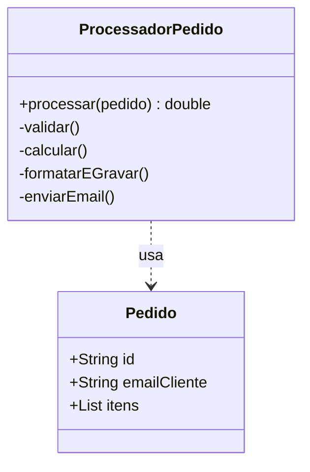
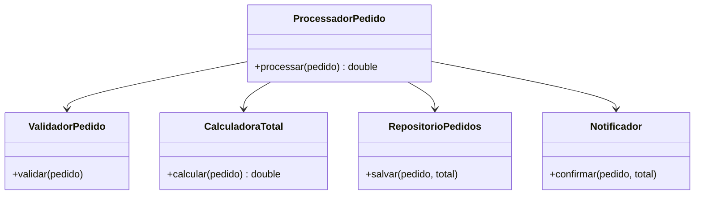
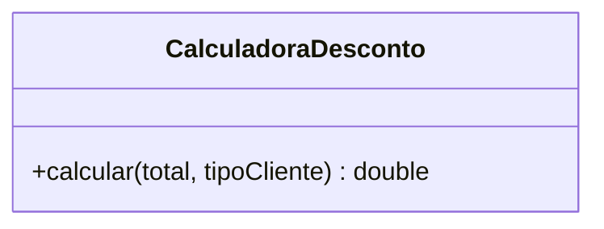
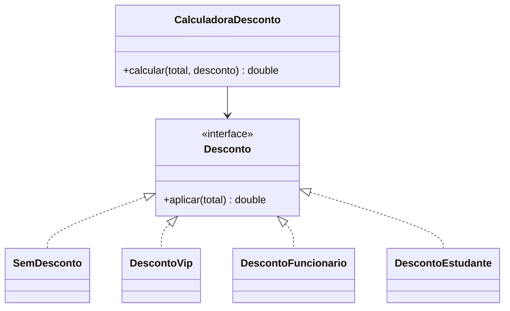
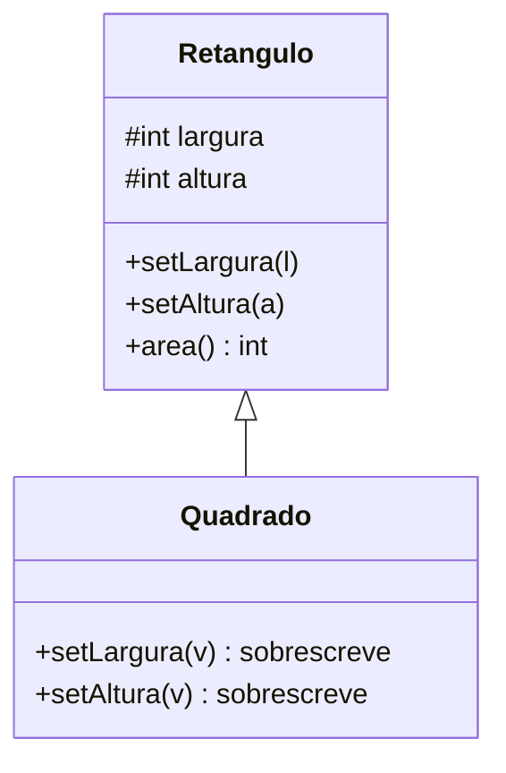
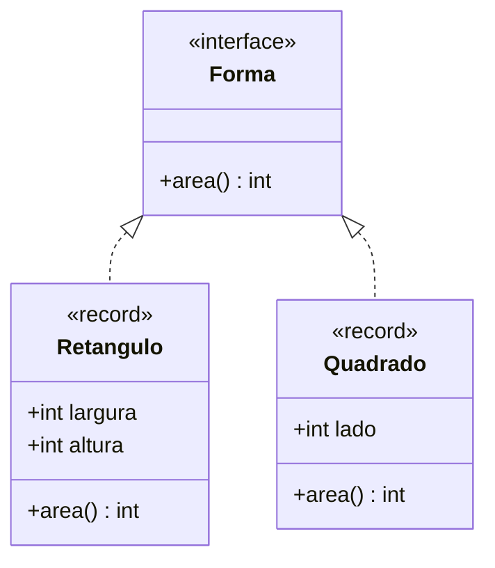
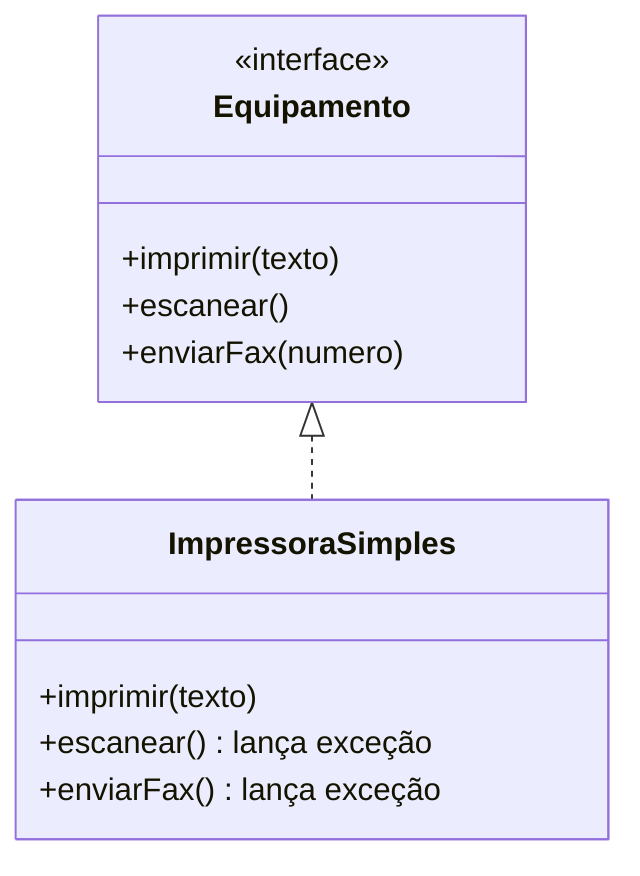
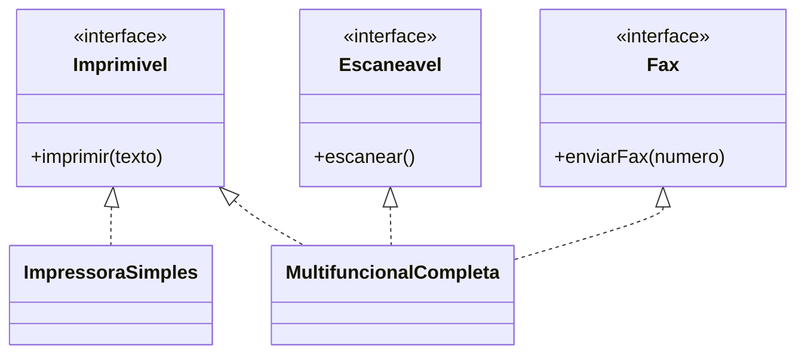
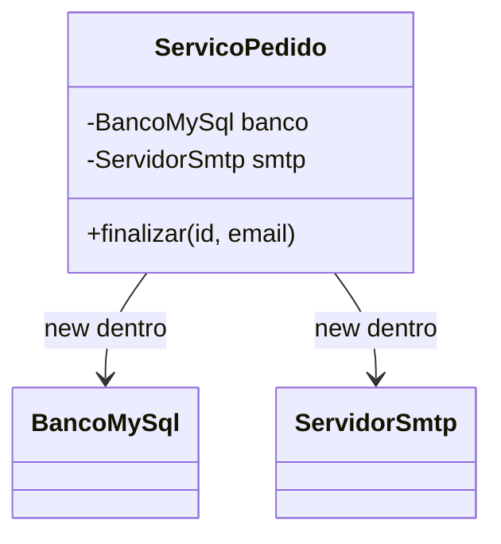
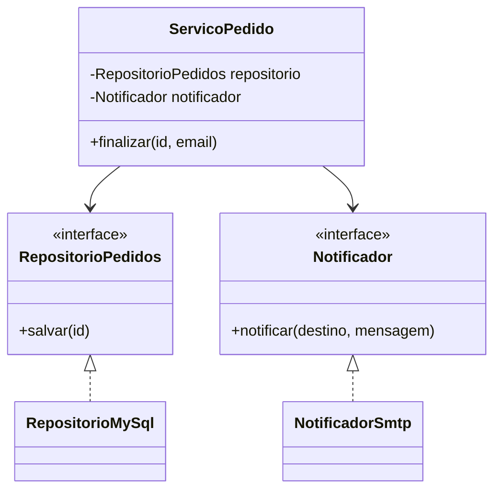

# SOLID em sala: diagramas de classes e projetos ruim × bom

Cola para a aula. Para cada princípio: o conceito, por que ele existe, o diagrama de classes da versão ruim, o código e a saída real, depois o mesmo para a versão boa. Os diagramas são Mermaid (`classDiagram`) e renderizam no GitHub.

## Roteiro sugerido (50 minutos)

1. Motivação (5 min): pergunte quantos arquivos a turma abriu na última mudança.
2. Acoplamento (5 min): mostre um diagrama com `new` e outro com interface.
3. Os cinco, em ordem S, O, L, I, D (35 min): para cada um, diagrama ruim, rodar, diagrama bom, rodar.
4. Quando não aplicar (5 min): um programa de 50 linhas com um tipo de desconto não precisa de interface.

## Como rodar cada projeto

Entre na pasta da versão e rode:

```bash
javac -Xlint:all -d out Main.java
java -cp out Main
```

Todos os projetos usam Java 17 ou superior.

## Tabela de projetos

| Princípio | Versão ruim | Versão boa |
|---|---|---|
| S · Responsabilidade única | `S-responsabilidade/ruim` | `S-responsabilidade/bom` |
| O · Aberto–fechado | `O-aberto-fechado/ruim` | `O-aberto-fechado/bom` |
| L · Substituição de Liskov | `L-liskov/ruim` | `L-liskov/bom` |
| I · Segregação de interfaces | `I-segregacao/ruim` | `I-segregacao/bom` |
| D · Inversão de dependência | `D-inversao/ruim` | `D-inversao/bom` |

---

## Os cálculos da aula

**Princípio O: novos descontos.** Modelo: cada tipo custa 3 linhas. Na versão ruim, os tipos antigos são retestados.

| k novos tipos | Ruim: linhas editadas | Ruim: testes repetidos | Boa: linhas editadas | Boa: testes novos |
|---|---|---|---|---|
| 1 | 3 | 3 | 0 | 1 |
| 2 | 6 | 7 | 0 | 2 |
| 3 | 9 | 12 | 0 | 3 |
| 4 | 12 | 18 | 0 | 4 |
| 5 | 15 | 25 | 0 | 5 |

A conta: testes repetidos na versão ruim = soma de (2 + j) para j de 1 até k. Com k = 5: 3 + 4 + 5 + 6 + 7 = 25.

**Princípio D: trocar o banco.** Modelo: cada serviço que faz `new` no banco é uma edição. Na versão boa, é uma linha no ponto de montagem.

| Serviços (m) | Ruim: edições | Boa: edições | Ruim: testes sem banco |
|---|---|---|---|
| 2 | 2 | 1 | 0 |
| 5 | 5 | 1 | 0 |
| 10 | 10 | 1 | 0 |
| 20 | 20 | 1 | 0 |

Os números são de um modelo simples. Use para discutir a ordem de grandeza, e não como medida exata.

---

## S · Responsabilidade única

**Conceito.** Uma classe deve ter um, e apenas um, motivo para mudar.

**Por que existe.** Quando um método valida, calcula, grava e notifica, cada pedido de mudança mexe no mesmo lugar e pode quebrar as outras partes.

### Versão ruim (jeito errado)

**Diagrama de classes**



**O que mostrar na tela.** Uma classe com quatro responsabilidades: o diagrama já mostra o problema. Pergunte quantos motivos de mudança existem.

<details><summary>Código: <code>exemplos/solid/S-responsabilidade/ruim/Main.java</code></summary>

```java
import java.util.ArrayList;
import java.util.List;
import java.util.Locale;

/**
 * S ruim: ProcessadorPedido valida, calcula, grava em arquivo e envia e-mail.
 * Qualquer mudança em uma dessas regras obriga a abrir e testar a mesma classe.
 */
public class Main {

    record Item(String nome, double preco, int quantidade) {}

    static final class Pedido {
        final String id;
        final String emailCliente;
        final List<Item> itens = new ArrayList<>();

        Pedido(String id, String emailCliente) {
            this.id = id;
            this.emailCliente = emailCliente;
        }
    }

    static final class ProcessadorPedido {
        double processar(Pedido pedido) {
            // validação
            if (pedido.itens.isEmpty()) {
                throw new IllegalArgumentException("pedido vazio: " + pedido.id);
            }
            // cálculo do total e regra de desconto
            double total = 0;
            for (Item item : pedido.itens) {
                total += item.preco() * item.quantidade();
            }
            if (total > 500) {
                total *= 0.95;
            }
            // formatação e persistência (arquivo)
            String linha = pedido.id + ";" + String.format("%.2f", total);
            System.out.println("gravando em pedidos.csv: " + linha);
            // notificação por e-mail
            System.out.println("enviando e-mail para " + pedido.emailCliente
                    + ": pedido " + pedido.id + " confirmado, total R$ " + String.format("%.2f", total));
            return total;
        }
    }

    public static void main(String[] args) {
        Locale.setDefault(Locale.ROOT);
        Pedido pedido = new Pedido("P-1001", "ana@exemplo.com");
        pedido.itens.add(new Item("teclado", 150.00, 2));
        pedido.itens.add(new Item("mouse", 80.00, 3));
        new ProcessadorPedido().processar(pedido);
    }
}
```

</details>

Saída real:

```text
gravando em pedidos.csv: P-1001;513.00
enviando e-mail para ana@exemplo.com: pedido P-1001 confirmado, total R$ 513.00
```

### Versão boa (como deveria ser)

**Diagrama de classes**



**O que mostrar na tela.** Quatro classes pequenas, com um motivo cada. O orquestrador só liga as peças. A saída é a mesma da versão ruim.

<details><summary>Código: <code>exemplos/solid/S-responsabilidade/bom/Main.java</code></summary>

```java
import java.util.ArrayList;
import java.util.List;
import java.util.Locale;

/**
 * S bom: cada classe tem um motivo para mudar.
 * Validação, cálculo, persistência e notificação ficam separados; o orquestrador só chama as partes.
 */
public class Main {

    record Item(String nome, double preco, int quantidade) {}

    static final class Pedido {
        final String id;
        final String emailCliente;
        final List<Item> itens = new ArrayList<>();

        Pedido(String id, String emailCliente) {
            this.id = id;
            this.emailCliente = emailCliente;
        }
    }

    // Motivo para mudar: regras de validação
    static final class ValidadorPedido {
        void validar(Pedido pedido) {
            if (pedido.itens.isEmpty()) {
                throw new IllegalArgumentException("pedido vazio: " + pedido.id);
            }
        }
    }

    // Motivo para mudar: regras de preço e desconto
    static final class CalculadoraTotal {
        double calcular(Pedido pedido) {
            double total = 0;
            for (Item item : pedido.itens) {
                total += item.preco() * item.quantidade();
            }
            return total > 500 ? total * 0.95 : total;
        }
    }

    // Motivo para mudar: formato ou local de gravação
    static final class RepositorioPedidos {
        void salvar(Pedido pedido, double total) {
            System.out.println("gravando em pedidos.csv: " + pedido.id + ";" + String.format("%.2f", total));
        }
    }

    // Motivo para mudar: canal de notificação
    static final class Notificador {
        void confirmar(Pedido pedido, double total) {
            System.out.println("enviando e-mail para " + pedido.emailCliente
                    + ": pedido " + pedido.id + " confirmado, total R$ " + String.format("%.2f", total));
        }
    }

    // Orquestrador: só coordena, não decide regra alguma
    static final class ProcessadorPedido {
        private final ValidadorPedido validador = new ValidadorPedido();
        private final CalculadoraTotal calculadora = new CalculadoraTotal();
        private final RepositorioPedidos repositorio = new RepositorioPedidos();
        private final Notificador notificador = new Notificador();

        double processar(Pedido pedido) {
            validador.validar(pedido);
            double total = calculadora.calcular(pedido);
            repositorio.salvar(pedido, total);
            notificador.confirmar(pedido, total);
            return total;
        }
    }

    public static void main(String[] args) {
        Locale.setDefault(Locale.ROOT);
        Pedido pedido = new Pedido("P-1001", "ana@exemplo.com");
        pedido.itens.add(new Item("teclado", 150.00, 2));
        pedido.itens.add(new Item("mouse", 80.00, 3));
        new ProcessadorPedido().processar(pedido);
    }
}
```

</details>

Saída real:

```text
gravando em pedidos.csv: P-1001;513.00
enviando e-mail para ana@exemplo.com: pedido P-1001 confirmado, total R$ 513.00
```

**Exercício para a turma.** Adicione o requisito “frete de R$ 15,00 abaixo de R$ 200,00”. Em qual classe entra? Quantas classes precisa abrir?

---


## O · Aberto–fechado

**Conceito.** Um módulo deve permitir novo comportamento sem alterar o código que já funciona.

**Por que existe.** Código testado tem valor. Um if/else que cresce obriga a retestar tudo a cada novo tipo.

### Versão ruim (jeito errado)

**Diagrama de classes**



**O que mostrar na tela.** Uma classe com um método cheio de ramos. A nota no diagrama diz onde mexer para ESTUDANTE.

<details><summary>Código: <code>exemplos/solid/O-aberto-fechado/ruim/Main.java</code></summary>

```java
import java.util.Locale;

/**
 * O ruim: cada novo tipo de desconto obriga a editar o método existente.
 * O if/else cresce, e cada teste antigo precisa ser refeito.
 */
public class Main {

    static final class CalculadoraDesconto {
        double calcular(double total, String tipoCliente) {
            if (tipoCliente.equals("VIP")) {
                return total * 0.80;
            } else if (tipoCliente.equals("FUNCIONARIO")) {
                return total * 0.70;
            } else if (tipoCliente.equals("NORMAL")) {
                return total;
            }
            // para incluir ESTUDANTE, é preciso abrir esta classe e mudar a lógica
            throw new IllegalArgumentException("tipo desconhecido: " + tipoCliente);
        }
    }

    public static void main(String[] args) {
        Locale.setDefault(Locale.ROOT);
        CalculadoraDesconto calc = new CalculadoraDesconto();
        System.out.printf("VIP: %.2f%n", calc.calcular(200, "VIP"));
        System.out.printf("FUNCIONARIO: %.2f%n", calc.calcular(200, "FUNCIONARIO"));
        System.out.printf("NORMAL: %.2f%n", calc.calcular(200, "NORMAL"));
        try {
            calc.calcular(200, "ESTUDANTE");
        } catch (IllegalArgumentException e) {
            System.out.println("erro: " + e.getMessage());
        }
    }
}
```

</details>

Saída real:

```text
VIP: 160.00
FUNCIONARIO: 140.00
NORMAL: 200.00
erro: tipo desconhecido: ESTUDANTE
```

### Versão boa (como deveria ser)

**Diagrama de classes**



**O que mostrar na tela.** Uma interface Desconto e uma classe por regra. A calculadora depende só da interface. Novo desconto é nova classe.

<details><summary>Código: <code>exemplos/solid/O-aberto-fechado/bom/Main.java</code></summary>

```java
import java.util.Locale;

/**
 * O bom: a calculadora é fechada para mudança e aberta para extensão.
 * Um novo desconto é uma nova classe que implementa a interface; nenhuma linha antiga muda.
 */
public class Main {

    interface Desconto {
        double aplicar(double total);
    }

    static final class SemDesconto implements Desconto {
        public double aplicar(double total) { return total; }
    }

    static final class DescontoVip implements Desconto {
        public double aplicar(double total) { return total * 0.80; }
    }

    static final class DescontoFuncionario implements Desconto {
        public double aplicar(double total) { return total * 0.70; }
    }

    // Adicionado depois, sem tocar nas classes acima
    static final class DescontoEstudante implements Desconto {
        public double aplicar(double total) { return total * 0.85; }
    }

    static final class CalculadoraDesconto {
        double calcular(double total, Desconto desconto) {
            return desconto.aplicar(total);
        }
    }

    public static void main(String[] args) {
        Locale.setDefault(Locale.ROOT);
        CalculadoraDesconto calc = new CalculadoraDesconto();
        System.out.printf("VIP: %.2f%n", calc.calcular(200, new DescontoVip()));
        System.out.printf("FUNCIONARIO: %.2f%n", calc.calcular(200, new DescontoFuncionario()));
        System.out.printf("NORMAL: %.2f%n", calc.calcular(200, new SemDesconto()));
        System.out.printf("ESTUDANTE: %.2f%n", calc.calcular(200, new DescontoEstudante()));
    }
}
```

</details>

Saída real:

```text
VIP: 160.00
FUNCIONARIO: 140.00
NORMAL: 200.00
ESTUDANTE: 170.00
```

**Exercício para a turma.** Crie DescontoBlackFriday (30%) na versão boa. Liste as classes existentes que você precisou alterar: resposta esperada, nenhuma.

---


## L · Substituição de Liskov

**Conceito.** Um subtipo deve poder ocupar o lugar do tipo base sem quebrar o programa.

**Por que existe.** Herança que sobrescreve setters viola o contrato do tipo base. Quem usa Retangulo espera lados independentes.

### Versão ruim (jeito errado)

**Diagrama de classes**



**O que mostrar na tela.** A seta de herança e o método sobrescrito. Rode o programa e mostre a linha FALHOU: o erro não lança exceção.

<details><summary>Código: <code>exemplos/solid/L-liskov/ruim/Main.java</code></summary>

```java
import java.util.Locale;

/**
 * L ruim: Quadrado herda de Retangulo e quebra o contrato de setLargura/setAltura.
 * Código que usa Retangulo espera que largura e altura mudem de forma independente.
 */
public class Main {

    static class Retangulo {
        protected int largura;
        protected int altura;

        void setLargura(int largura) { this.largura = largura; }
        void setAltura(int altura) { this.altura = altura; }
        int area() { return largura * altura; }
    }

    static final class Quadrado extends Retangulo {
        @Override void setLargura(int valor) { largura = valor; altura = valor; }
        @Override void setAltura(int valor) { largura = valor; altura = valor; }
    }

    static void testarArea(Retangulo r) {
        r.setLargura(5);
        r.setAltura(4);
        int esperado = 20;
        System.out.println("esperado " + esperado + ", obtido " + r.area()
                + (r.area() == esperado ? " (ok)" : " (FALHOU)"));
    }

    public static void main(String[] args) {
        Locale.setDefault(Locale.ROOT);
        testarArea(new Retangulo());
        testarArea(new Quadrado());
    }
}
```

</details>

Saída real:

```text
esperado 20, obtido 20 (ok)
esperado 20, obtido 16 (FALHOU)
```

### Versão boa (como deveria ser)

**Diagrama de classes**



**O que mostrar na tela.** Forma é contrato, e os dois records são irmãos. Não há setter, então não há como quebrar a área.

<details><summary>Código: <code>exemplos/solid/L-liskov/bom/Main.java</code></summary>

```java
import java.util.Locale;

/**
 * L bom: a forma é um contrato comum (área), sem herança que quebre o comportamento.
 * Retangulo e Quadrado são implementações independentes, e o teste de área vale para os dois.
 */
public class Main {

    interface Forma {
        int area();
    }

    // imutável: não há setters, então nenhuma substituição pode quebrar o contrato
    record Retangulo(int largura, int altura) implements Forma {
        public int area() { return largura * altura; }
    }

    record Quadrado(int lado) implements Forma {
        public int area() { return lado * lado; }
    }

    static void testarArea(String nome, Forma forma, int esperado) {
        System.out.println(nome + ": esperado " + esperado + ", obtido " + forma.area()
                + (forma.area() == esperado ? " (ok)" : " (FALHOU)"));
    }

    public static void main(String[] args) {
        Locale.setDefault(Locale.ROOT);
        testarArea("retangulo 5x4", new Retangulo(5, 4), 20);
        testarArea("quadrado 4", new Quadrado(4), 16);
    }
}
```

</details>

Saída real:

```text
retangulo 5x4: esperado 20, obtido 20 (ok)
quadrado 4: esperado 16, obtido 16 (ok)
```

**Exercício para a turma.** Crie um Triangulo que implemente Forma. Escreva um teste de contrato que qualquer Forma deva passar.

---


## I · Segregação de interfaces

**Conceito.** Nenhum cliente deve depender de métodos que não usa.

**Por que existe.** Uma interface gorda obriga implementações simples a lançar exceção, e o erro só aparece em execução.

### Versão ruim (jeito errado)

**Diagrama de classes**



**O que mostrar na tela.** Uma interface com três métodos e uma classe que lança exceção em dois deles.

<details><summary>Código: <code>exemplos/solid/I-segregacao/ruim/Main.java</code></summary>

```java
import java.util.Locale;

/**
 * I ruim: uma interface gorda obriga a implementação a ter métodos que ela não usa.
 * ImpressoraSimples precisa "implementar" escanear e fax, e lança exceção.
 */
public class Main {

    interface Equipamento {
        void imprimir(String texto);
        void escanear();
        void enviarFax(String numero);
    }

    static final class ImpressoraSimples implements Equipamento {
        public void imprimir(String texto) { System.out.println("imprimindo: " + texto); }
        public void escanear() { throw new UnsupportedOperationException("não escaneia"); }
        public void enviarFax(String numero) { throw new UnsupportedOperationException("não envia fax"); }
    }

    public static void main(String[] args) {
        Locale.setDefault(Locale.ROOT);
        Equipamento eq = new ImpressoraSimples();
        eq.imprimir("relatório de vendas");
        try {
            eq.escanear();
        } catch (UnsupportedOperationException e) {
            System.out.println("erro em tempo de execução: " + e.getMessage());
        }
    }
}
```

</details>

Saída real:

```text
imprimindo: relatório de vendas
erro em tempo de execução: não escaneia
```

### Versão boa (como deveria ser)

**Diagrama de classes**



**O que mostrar na tela.** Três interfaces pequenas. ImpressoraSimples implementa uma, MultifuncionalCompleta implementa três.

<details><summary>Código: <code>exemplos/solid/I-segregacao/bom/Main.java</code></summary>

```java
import java.util.Locale;

/**
 * I bom: interfaces pequenas, uma por capacidade.
 * Cada classe implementa só o que de fato faz; quem precisa de escanear depende só de Escaneavel.
 */
public class Main {

    interface Imprimivel { void imprimir(String texto); }
    interface Escaneavel { void escanear(); }
    interface Fax { void enviarFax(String numero); }

    static final class ImpressoraSimples implements Imprimivel {
        public void imprimir(String texto) { System.out.println("imprimindo: " + texto); }
    }

    static final class MultifuncionalCompleta implements Imprimivel, Escaneavel, Fax {
        public void imprimir(String texto) { System.out.println("imprimindo: " + texto); }
        public void escanear() { System.out.println("escaneando documento"); }
        public void enviarFax(String numero) { System.out.println("enviando fax para " + numero); }
    }

    // depende só do que usa: não precisa saber que existe fax
    static void digitalizar(Escaneavel equipamento) {
        equipamento.escanear();
    }

    public static void main(String[] args) {
        Locale.setDefault(Locale.ROOT);
        new ImpressoraSimples().imprimir("relatório de vendas");
        MultifuncionalCompleta mf = new MultifuncionalCompleta();
        digitalizar(mf);
        mf.enviarFax("1199999-0000");
    }
}
```

</details>

Saída real:

```text
imprimindo: relatório de vendas
escaneando documento
enviando fax para 1199999-0000
```

**Exercício para a turma.** Crie uma impressora duplex (frente e verso). Ela precisa implementar Escaneavel? Justifique com o princípio.

---


## D · Inversão de dependência

**Conceito.** Módulos de alto nível não devem depender de baixo nível; ambos dependem de abstrações.

**Por que existe.** Sem isso, a regra de negócio fica presa ao banco e ao e-mail, e não dá para testar. Fowler (2004) chama de injeção de dependência.

### Versão ruim (jeito errado)

**Diagrama de classes**



**O que mostrar na tela.** O serviço cria as próprias dependências com new. Não há como trocar nem testar sem servidor.

<details><summary>Código: <code>exemplos/solid/D-inversao/ruim/Main.java</code></summary>

```java
import java.util.ArrayList;
import java.util.List;
import java.util.Locale;

/**
 * D ruim: ServicoPedido cria o banco e o e-mail por conta própria (new).
 * Não dá para testar sem banco real e sem enviar e-mail de verdade.
 */
public class Main {

    static final class BancoMySql {
        private final List<String> tabela = new ArrayList<>();
        void inserir(String pedido) {
            tabela.add(pedido);
            System.out.println("INSERT INTO pedidos (dados) VALUES ('" + pedido + "') -- servidor MySQL");
        }
    }

    static final class ServidorSmtp {
        void enviar(String para, String texto) {
            System.out.println("SMTP -> " + para + ": " + texto);
        }
    }

    static final class ServicoPedido {
        // dependências concretas, criadas aqui dentro
        private final BancoMySql banco = new BancoMySql();
        private final ServidorSmtp smtp = new ServidorSmtp();

        void finalizar(String id, String email) {
            banco.inserir(id);
            smtp.enviar(email, "pedido " + id + " confirmado");
        }
    }

    public static void main(String[] args) {
        Locale.setDefault(Locale.ROOT);
        new ServicoPedido().finalizar("P-1001", "ana@exemplo.com");
    }
}
```

</details>

Saída real:

```text
INSERT INTO pedidos (dados) VALUES ('P-1001') -- servidor MySQL
SMTP -> ana@exemplo.com: pedido P-1001 confirmado
```

### Versão boa (como deveria ser)

**Diagrama de classes**



**O que mostrar na tela.** O serviço recebe as abstrações pelo construtor. O main escolhe a implementação. O teste usa versões em memória.

<details><summary>Código: <code>exemplos/solid/D-inversao/bom/Main.java</code></summary>

```java
import java.util.ArrayList;
import java.util.List;
import java.util.Locale;

/**
 * D bom: ServicoPedido depende de abstrações (RepositorioPedidos, Notificador).
 * Quem monta o objeto decide a implementação: produção usa MySQL e SMTP; o teste usa versões falsas.
 */
public class Main {

    // abstrações de alto nível
    interface RepositorioPedidos { void salvar(String id); }
    interface Notificador { void notificar(String destino, String mensagem); }

    // detalhes de baixo nível: produção
    static final class RepositorioMySql implements RepositorioPedidos {
        public void salvar(String id) { System.out.println("MySQL: pedido " + id + " gravado"); }
    }

    static final class NotificadorSmtp implements Notificador {
        public void notificar(String destino, String mensagem) {
            System.out.println("SMTP -> " + destino + ": " + mensagem);
        }
    }

    // detalhe para teste: não toca em rede nem em disco
    static final class RepositorioEmMemoria implements RepositorioPedidos {
        final List<String> gravados = new ArrayList<>();
        public void salvar(String id) { gravados.add(id); }
    }

    static final class NotificadorFalso implements Notificador {
        public void notificar(String destino, String mensagem) {
            System.out.println("(teste) notificação para " + destino + ": " + mensagem);
        }
    }

    static final class ServicoPedido {
        private final RepositorioPedidos repositorio;
        private final Notificador notificador;

        // dependências chegam pelo construtor (injeção de dependência)
        ServicoPedido(RepositorioPedidos repositorio, Notificador notificador) {
            this.repositorio = repositorio;
            this.notificador = notificador;
        }

        void finalizar(String id, String email) {
            repositorio.salvar(id);
            notificador.notificar(email, "pedido " + id + " confirmado");
        }
    }

    public static void main(String[] args) {
        Locale.setDefault(Locale.ROOT);
        System.out.println("== produção");
        new ServicoPedido(new RepositorioMySql(), new NotificadorSmtp()).finalizar("P-1001", "ana@exemplo.com");

        System.out.println("== teste");
        RepositorioEmMemoria memoria = new RepositorioEmMemoria();
        new ServicoPedido(memoria, new NotificadorFalso()).finalizar("P-T1", "teste@exemplo.com");
        System.out.println("gravados em memória: " + memoria.gravados);
    }
}
```

</details>

Saída real:

```text
== produção
MySQL: pedido P-1001 gravado
SMTP -> ana@exemplo.com: pedido P-1001 confirmado
== teste
(teste) notificação para teste@exemplo.com: pedido P-T1 confirmado
gravados em memória: [P-T1]
```

**Exercício para a turma.** Crie RepositorioArquivo (grava em texto) e rode o serviço com ele. Quantas linhas mudam em ServicoPedido?

---

## Exercício final: um requisito novo no pedido

Requisito: o total deve incluir frete de R$ 15,00 para pedidos abaixo de R$ 200,00. Depois, o e-mail deve ser enviado também por SMS.

1. Em qual classe da versão ruim você faria cada mudança? Quantas linhas de código antigo editaria?
2. Faça o mesmo na versão boa. Quais classes mudam? Quais são novas?
3. Conte, nas duas versões, quantas classes você abriu para o frete e quantas para o SMS.

**Gabarito esperado.** Versão ruim: duas regras num mesmo lugar, com edição de código antigo. Versão boa: duas classes novas (cálculo de frete e canal SMS), e o orquestrador só recebe a nova dependência na montagem. Aceite respostas diferentes desde que justificadas pelo princípio.

## Referências

- MEYER, B. *Object-Oriented Software Construction*. Prentice Hall, 1988.
- LISKOV, B.; WING, J. A behavioral notion of subtyping. *ACM TOPLAS*, 1994.
- MARTIN, R. C. *Agile Software Development: Principles, Patterns, and Practices*. Prentice Hall, 2003.
- FOWLER, M. *Inversion of Control Containers and the Dependency Injection pattern*, 2004.
